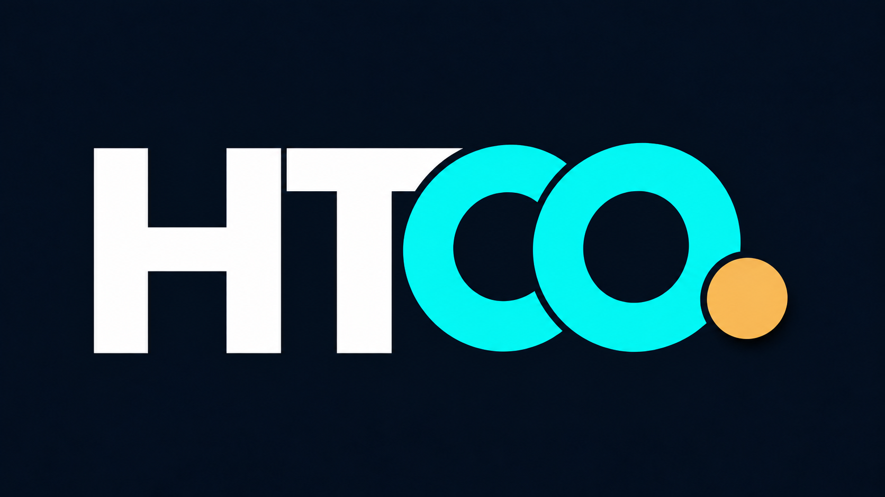
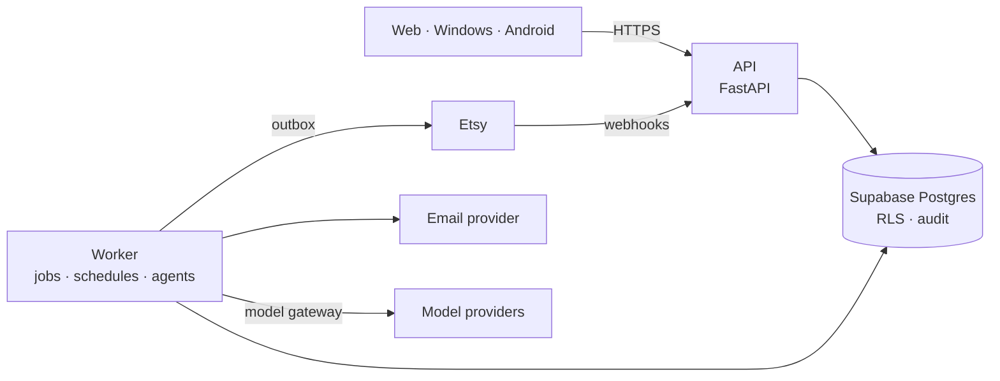

<p align="center">
  
</p>

<h1 align="center">HTCO Platform</h1>

<p align="center">
  Backend, integrations, automations and the AI agent runtime of <strong>HTCO OS</strong>,<br>
  an operating system for marketplace commerce.
</p>

<p align="center">
  <a href="docs/product/PRD.md">Product</a> ·
  <a href="docs/plan/PLAN.md">Plan</a> ·
  <a href="docs/architecture/SOFTWARE_DESIGN.md">Architecture</a> ·
  <a href="docs/engineering/ENGINEERING_RULES.md">Engineering rules</a> ·
  <a href="docs/adr/README.md">Decisions</a>
</p>

---

> **Status:** Phase 1 — building the walking skeleton (workspace, quality gates, API skeleton, CI). See the [master plan](docs/plan/PLAN.md).

## What HTCO OS does

HTCO OS runs the operations of online shops on marketplaces, starting with Etsy:

- **A trustworthy operational core.** Orders, fulfillment and tracking, incidents, finance and audit, synchronized from the marketplace and computed by deterministic code.
- **An AI workforce.** Eighteen agent roles in four departments that research, write, check and coordinate work, using typed tools under a deny-by-default policy engine, with human approval for anything that spends money or changes something outside the system.
- **One command surface.** Web, Windows and Android apps (in [`htco-clients`](https://github.com/Tzvi1234/htco-clients)) where the owner sees verified business state, approves actions and watches the office at work.

The guiding promise is **autonomy you can audit**: every number shows its source and freshness, every agent action leaves a receipt, every risky action needs the right approval.

## Architecture



- **Modular monolith** with hexagonal boundaries enforced in CI: pure domain, use cases and ports, adapters, thin transport.
- **Supabase Postgres** as the single source of truth, with row-level security as defense in depth behind server-side authorization.
- **Durable, idempotent work**: inbox and outbox, a Postgres job queue, explicit state machines.
- **Agents as profiles, not services**: LangGraph workflows with checkpoints and human-approval interrupts, behind our own runtime port; every model call goes through a budgeted, logged gateway.
- **DigitalOcean App Platform** for the API and workers.

Read the full [software design](docs/architecture/SOFTWARE_DESIGN.md).

## Repository layout

```text
apps/api/               HTTP API and composition root
workers/                Background jobs, schedules and agent runs
packages/domain/        Pure business rules
packages/application/   Use cases, ports, policy engine
packages/persistence/   Postgres adapters, inbox/outbox, job queue
packages/integrations/  Etsy, AutoVA, email
packages/model-router/  Model gateway, routing, budgets
packages/agent-runtime/ LangGraph graphs and tool bridge
packages/platform/      Settings, logging, tracing, crypto
packages/contracts/     OpenAPI and event schemas
supabase/               Migrations and database tests
infra/digitalocean/     App spec
tests/                  Tests, one folder per package, plus architecture and end-to-end
tools/                  Scripts used by Git hooks and CI
docs/                   Product, plan, architecture, decisions, engineering
```

## Technology

| Area | Choice |
|---|---|
| Language | Python 3.14, managed with uv |
| API | FastAPI, Pydantic |
| Data | Supabase (Postgres, Auth, Storage), psycopg 3, SQL migrations with pgTAP tests |
| Agents | LangGraph with Postgres checkpoints, official Anthropic and OpenAI SDKs behind our gateway |
| Hosting | DigitalOcean App Platform |
| Quality | Ruff, mypy (strict), import-linter, pytest, Hypothesis, Schemathesis |
| Security | gitleaks, osv-scanner, Semgrep, image scanning, SHA-pinned workflows |

Exact versions: [toolchain](docs/engineering/TOOLCHAIN.md).

## How we build

Every change starts from a planned slice with acceptance criteria, is written **test-first**, is verified in a running system, and ships with its documentation in the same pull request. The rules are in [ENGINEERING_RULES.md](docs/engineering/ENGINEERING_RULES.md) and [TESTING_STRATEGY.md](docs/engineering/TESTING_STRATEGY.md); contribution workflow in [CONTRIBUTING.md](CONTRIBUTING.md).

## Getting started

You need [uv](https://docs.astral.sh/uv/getting-started/installation/) 0.13 (and Go, which the gitleaks hook builds with). uv installs the pinned Python, `just` and every tool from `uv.lock`.

```bash
uv run just setup   # install the workspace and the Git hooks
uv run just check   # formatting, lint, types, architecture contracts, tests and coverage
uv run just up      # run the API on http://127.0.0.1:8000 (try /healthz and /readyz)
uv run just         # list every recipe
```

All dependencies respect a seven-day minimum release age (`exclude-newer` in `pyproject.toml`). Local settings live in [`.env.example`](.env.example); the API logs one JSON object per line.

## Security

Please report vulnerabilities privately as described in [SECURITY.md](SECURITY.md).

## License

Copyright © 2026 H.T.Z Studios. All rights reserved. See [LICENSE](LICENSE).

"Etsy" is a trademark of Etsy, Inc. This application uses the Etsy API but is not endorsed or certified by Etsy, Inc.
