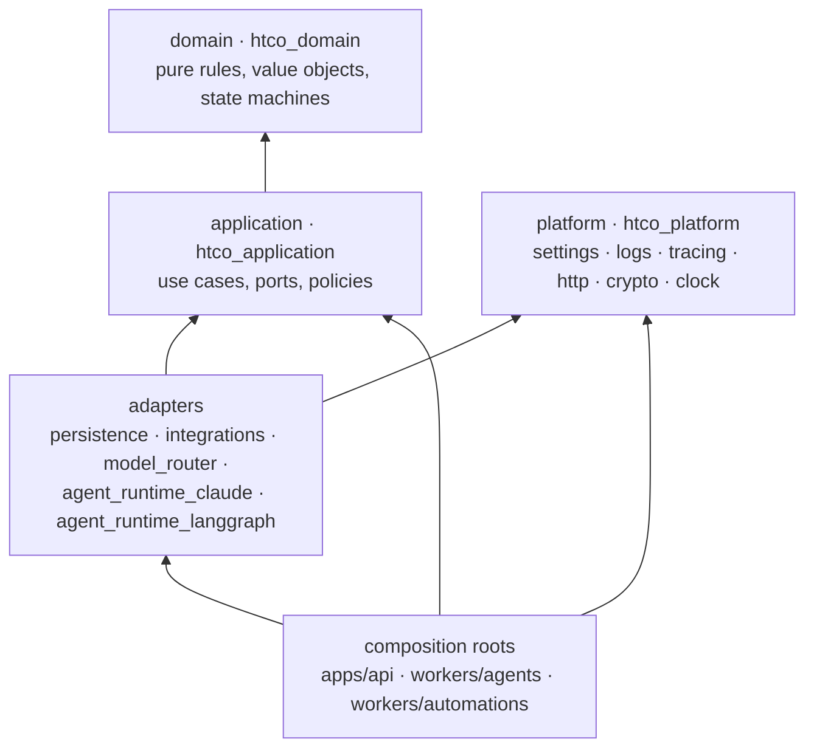
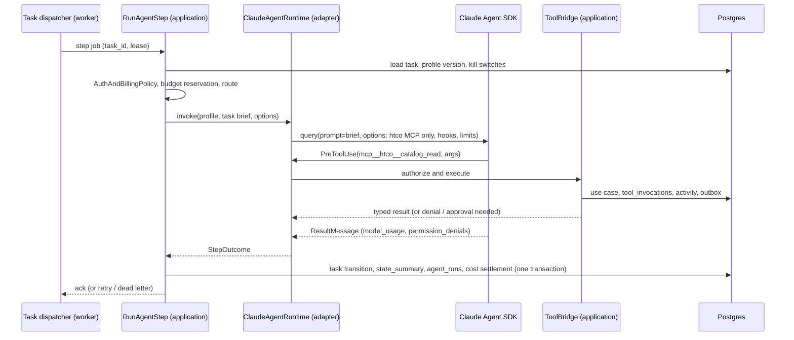

# HTCO OS — Code Design

| | |
|---|---|
| **Status** | Version 1.0 for the Claude-Native Hybrid Edition |
| **Last updated** | 2026-10-14 |
| **Applies to** | All Python code in `htco-platform`; the client side is in `htco-clients/docs/architecture/CLIENT_ARCHITECTURE.md` |
| **Related** | [Software design](SOFTWARE_DESIGN.md) (the system view) · [Engineering rules](../engineering/ENGINEERING_RULES.md) (the rules this design enforces) · [ADR-0002](../adr/0002-modular-monolith-hexagonal.md) · [ADR-0016](../adr/0016-claude-native-agent-runtime.md) |

[SOFTWARE_DESIGN.md](SOFTWARE_DESIGN.md) explains *what* the system is and *why*. This document says **where every piece of code goes, what it may depend on, and what shape it has**, so that hundreds of AI-assisted sessions add code in the same places and the same way. When you are about to create a file, find its row here first. If no row fits, stop: the design needs an update (and maybe an ADR) before the code.

---

## 1. The layers



Arrows point to what a layer depends on. Nothing points outward. [ER-ARCH-01](../engineering/ENGINEERING_RULES.md#3-architecture-er-arch) makes this a rule, and import-linter enforces it (§9).

| Layer | Purpose | May import | Must never | Typical file |
|---|---|---|---|---|
| **Domain** | Business truth: what is valid, what may change into what, how money is calculated | Standard library only | Do I/O, read the clock, generate random IDs, log, know about HTTP, SQL, models or agents | `htco_domain/orders/order.py`: `Order`, `OrderState`, `Order.mark_shipped(evidence)` |
| **Application** | What the system *does*: one use case per user or system intention, and the ports it needs | `htco_domain` | Import a framework, driver or SDK; build SQL; format HTTP responses; hold state between calls | `htco_application/orders/ingest_receipt.py`: `IngestReceipt` use case and the `OrderRepository` port |
| **Adapters** | Talk to one outside thing, implementing a port | application, domain, platform, and their one outside library | Contain business decisions; import another adapter; return provider payloads or rows across the port | `htco_persistence/orders/order_repository.py`: `PostgresOrderRepository` |
| **Platform** | Cross-cutting infrastructure with no business meaning | infrastructure libraries | Import domain, application, adapters or web frameworks | `htco_platform/logs.py` |
| **Composition roots** | Build the object graph and translate transport (HTTP, jobs, schedules) to use cases | everything | Contain rules; call a database or provider directly | `apps/api/src/htco_api/routes/orders.py`, `workers/agents/src/htco_worker_agents/main.py` |

Three habits keep the layers honest:

1. **Rules move inward.** If a router, consumer or adapter contains an `if` about the business (a price, a state, a permission), move it into the domain or a use case and test it there.
2. **Data crosses boundaries as our types.** Ports take and return domain objects or small frozen dataclasses defined in `htco_application`. Rows, Pydantic API models, Etsy JSON and SDK messages stay inside their adapter or root.
3. **Effects are injected.** Clock, ID generator, randomness, unit of work, gateway: all passed in. A use case is a class whose constructor lists every port it touches.

## 2. Master plan packages and where they live

The master plan lists packages by business capability. The repository keeps the hexagonal layers ([ADR-0002](../adr/0002-modular-monolith-hexagonal.md)), so each capability is a **bounded context** that appears as a sub-package in each layer it needs, not as a separate package with its own mini-layers. Only adapters with their own outside dependency become separate workspace members.

| Master plan name | Domain (`htco_domain.`) | Application (`htco_application.`) | Adapter / root | Phase |
|---|---|---|---|---|
| `packages/domain` | everything below | — | — | from 1 |
| `packages/contracts` | — | — | `packages/contracts/openapi.yaml`, `asyncapi.yaml`, `events/*.json` | 1, 4 |
| `packages/employee-registry` | `workforce` | `workforce.registry`, `workforce.tool_access` | `registry/` TOML; `htco_persistence.workforce` | 6 |
| `packages/task-bus` | `tasks`, `messages` | `tasks` (dispatch, handoff), `messages` | `htco_persistence.jobs`, `htco_persistence.tasks` | 4, 5 |
| `packages/agent-runtime/claude` | — | `agents.runtime` (port), `agents.brief`, `agents.steps` | `packages/agent-runtime/claude` → `htco_agent_runtime_claude` | 6 |
| `packages/agent-runtime/langgraph` | — | same port | `packages/agent-runtime/langgraph` → `htco_agent_runtime_langgraph` | moved in 6 |
| `packages/model-router` | `routing`, `billing` | `routing.router`, `billing`, `media` (image port) | `packages/model-router` → `htco_model_router` (provider SDKs, catalog loader, budget client) | 7, 8 |
| `packages/decision-advisor` | `routing` (advisor usage) | `decisions.advisor` | Jev adapter in `htco_model_router.advisors` | 8 |
| `packages/automation-engine` | `automation` | `automation.engine` | `htco_persistence.automation` (execution store) | 4 |
| `packages/tool-registry` | `tooling` | `tools` (bridge, catalog, invocation records) | MCP server factory in `htco_agent_runtime_claude.mcp` | 6, 8 |
| `packages/integrations` | `orders`, `catalog`, `sourcing`, `support` | ports per provider | `packages/integrations` → `htco_integrations.etsy`, `.autova`, `.email`, `.github` | 4, 9, 13, 15, 19 |
| `packages/observability` | `activity`, `incidents` | `activity`, `incidents` | `htco_platform.logs/tracing/error_reporting`; `htco_persistence.activity` | 1, 5, 10 |
| `packages/quality-supervision` | `quality` | `quality` (monitors, findings, nightly review) | jobs in `workers/automations` (or `workers/agents` until split) | 7, 14 |
| `packages/optimization` | `improvement` | `optimization` (data mart queries, proposals) | `htco_persistence.optimization` | 7, 14 |
| `apps/api` | — | — | `htco_api` | 1 |
| `workers/agents` | — | — | `htco_worker_agents` (task dispatcher, agent steps) | 5, 6 |
| `workers/automations` | — | — | `htco_worker_automations`, only when an ADR splits it from the agents worker | 14+ |
| `workers/browser` | — | — | `htco_worker_browser`, only after an ADR | later |
| `supabase/migrations`, `infra/digitalocean` | — | — | SQL and app spec | 2, 1 |

Today's `htco_application.access` (policy engine), `htco_domain.identity` and `htco_domain.actors` keep their places.

## 3. Inside a bounded context

Every context uses the same shape, so a reader always knows where to look. Example: Orders.

```text
packages/domain/src/htco_domain/orders/
  __init__.py            public names only (re-exports)
  order.py               Order aggregate, OrderState, transition table
  money.py               (shared money lives in htco_domain/money.py; context-specific math here)
  events.py              OrderIngested, OrderShipped … (frozen dataclasses)
  errors.py              OrderError subclasses
packages/application/src/htco_application/orders/
  __init__.py
  ports.py               OrderRepository, MarketplaceReader (Protocols)
  ingest_receipt.py      IngestReceipt use case (one public method: __call__ or execute)
  queries.py             ListOrders, GetOrder (read models)
  dto.py                 Command and result dataclasses for this context
packages/persistence/src/htco_persistence/orders/
  order_repository.py    PostgresOrderRepository (explicit SQL, psycopg)
  mappers.py             row <-> domain
packages/integrations/src/htco_integrations/etsy/
  client.py              typed HTTP client (httpx through htco_platform.http)
  receipts.py            EtsyReceiptReader implements MarketplaceReader
  errors.py              Etsy errors mapped to typed errors
apps/api/src/htco_api/routes/orders.py        HTTP: parse, call use case, map to contract
apps/api/src/htco_api/schemas/orders.py       Pydantic request/response models (contract)
tests/domain/orders/ · tests/application/orders/ · tests/persistence/orders/ · tests/integrations/etsy/ · tests/api/orders/
```

Rules:

- A context imports another context's **application API** (a use case or query) or reacts to its **events**. It never imports another context's persistence or reads its tables ([ER-ARCH-03](../engineering/ENGINEERING_RULES.md#3-architecture-er-arch)).
- One use case per file. A file that grows past about 300 lines, or a function past about 40, is a signal to split ([ER-CODE-04](../engineering/ENGINEERING_RULES.md#4-code-er-code)).
- `__init__.py` re-exports the public names; everything else is private by convention (leading underscore for module-private helpers).

## 4. Shapes we use

### 4.1 Domain objects

```python
@dataclass(frozen=True)
class Order:
    id: OrderId
    shop_id: ShopId
    state: OrderState
    lines: tuple[OrderLine, ...]
    total: Money

    def mark_shipped(self, evidence: ShipmentEvidence) -> tuple["Order", OrderShipped]:
        check_transition("order", _TRANSITIONS, self.state, OrderState.SHIPPED)
        return replace(self, state=OrderState.SHIPPED), OrderShipped(self.id, evidence)
```

- Frozen dataclasses, enums, `Decimal`. Invariants in `__post_init__`; invalid objects cannot exist.
- State changes return a new object and the domain events they cause. The domain never publishes; the use case does.
- Lifecycles use `htco_domain.state_machine.check_transition` with an explicit table.

### 4.2 Ports

```python
class OrderRepository(Protocol):
    def get(self, shop_id: ShopId, order_id: OrderId) -> Order | None: ...
    def save(self, order: Order) -> None: ...
```

- `typing.Protocol` in `htco_application.<context>.ports`. Named for the capability the use case needs (`OrderRepository`, `MarketplaceReader`, `ModelGateway`), never for the technology.
- Every port has an **in-memory fake** in `tests/fakes/` that behaves like the real thing (same errors, same idempotency). Fakes are tested against the same contract tests as the real adapter where practical.

### 4.3 Use cases

```python
@dataclass(frozen=True)
class IngestReceipt:
    orders: OrderRepository
    marketplace: MarketplaceReader
    outbox: Outbox
    activity: ActivityRecorder
    uow: UnitOfWork
    clock: Clock

    def __call__(self, command: IngestReceiptCommand, actor: ActorRef) -> IngestResult: ...
```

- Input: a command dataclass plus the acting `ActorRef` and tenant, taken from the authenticated context, never from the payload ([ER-AI-12](../engineering/ENGINEERING_RULES.md#8-ai-employees-automations-and-tools-er-ai)).
- Authorize first (policy engine), then load, decide (domain), save, write the outbox and the activity record **in one unit of work**, then return a result dataclass.
- Idempotent: the command carries or derives an idempotency key; a repeat returns the first result.
- Errors: domain errors pass through; adapter errors arrive already mapped to typed errors (`MarketplaceUnavailable`, `RateLimited(retry_after)`).

### 4.4 Adapters

- One outside system per adapter package. Use the official SDK or `htco_platform.http` (timeouts, retries with jitter, tracing, redaction).
- Map every documented error to a typed error. Never log secrets or full payloads with personal data.
- Contract-tested against recorded, scrubbed fixtures ([TESTING_STRATEGY §3](../engineering/TESTING_STRATEGY.md#3-the-test-portfolio-platform)).

### 4.5 Persistence

- psycopg 3 with explicit SQL ([ADR-0011](../adr/0011-data-access-and-migrations.md)). No ORM.
- `UnitOfWork` opens one transaction; user requests set `role authenticated` and the verified claims (`set local`) so RLS applies; workers use their own role and filter by tenant explicitly.
- Repositories map rows to domain objects in `mappers.py`. Inserts that must be unique use `ON CONFLICT` on the natural or idempotency key.
- The schema exists only in `supabase/migrations`. Code never creates tables.

### 4.6 Composition roots

- `apps/api`: FastAPI routers translate HTTP to commands, call one use case, map the result to the contract schema. Dependency wiring lives in one module (`htco_api/container.py`).
- `workers/agents`: the task dispatcher claims jobs (lease and heartbeat), calls the matching use case or `RunAgentStep`, and acknowledges. No business logic.
- Settings are read once at start (`htco_platform.settings`), validated, and passed down ([ER-CODE-07](../engineering/ENGINEERING_RULES.md#4-code-er-code)).

## 5. Ports catalogue

| Port | Context (application) | Adapters | Phase |
|---|---|---|---|
| `Clock`, `IdGenerator` | shared (`htco_application.shared`) | system, fixed (tests) | 1 |
| `UnitOfWork`, repositories | each context | `htco_persistence.*` | 2 → |
| `JobQueue` | `tasks` | Postgres queue chosen by spike ([ADR-0007](../adr/0007-job-queue.md)) | 4 |
| `Inbox`, `Outbox` | `shared` | `htco_persistence.messaging` | 4 |
| `ExecutionStore` | `automation` (exists) | in-memory (exists), Postgres | 4 |
| `WebhookVerifier` | `shared` | Standard Webhooks HMAC | 4 |
| `MarketplaceReader`, `MarketplaceWriter` | `orders`, `catalog` | `htco_integrations.etsy` (fixtures in 4, live in 9) | 4, 9 |
| `ActivityRecorder`, `AuditWriter` | `activity` | `htco_persistence.activity` | 2, 5 |
| `TaskDispatcher` | `tasks` | `htco_worker_agents` loop on `JobQueue` | 5 |
| `MessageBus` | `messages` | `htco_persistence.messages` (+ Supabase Realtime notifications later) | 5 |
| `AgentRuntime` | `agents` (exists) | `ClaudeAgentRuntime` (default), `LangGraphRuntime`, `PlainPythonRuntime` (tests, Scenario J) | 6 |
| `CredentialProvider` | `billing` | DigitalOcean secret reader in `htco_agent_runtime_claude` | 6 |
| `ModelGateway` | `routing` | `htco_model_router` (Anthropic first; others in 8) | 7, 8 |
| `ModelCatalog`, `BudgetLedger` | `routing`, `billing` | `htco_persistence.routing` | 8 |
| `DecisionAdvisor` | `decisions` (exists) | rules (exists), Jev, economy model | 8 |
| `ImageGenerationPort` | `media` | `OpenAIImageAdapter` ([ADR-0018](../adr/0018-image-generation-specialist.md)) | 8 |
| `BlobStore` | `media` | Supabase Storage | 8, 12 |
| `IssueTracker` | `optimization`, `engineering` | `htco_integrations.github` | 7, 19 |
| `AutoVaPort` | `sourcing`, `orders` | manual adapter first ([ADR-0009](../adr/0009-autova-integration.md)) | 10, 13 |
| `EmailPort` | `support`, `notifications` | Resend (verify at kickoff) | 15 |
| `ErrorReporter` | platform (exists) | Sentry | 1 |

## 6. The Claude runtime adapter

Package `htco_agent_runtime_claude` ([ADR-0016](../adr/0016-claude-native-agent-runtime.md)). The only package that imports `claude_agent_sdk`.

```text
packages/agent-runtime/claude/src/htco_agent_runtime_claude/
  runtime.py        ClaudeAgentRuntime: implements AgentRuntime; runs one step
  options.py        build_options(profile, routing, credential) -> ClaudeAgentOptions (locked-down values)
  mcp.py            build_htco_server(grants, bridge) -> in-process MCP server with only granted tools
  hooks.py          pre_tool_use / post_tool_use: delegate to the ToolBridge, never decide themselves
  transcript.py     map SDK messages (ResultMessage, model_usage, permission_denials) to StepOutcome
  errors.py         SDK and provider failures -> typed errors (RateLimited, BudgetExhausted, RuntimeUnavailable)
```

What lives in `htco_application` (framework-free, unit-tested with fakes):

| Module | Responsibility |
|---|---|
| `agents.brief.TaskBriefBuilder` | Builds the task brief from the task, inputs, resource references, the latest `state_summary`, the profile's instructions and the shop scope |
| `agents.steps.RunAgentStep` | The use case the dispatcher calls: check kill switches and the AuthAndBillingPolicy, reserve budget, ask the router for the route, call `AgentRuntime`, record the `StepOutcome` (task transition, new state summary, `agent_runs`, cost settlement, activity) in one unit of work |
| `tools.bridge.ToolBridge` | The authority for every tool call: identity and tenant from the step, `decide_tool_access`, policy engine, approvals, idempotency key, the use case behind the tool, `tool_invocations` and the activity record |
| `tools.catalog` | Typed tool definitions (input and output schemas) built from `registry/tools/` |
| `billing.AuthAndBillingPolicy` | Which billing mode and credential a step may use ([ADR-0017](../adr/0017-auth-and-billing-policy.md)) |

One step, end to end:



The LangGraph adapter implements the same port. `PlainPythonRuntime` (tests only) runs scripted steps, so Scenario J compares records across runtimes.

## 7. Workers, jobs and schedules

| Job kind | Producer | Consumer use case | Idempotency key |
|---|---|---|---|
| `automation.run` | events, schedules, users, employees | `AutomationEngine.trigger` | `(automation_id, idempotency_key)` |
| `agent.step` | task created, handoff, approval decided, event arrived, retry timer | `RunAgentStep` | `(task_id, step_number)` |
| `outbox.deliver` | any use case with an external effect | the adapter's `deliver` | outbox row key |
| `recovery.scan` | schedule | `RecoverExpiredWork` | `(scan, period)` |

Leases and heartbeats come from the queue ([ER-REL-05](../engineering/ENGINEERING_RULES.md#6-reliability-er-rel)). A job handler is a thin function that builds the command and calls the use case; it never holds business rules.

## 8. Errors, transactions and idempotency

- **Errors.** Domain errors (`IllegalTransition`, `OrderError`) → HTTP 409/422 problem responses or task failures with a reason. Adapter errors arrive typed. `RateLimited` and `RuntimeUnavailable` move a task to `WAITING_FOR_EXTERNAL` with `retry_at`. Unexpected exceptions are caught only at the root, logged with IDs and reported through `ErrorReporter`.
- **Transactions.** A use case's writes (state, outbox, activity, audit) commit together or not at all. External calls never happen inside a database transaction; they happen in outbox delivery.
- **Idempotency.** Commands derive keys from business identity (`etsy:{shop}:{receipt}:paid`, `step:{task}:{n}`). Unique constraints enforce them. A repeat returns the stored result.

## 9. Enforcement (import-linter and tests)

Contracts in `pyproject.toml` (today's in **bold**; the rest are added by the slice that creates the package):

| Contract | Rule |
|---|---|
| **dependency-rule** | `htco_api` → adapters → `htco_application` → `htco_domain` |
| **platform-is-infrastructure** | `htco_platform` imports no business or web framework code |
| **inner-layers-without-platform** | domain and application do not import `htco_platform` |
| **langgraph-only-in-agent-runtime** | only the LangGraph runtime imports `langgraph`, `langchain_core` (renamed to `htco_agent_runtime_langgraph` in Phase 6) |
| claude-sdk-only-in-claude-runtime | only `htco_agent_runtime_claude` imports `claude_agent_sdk` |
| provider-sdks-only-in-model-router | only `htco_model_router` imports `anthropic`, `openai` |
| db-driver-only-in-persistence | only `htco_persistence` imports `psycopg` |
| adapters-independent | no adapter package imports another adapter package |

`tests/architecture/test_layer_purity.py` also checks that the domain does no I/O, reads no clock and imports only the standard library, and `tests/application/test_framework_independence.py` keeps Scenario J honest.

## 10. Naming

| Thing | Convention | Example |
|---|---|---|
| Packages | `htco_<layer or adapter>` | `htco_agent_runtime_claude` |
| Use cases | Verb phrase, class | `IngestReceipt`, `HandOffTask`, `RunAgentStep` |
| Queries | `Get…`, `List…` | `ListEmployeeRuns` |
| Ports | Capability noun | `MarketplaceReader`, `MessageBus` |
| Adapters | Technology + port | `PostgresTaskRepository`, `EtsyReceiptReader` |
| Events | Past tense, versioned type string | `OrderIngested` / `orders.ingested.v1` |
| Errors | What happened | `ApprovalExpired`, `RateLimited` |
| Tools | `family.verb[_object]` | `catalog.read`, `task.handoff`, `media.generate_gpt` |
| Tests | `test_<unit>__<scenario>__<expected>` | `test_run_agent_step__lease_expired__restarts_from_brief` |

Use the [glossary](../product/GLOSSARY.md) for business words.

## 11. Where tests go

| Code | Test folder | Doubles |
|---|---|---|
| `htco_domain.<ctx>` | `tests/domain/<ctx>/` | none |
| `htco_application.<ctx>` | `tests/application/<ctx>/` | fakes from `tests/fakes/` |
| `htco_persistence.<ctx>` | `tests/persistence/<ctx>/` | real local Postgres |
| `htco_integrations.<provider>` | `tests/integrations/<provider>/` | recorded fixtures (respx) |
| `htco_model_router` | `tests/model_router/` | recorded fixtures |
| `htco_agent_runtime_claude` | `tests/agent_runtime/claude/` | scripted SDK message streams through the SDK's transport seam (verified in Phase 6); never the network |
| `htco_agent_runtime_langgraph` | `tests/agent_runtime/langgraph/` | fake gateway, in-memory saver |
| `htco_api` | `tests/api/` | fakes at the port level |
| workers | `tests/workers/` | real Postgres |
| architecture | `tests/architecture/` | — |

The procedures are in the [`tdd`](../../.claude/skills/tdd/SKILL.md) and [`testing`](../../.claude/skills/testing/SKILL.md) skills.
