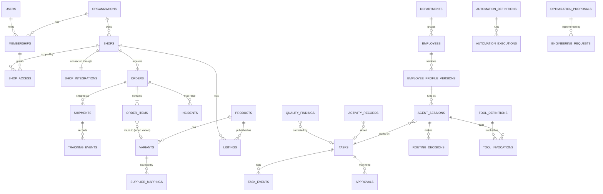

# HTCO OS — Data Model

| | |
|---|---|
| **Status** | Logical model 2.0 (the living office, [ADR-0012](../adr/0012-living-office-organization.md)). No migrations exist yet; physical tables are created phase by phase, and this page is updated in the same pull request as each migration. |
| **Last updated** | 2026-10-14 |
| **Rules** | [ER-DATA](../engineering/ENGINEERING_RULES.md#5-data-er-data), [ADR-0011](../adr/0011-data-access-and-migrations.md) |

## 1. Conventions

| Topic | Convention |
|---|---|
| Schemas | `app` business tables · `private` security-definer helpers · `audit` append-only log · `jobs` technical queue · `agent_runtime` LangGraph checkpoints and store |
| Primary keys | `id uuid` (UUID v7, generated by the application) |
| Tenancy | `organization_id uuid not null` on every business table; `shop_id uuid not null` on every commercial table; both indexed as the leading column of RLS-relevant indexes |
| External IDs | `source text` + `external_id text`, unique per `(shop_id, source, external_id)` |
| Time | `timestamptz`, UTC; `created_at`, `updated_at` on every table; `observed_at` for facts from external systems |
| Money | `amount numeric(14,4)` + `currency char(3)` |
| Status | `text` with a check constraint listing allowed values, mirrored by a domain enum |
| Soft delete | Only where retention requires it (`deleted_at`); otherwise hard delete with audit |
| Naming | Plural snake_case tables; `<table>_<columns>_idx` indexes; `<table>_<columns>_key` unique constraints |

## 2. Core entity relationships



Every operational table also carries `organization_id`, and where relevant `shop_id`, `correlation_id` and an actor (`actor_kind` in `user`, `employee`, `automation`, `advisor`, `system`, plus `actor_id`).

## 3. Tables by bounded context

The phase column says when a table first appears.

### Identity & Access

| Table | Purpose | Phase |
|---|---|---|
| `organizations` | Tenant root | 2 |
| `users` (Supabase `auth.users`) + `user_profiles` | Identity managed by Supabase Auth; profile data in `app` | 2 |
| `memberships` | User ↔ organization with role | 2 |
| `shop_access` | Membership ↔ shop grants | 2 |
| `service_identities` | Automations, employees and system components as authenticated actors | 7–8 |
| `web_sessions` | BFF sessions (hashed session ID, encrypted Supabase tokens, expiry, device, last step-up time) | 3 |
| `device_keys` | Public keys of native devices for biometric step-up (Android, Windows) | 16 |

### Shops

| Table | Purpose | Phase |
|---|---|---|
| `shops` | Shop per marketplace account | 2 (shell), 4 |
| `shop_integrations` | Encrypted tokens, scopes, token expiry, status | 4 |
| `shop_capabilities` | Probe results with `checked_at` | 4 |
| `sync_cursors` | Reconciliation cursors per shop and resource | 5 |
| `sync_drifts` | Differences found by reconciliation between our records and the marketplace | 5 |

### Orders & Fulfillment

| Table | Purpose | Phase |
|---|---|---|
| `orders` | One per receipt; status, totals, `external_updated_at`, raw payload hash | 5 |
| `order_items` | One per transaction; quantity, SKU, price; `variant_id` nullable until the catalog maps it (Phases 11–12) | 5 |
| `order_status_events` | Every order state transition with source and proof | 5 |
| `shipments` | Shipment records from the marketplace (carrier, tracking code) | 5 |
| `tracking_events` | Tracking facts with source and `observed_at` | 6 |
| `sla_policies` | SLA windows per shop, supplier and shipping method | 6 |

### Catalog, Sourcing, Media

| Table | Purpose | Phase |
|---|---|---|
| `products`, `variants` | Internal catalog | 11–12 |
| `product_facts` | Verified attributes (dimensions, material, contents) with source | 11 |
| `product_sales_counters` | Units and orders per product, net of cancellations and refunds (Product Sales Counters automation) | 5 |
| `listings`, `listing_variants`, `listing_metrics` | Per-shop publication and stats | 11–12 |
| `listing_audits`, `listing_findings` | Listing Health results and evidence | 11 |
| `product_candidates` | Shon's candidates with APPROVED / REVIEW / REJECTED, reasons, sources and confidence | 12 |
| `product_sources`, `product_assets`, `asset_provenance` | Sources and media lineage | 12 |
| `quote_requests`, `supplier_quotes`, `supplier_mappings` | Supplier onboarding and active mappings | 13 |

### Finance

| Table | Purpose | Phase |
|---|---|---|
| `financial_entries` | Ledger lines (revenue, fees, refunds, costs) with source and `ESTIMATED`/`VERIFIED` | 5 (basic), 13 |
| `payouts`, `fees`, `refunds`, `cost_snapshots` | Marketplace and supplier finance detail | 13 |
| `budgets`, `budget_ledger` | AI and infrastructure budgets, reserved and actual, per organization, shop, employee, task, day and month | 9 |

### Support and Email

| Table | Purpose | Phase |
|---|---|---|
| `customers`, `customer_consents` | Minimal buyer records per shop; consent ledger | 14 |
| `support_tickets`, `customer_messages` | Tickets and messages | 14 |
| `email_domains`, `email_identities`, `mailboxes` | Sending and receiving identities | 6, 14 |
| `email_threads`, `email_messages`, `email_attachments` | Mail content (untrusted) | 14 |
| `email_delivery_events`, `email_sender_grants`, `email_template_versions`, `email_approvals` | Delivery, permissions, templates, approvals | 6, 14 |

### Work and approvals

| Table | Purpose | Phase |
|---|---|---|
| `tasks`, `task_events` | Business tasks (assignee: user, employee or automation) and their history | 7 |
| `approvals` | Approval requests and decisions | 7 |
| `policies` | Versioned policy documents for the policy engine | 7 |

### Workforce (the office)

These tables hold the reviewed documents of `registry/` (synced by a migration or a reviewed release step, never edited by employees) plus runtime facts. Replaces version 1.0's `agent_profiles`, `agent_versions` and `agent_runs`.

| Table | Purpose | Phase |
|---|---|---|
| `departments` | The seven employee departments | 8 |
| `employees` | Permanent identities: id, name, title, department, current profile version, kill switch | 8 |
| `employee_profile_versions` | Versioned profiles: autonomy, readiness, tools, automations, routing policy, the 22-section specification, evaluation result | 8 |
| `decision_advisors` | Shared advisors (Jev): providers, readiness | 9 |
| `agent_sessions` | Runtime sessions: employee, profile version, task, runtime name, status, correlation ID (the runtime's own checkpoints stay in `agent_runtime`) | 8 |
| `agent_threads` | Thread registry with lock, graph version, status | 8 |
| `office_messages`, `conversations` | Business-level messages between the owner, employees and departments, task threads and handoffs | 8, 15 |
| `agent_memory` | Professional memory items with source and expiry | 8+ |
| `evaluation_runs` | Evaluation suites, versions, scores and pass/fail per employee and automation | 8+ |

### Automation and tools

| Table | Purpose | Phase |
|---|---|---|
| `automation_definitions` | Versioned automation definitions with their 18-section specification | 5 |
| `automation_executions` | One per `(automation_id, idempotency_key)`: state, attempts, trigger, actor, correlation ID | 5 |
| `tool_definitions` | Versioned tool definitions: family, owner, side effect, risk, data scope, readiness | 8 |
| `tool_invocations` | Every tool call: employee, profile and tool versions, access decision, outcome, cost | 8 |

### Decisions and routing

| Table | Purpose | Phase |
|---|---|---|
| `model_catalog` | Verified models, prices with as-of dates, health, eval scores | 9 |
| `routing_decisions`, `model_usage` | Routing decisions (employee, policy version, tier, model, reason) and token and cost logs | 9 |
| `decision_records` | Decision Advisor attempts: question, provider, outcome, value, latency, cost | 9 |

### Activity, supervision and improvement

| Table | Purpose | Phase |
|---|---|---|
| `activity_records` | One per meaningful operation of any actor: kind, action, outcome, business summary, organization, shop, task, correlation and causation IDs; append-only | 7 |
| `quality_findings` | Noa's and the monitors' findings with evidence, severity, follow-up task and verification | 10 |
| `reconciliation_runs` | Evidence of comparisons with external systems | 10 |
| `daily_operations_reports` | The nightly supervisor's report | 10 |
| `optimization_proposals`, `optimization_measurements` | Omer's proposals with lifecycle, baseline and post-deployment measurements | 18 |
| `engineering_requests`, `engineering_changes` | Requests and their links to issues, pull requests, tests and deployments | 19 |

### Observability & Incidents

| Table | Purpose | Phase |
|---|---|---|
| `incidents`, `incident_events`, `remediations` | Incident lifecycle and fixes | 6 |
| `debug_reports` | Amir's diagnoses | 19 |
| `audit.audit_log` | Append-only audit of sensitive actions | 2 |
| `system_alerts`, `notifications`, `notification_preferences` | Alerts and user notifications | 6–7 |
| `worker_heartbeats` | Liveness of workers | 5 |

### Infrastructure tables

| Table | Purpose | Phase |
|---|---|---|
| `inbox` | External events, unique by `(source, event_id)` | 5 |
| `idempotency_keys` | Stored request hash and response for unsafe API requests with an `Idempotency-Key` (24 h) | 5 |
| `outbox` | Pending external side effects, unique by idempotency key | 5 |
| `jobs.*` | Technical job queue (implementation per ADR-0007) | 5 |
| `agent_runtime.*` | LangGraph checkpoints, writes, blobs, store | 8 |

## 4. Row-level security pattern

```sql
-- Helper in the private schema (not exposed through the Data API)
-- Owner and Admin memberships see every shop of their organization; other roles see granted shops.
create function private.user_shop_ids() returns setof uuid
language sql stable security definer set search_path = '' as $$
  select s.id
  from app.memberships m
  join app.shops s on s.organization_id = m.organization_id
  where m.user_id = (select auth.uid()) and m.revoked_at is null and m.role in ('owner', 'admin')
  union
  select sa.shop_id
  from app.shop_access sa
  join app.memberships m on m.id = sa.membership_id
  where m.user_id = (select auth.uid()) and m.revoked_at is null
$$;

alter table app.orders enable row level security;

create policy orders_select on app.orders
  for select to authenticated
  using (shop_id = any (array(select private.user_shop_ids())));
```

Rules: every table has RLS enabled (tested by an inventory test); policies call helpers inside `(select …)`; owner-only tables add a restrictive policy requiring `aal2`; writes from user requests go through use cases, so most tables grant clients no direct insert, update or delete.

## 5. Personal data classification

Data classes are written DC0–DC4 so they are never confused with requirement priorities (P0–P2).

| Class | Examples | Where | Default handling |
|---|---|---|---|
| DC0 Secret | OAuth tokens, API keys, session tokens | `shop_integrations`, `web_sessions` | Application-level encryption; never logged or shown |
| DC1 Buyer contact | Buyer name, shipping address, email (if granted) | `orders`, `customers` | Masked in lists and logs; visible only to roles that need it |
| DC2 Buyer content | Messages, emails, attachments | `customer_messages`, `email_*` | Untrusted; masked before model calls unless needed |
| DC3 User account | Team members' names and emails | `user_profiles` | Visible inside the organization |
| DC4 Business | Orders amounts, products, costs | Most tables | Tenant-scoped |

## 6. Retention

Proposed defaults, confirmed with the owner before Phase 5 and checked against Etsy's current API terms:

| Data | Retention |
|---|---|
| Orders, items, financial entries | 7 years (bookkeeping) with buyer PII minimized after the support window |
| Buyer contact details (DC1) | Until the order is closed plus 180 days, then masked |
| Buyer messages and inbound email (DC2) | 365 days, then deleted |
| Audit log | 7 years |
| Agent checkpoints | 30 days after a thread completes |
| Agent sessions, routing decisions, decision records, model usage, tool invocations | 400 days (cost analysis across a year) |
| Activity records, quality findings, optimization proposals, engineering requests | 7 years for records tied to money, permissions or publishing; otherwise 400 days |
| Registry versions (employee profiles, automations, tools) | Kept for the life of the system (they explain past decisions) |
| Application logs | Provider retention (Supabase 7 days on Pro; forwarded logs per destination) |
| Disconnected shop data | Purged within 30 days of disconnection, except records under legal retention |
