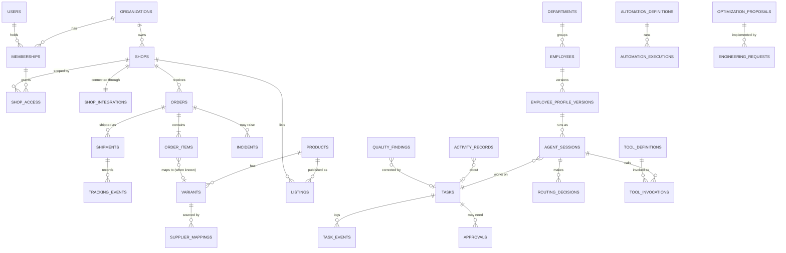

# HTCO OS — Data Model

| | |
|---|---|
| **Status** | Logical model 2.0 (the living office, [ADR-0012](../adr/0012-living-office-organization.md)). Physical tables are created phase by phase, and this page is updated in the same pull request as each migration. Created so far: the base schemas (slice 2.1); `organizations`, `user_profiles`, `memberships`, `shops` (shell), `shop_access` and `audit.audit_log` (slice 2.2, `supabase/migrations/20261014160000_identity_access.sql`); the `jobs` schema with `jobs.jobs` and `jobs.worker_heartbeats`, and the `htco_worker` role (slice 5.1, `20261023120000_job_queue.sql`). |
| **Last updated** | 2026-10-23 (unified execution architecture: [execution-engine.md](execution-engine.md)) |
| **Rules** | [ER-DATA](../engineering/ENGINEERING_RULES.md#5-data-er-data), [ADR-0011](../adr/0011-data-access-and-migrations.md) |

## 1. Conventions

| Topic | Convention |
|---|---|
| Schemas | `app` business tables · `private` security-definer helpers · `audit` append-only log · `jobs` technical queue · `agent_runtime` LangGraph checkpoints and store |
| Primary keys | `id uuid` (UUID v7, generated by the application) |
| Tenancy | `organization_id uuid not null` on every business table; `shop_id uuid not null` on every commercial table; both indexed as the leading column of RLS-relevant indexes |
| External IDs | `source text` + `external_id text`, unique per `(shop_id, source, external_id)` |
| Time | `timestamptz`, UTC; `created_at`, `updated_at` on every table; `observed_at` for facts from external systems |
| Money | `amount numeric(14,4)` + `currency char(3)` |
| Status | `text` with a check constraint listing allowed values, mirrored by a domain enum |
| Soft delete | Only where retention requires it (`deleted_at`); otherwise hard delete with audit |
| Naming | Plural snake_case tables; `<table>_<columns>_idx` indexes; `<table>_<columns>_key` unique constraints |

## 2. Core entity relationships



Every operational table also carries `organization_id`, and where relevant `shop_id`, `correlation_id` and an actor (`actor_kind` in `user`, `employee`, `automation`, `advisor`, `system`, plus `actor_id`).

## 3. Tables by bounded context

The phase column says when a table first appears.

### Identity & Access

| Table | Purpose | Phase |
|---|---|---|
| `organizations` | Tenant root | 2 |
| `users` (Supabase `auth.users`) + `user_profiles` | Identity managed by Supabase Auth; profile data in `app` | 2 |
| `memberships` | User ↔ organization with role | 2 |
| `shop_access` | Membership ↔ shop grants | 2 |
| `service_identities` | Automations, employees and system components as authenticated actors | 7–8 |
| `web_sessions` | BFF sessions (hashed session ID, encrypted Supabase tokens, expiry, device, last step-up time) | 3 |
| `oauth_authorizations` (`private`) | Pending marketplace OAuth authorizations: SHA-256 of the state, sealed PKCE verifier, organization, user, web session, scopes, 10-minute expiry; deleted when used ([connect flow](../features/etsy-integration/connect-flow.md)) | 4 |
| `device_keys` | Public keys of native devices for biometric step-up (Android, Windows) | 16 |

### Shops

| Table | Purpose | Phase |
|---|---|---|
| `shops` | Shop per marketplace account | 2 (shell), 4 |
| `shop_integrations` | Etsy tokens sealed by envelope encryption (key ID, wrapped data key, ciphertexts), scopes, token expiry, status, failure count ([token vault](../features/etsy-integration/token-vault.md)); one per Etsy shop and organization; `disconnected_at` and `purge_after` (30 days) once disconnected | 4 |
| `shop_capabilities` | Latest read-only probe result per shop and capability: state (`available` only after a successful probe), detail code, `checked_at`; Owner/Admin read through RLS ([operations](../features/etsy-integration/operations.md#capability-probes)) | 4 |
| `sync_cursors` | Reconciliation cursors per shop and resource (created: migration `20261024220000_order_reconciliation.sql`; kinds `reconcile`, `sweep`) | 5 |
| `sync_drifts` | Differences found by reconciliation between our records and the marketplace (created: migration `20261024220000_order_reconciliation.sql`; kinds `missing`, `status`, `items`, `shipments`, both values, no money or buyer data; `totals` and source `verification` added by `20261025150000_order_automations.sql` for Order Deduplication & Verification, naming the field, never the amount) | 5 |
| `product_sales_counters` | Per shop and listing: units and orders that count as sales (created: migration `20261025150000_order_automations.sql`; Product Sales Counters; numbers only) | 5 |
| `product_sales_applications` | Per receipt: what the counters hold for it now (listing → units), so a replay moves nothing (created: migration `20261025150000_order_automations.sql`) | 5 |

### Orders & Fulfillment

| Table | Purpose | Phase |
|---|---|---|
| `etsy_orders`, `etsy_order_items`, `etsy_order_refunds` | The shop's stored order history from Etsy (owner's decision of 2026-10-22): one row per receipt (status, totals as amount/divisor/currency, country, shipments' carrier and time), its items, its refunds with Etsy's reason; upserted by `(shop_id, receipt_id)`; members of the shop read through RLS ([dashboard data](../features/etsy-integration/dashboard-data.md#stored-order-history)) | 4 (ahead of 5) |
| `etsy_order_buyers` | The buyer's name, shipping address and tracking numbers per stored order; RLS for buyer-data roles only (Owner, Admin; Operations and Support with access); no contact columns | 4 (ahead of 5) |
| `etsy_order_sync_state` | Per shop: the backfill's offset checkpoint, when it completed, the last 30-day sync, the last error type | 4 (ahead of 5) |
| `orders` | **Not created as a separate table** (2026-10-23): `etsy_orders` (#57) is the order store, and Phase 5 extends it (`external_updated_at`, raw payload hash). A channel-neutral `orders` view over the marketplace stores is added with the Shopify adapter (Phase 21) | 21 (view) |
| `order_items` | As `orders`: `etsy_order_items` is the store; `variant_id` (nullable until the catalog maps it, Phases 11–12) is added to it | 5 (column), 21 (view) |
| `order_status_events` | Every order state transition with source and proof; references `etsy_orders` (created: migration `20261024210000_order_intake.sql`) | 5 |
| `shipments` | Shipment records from the marketplace (carrier, tracking code); today embedded in `etsy_orders` and `etsy_order_buyers` (tracking numbers); split into a table only when Phase 6 needs one row per shipment | 6 |
| `tracking_events` | Tracking facts with source and `observed_at` | 6 |
| `sla_policies` | SLA windows per shop, supplier and shipping method | 6 |

### Catalog, Sourcing, Media

| Table | Purpose | Phase |
|---|---|---|
| `products`, `variants` | Internal catalog | 11–12 |
| `product_facts` | Verified attributes (dimensions, material, contents) with source | 11 |
| `product_sales_counters` | Units and orders per product, net of cancellations and refunds (Product Sales Counters automation) | 5 |
| `listings`, `listing_variants`, `listing_metrics` | Per-shop publication and stats; `listing_metrics` also takes the stats export (CSV upload, or recipe B-02 where scoped) | 11–12 |
| `shop_traffic_daily`, `ads_daily` | Shop visits, views, conversion and search terms per day; Etsy Ads spend and results per day; from CSV uploads or scoped browser exports (B-02, B-03), with source and `observed_at` | 8A, 11 |
| `listing_audits`, `listing_findings` | Listing Health results and evidence | 11 |
| `product_candidates` | Shon's candidates with APPROVED / REVIEW / REJECTED, reasons, sources and confidence | 12 |
| `product_sources`, `product_assets`, `asset_provenance` | Sources and media lineage | 12 |
| `suppliers`, `quote_requests`, `supplier_quotes`, `supplier_mappings` | Supplier onboarding and active mappings; quotes parsed from AutoVA's emails; one active mapping per product or variant ([AutoVA integration](autova-integration.md)) | 7 (moved from 13) |
| `autova_orders` | Snapshots of AutoVA orders from recipe A-01 (export or screen): AutoVA ID, receipt, supplier, status, paid, mode, carrier, tracking, profit, `source`, `observed_at` | 8A |

### Finance

| Table | Purpose | Phase |
|---|---|---|
| `financial_entries` | Ledger lines (revenue, fees, refunds, costs) with source and `ESTIMATED`/`VERIFIED` (created: migration `20261024210000_order_intake.sql`, revenue and refunds only; fees with the ledger) | 5 (basic), 13 |
| `payouts`, `fees`, `refunds`, `cost_snapshots` | Marketplace and supplier finance detail | 13 |
| `budgets`, `budget_ledger` | AI and infrastructure budgets, reserved and actual, per organization, shop, employee, task, day and month | 9 |

### Support and Email

| Table | Purpose | Phase |
|---|---|---|
| `customers`, `customer_consents` | Not for Etsy buyers: no stored customer list, segments or marketing profiles ([ADR-0018](../adr/0018-order-history-and-buyer-data.md)); a per-buyer view is computed from the order history on demand. Only email support contacts (Phase 14), if the owner approves | 14 |
| `support_tickets`, `customer_messages` | Tickets and messages | 14 |
| `email_domains`, `email_identities`, `mailboxes` | Sending and receiving identities | 6, 14 |
| `email_threads`, `email_messages`, `email_attachments` | Mail content (untrusted) | 14 |
| `email_delivery_events`, `email_sender_grants`, `email_template_versions`, `email_approvals` | Delivery, permissions, templates, approvals | 6, 14 |

### Work and approvals

| Table | Purpose | Phase |
|---|---|---|
| `tasks`, `task_events` | Business tasks (assignee: user, employee or automation) and their history | 7 |
| `approvals` | Approval requests and decisions | 7 |
| `policies`, `policy_decisions` | Versioned policy documents for policy engine v1: the capability catalogue with side effect and risk, and the grants of employees, automations and system components. They are append-only, so a change is the next version. Each engine decision is stored with its actor, capability, verdict, reason and `policy_version`, also append-only, with no request parameters or buyer data. RLS: the Owner and Admins read; the worker reads its job's policy and records its job's decisions. **Created** (slice 7.2, `20261027110000_policies.sql`) | 7 |

### Workforce (the office)

These tables hold the reviewed documents of `registry/` (synced by a migration or a reviewed release step, never edited by employees) plus runtime facts. Replaces version 1.0's `agent_profiles`, `agent_versions` and `agent_runs`.

| Table | Purpose | Phase |
|---|---|---|
| `departments` | The seven employee departments | 8 |
| `employees` | Permanent identities: id, name, title, department, current profile version, kill switch | 8 |
| `employee_profile_versions` | Versioned profiles: autonomy, readiness, tools, automations, routing policy, the 22-section specification, evaluation result | 8 |
| `decision_advisors` | Shared advisors (Jev): providers, readiness | 9 |
| `agent_sessions` | Runtime sessions: employee, profile version, task, runtime name, status, correlation ID (the runtime's own checkpoints stay in `agent_runtime`) | 8 |
| `agent_threads` | Thread registry with lock, graph version, status | 8 |
| `office_messages`, `conversations` | Business-level messages between the owner, employees and departments, task threads and handoffs | 8, 15 |
| `agent_memory` | Professional memory items with source and expiry | 8+ |
| `evaluation_runs` | Evaluation suites, versions, scores and pass/fail per employee and automation | 8+ |

### Automation and tools

| Table | Purpose | Phase |
|---|---|---|
| `automation_definitions` | Versioned automation definitions (`(id, version)`) with their 18-section specification, the whole reviewed document, its SHA-256 and the registry commit; written only by `htco registry sync --automations`. **Created** (slice 5.10, `20261023140000_automation_engine.sql`) | 5 |
| `automation_executions` | One per `(automation_id, idempotency_key)`: organization, shop, definition version, state (machine enforced by a trigger), attempts, trigger, actor, correlation and causation IDs, last error, payload. **Created** (slice 5.10) | 5 |
| `automation_execution_events` | Every execution state change with its actor and correlation ID; append-only. **Created** (slice 5.10) | 5 |
| `tool_definitions` | Versioned tool definitions: family, owner, side effect, risk, data scope, readiness | 8 |
| `tool_invocations` | Every tool call: employee, profile and tool versions, access decision, outcome, cost | 8 |

### Execution (Action Gateway and channels)

[execution-engine.md](execution-engine.md) holds the contracts and state machines.

| Table | Purpose | Phase |
|---|---|---|
| `action_executions` | One per `(organization_id, action_name, idempotency_key)` (created in `20261023150000`): action and version, request hash, actor, on-behalf-of user, organization, shop, state, outcome, channel, attempts, approval ID, verification, evidence, error code and reason, output (never for R1 reads), correlation and causation IDs; finished rows never change (trigger); RLS by organization and shop for users (no output column), by the job's organization for the worker. Owner-trigger flag and cost follow with 5.14 and 5.15 | 5 |
| `action_first_runs` | Per shop and write tool: the owner's first verified run (or its error) that unlocks the tool for automations and employees (ADR-0022) | 6–7 |
| `rate_limit_buckets` | Postgres token buckets for app-wide limits (Etsy QPS and QPD) and per-shop browser pace | 5 |
| `circuit_breakers` | Shared breaker state per key (`etsy:api`, `etsy:web`, `browser:{shop}`) | 5 |
| `human_tasks` (as `tasks` with `assignee_kind = user` and a waiting reason) | Human-channel work: manual login, challenge, refund in Etsy, unsupported authentication; resumes the waiting execution | 7 |

### Browser environments and secrets

| Table | Purpose | Phase |
|---|---|---|
| `shop_browser_environments` | One per shop (optional; created in `20261024200000`): status (`NOT_CONFIGURED`, `PROVISIONING`, `READY`, `LOGIN_REQUIRED`, `DEGRADED`, `SUSPENDED`, `FAILED`; created `PROVISIONING`, every change checked against the transition table by a trigger), consent (text version, user, time, address hash; all or none), profile storage key and key ID (8A), last health, last session, challenge count, error count (failed sessions, 8A.2); no proxy or fingerprint columns (ADR-0020). RLS: Owner and Admin read their organization's rows (no consent or profile columns); the worker reads its job's organization's statuses. Enabled actions follow with the scope flags (8A) | 5 (table and state machine), 8A |
| `browser_profile_archives` | One sealed profile archive per environment (created in `20261025170000`): environment, shop and organization (composite foreign key to the environment), key ID, the sealed bytes (1 byte to 25 MiB), sealed time. Only `htco_browser` reads or writes it, in its organization; no client role and not the agent-worker | 8A |
| `browser_environment_events` | Append-only (created in `20261024200000`): `transition` rows (from, to, actor, reason, correlation ID; only the table's edges) and `health` rows (ok, problem codes) | 5, 8A |
| `browser_sessions` | Each session (created in `20261025190000`): environment, shop and organization (composite foreign key to the environment), purpose code, started and ended, outcome (`running`, `succeeded`, `failed` with a failure code, `deferred`), final once ended. The browser role writes its organization's; Owner and Admin read theirs. Execution, recipe, preflight report and challenge kind follow in 8A.3 to 8A.5. Planned by [ADR-0025](../adr/0025-browser-and-network-providers.md): the egress ID, configuration version and Chromium version each session used. Pre-update profile archives (ADR-0025 §2) count as the profile: destroyed with the environment and purged with a disconnected shop | 8A |
| `shop_browser_environments.provider` | The environment's `BrowserProvider` (`managed-chromium`, the only enabled one); Owner-only to change, audited. Any future provider must implement the contract and pass the same gates (ADR-0025 §1) | 8A |
| `browser_providers` | The provider catalog: ID, readiness (`enabled` or `disabled`), declared capabilities, the contract-suite run that enabled it, enabled by and when. Only `managed-chromium` is `enabled` | 8A |
| `browser_configurations` | One versioned configuration profile per environment (ADR-0025 §2): version, locale and languages, egress assignment, the baseline version it builds on, validation result, changed by (Owner or Admin with step-up) and when; append-only versions, audited. No User-Agent, screen, time zone, geolocation, fingerprint or proxy columns | 8A |
| `browser_control_leases` | One active Controller lease per browser session (ADR-0026 §2): the session, the holder (user), the purpose and its path scope, acquired, renewed and expires at, the maximum until, released at and why. Taken by compare-and-set, with one active row per session (unique). Renewed only by the holder. Audited. Agents and automations have no access | 8A |
| `browser_sessions.control_state` | `AGENT`, `PAUSING`, `HUMAN_CONTROLLING` or `RETURNING` (ADR-0026 §2), with the current lease. It changes only along the transition table in execution-engine.md §7, and the database refuses any other transition. The action meanwhile stays `DISPATCHED`, reported with the waiting reason `waiting_for_human_control` | 8A |
| `browser_run_outcomes` | One row per dispatched execution and attempt (ADR-0025 §3). It holds the status (`started`, then once `succeeded`, `failed`, `challenge`, `refused`, `timeout` or `interrupted`), `started_at` (the started marker, committed before an approval-gated run or a write touches a page), `run_token_hash` (the attempt's run token, stored hashed), the validated output, evidence hashes, the error code and the publication time. `htco_browser` has **no direct grant on it**. Every approval-gated run, reads included, and every write starts its row only through `private.start_browser_run(job_id, lease_token)` (`security definer`; the leased job, the action row locked, `on conflict do nothing`). A started run's final status goes only through `private.finish_browser_run(run_token, outcome)`, with the run token that only the starter received. An unapproved read's row goes only through `private.record_unapproved_read(job_id, lease_token, outcome)`, with its leased job. Only the agent-worker's resume reads it; `authenticated` has no access. It never holds a secret. Output fields that the recipe's output model declares as DC1 are classified DC1, with ADR-0018's retention and the disconnect purge. It is kept with the action execution | 8A |
| `shop_network_egress` | Optional, one per shop with a dedicated egress: the egress ID, the expected public IP (an HTCO-owned static datacenter IP), allocated by and when, last check and its result. No row means the shared browser egress. Owner-only writes, audited. The egress is HTCO's own gateway, never a third-party proxy service or a commercial VPN endpoint (ADR-0025 §4) | 8A |
| `model_call_budgets` (interim) | Before the Phase 9 ledger: reservations and settlements per run and per shop per day for Browser Use's gateway calls (8A.6); 9.4's `budget_ledger` absorbs it | 8A, then 9 |
| `browser_artifacts` | Downloaded exports and challenge screenshots (by storage key and hash; screenshots kept 7 days) | 8A |
| `browser_scope_flags` | Mirror of [etsy-automation-approval.md](etsy-automation-approval.md): action ID, scope version, flag state, changed by | 8A |
| `shop_credentials` (`private`) | Sealed Etsy password per environment (envelope encryption with the token vault's key ring; DC0) | 8A |
| `totp_accounts` (`private`) | Sealed TOTP secrets: organization, shop, label, issuer, digits, period, algorithm, key ID, status, consent reference; never the code | 8B |
| `totp_events` | Append-only enrol, rotate, remove, view, inject and refuse events; never the code | 8B |
| `secret_grants` | Single-use injection grants: execution, environment, secret reference, field, expiry, redeemed at | 8B |

### Decisions and routing

| Table | Purpose | Phase |
|---|---|---|
| `model_catalog` | Verified models, prices with as-of dates, health, eval scores | 9 |
| `model_catalog_aliases` | Stable names (`default-advanced`, `default-embedding`), each pointing to exactly one catalog row, with an as-of date and a source; changed only by pull request ([ADR-0023](../adr/0023-routing-modes-and-difficulty-assessment.md)) | 9 |
| `employee_routing_settings` | The Owner's current routing mode per employee (`routed` or `pinned`, alias and fallback list), set only by the Owner and carried into each new profile version | 9 |
| `routing_decisions`, `model_usage` | Routing decisions (employee, policy version, mode, alias, tier, model, difficulty and its source, the clamp and pin flags, reason) and token and cost logs | 9 |
| `decision_records` | Decision Advisor attempts: question, provider, outcome, value, latency, cost | 9 |
| `knowledge_sources` | One row per ingested knowledge source: organization, shop, kind (`shop_policy`, `faq`, `listing`, `product`; no reply kind in v1), source reference, content hash, version, status, `retain_until`. RLS by organization and shop; organization-wide rows (null shop) are visible to every member of that organization ([ADR-0024](../adr/0024-knowledge-base-and-retrieval.md)) | 9 |
| `knowledge_chunks` | Redacted chunk text, language, `tsvector`, `vector(n)` embedding with its alias and model, position; HNSW and GIN indexes; RLS by organization and shop. Never DC1 or DC2 data, and no reply text in v1 (ADR-0024 §2) | 9 |

### Activity, supervision and improvement

| Table | Purpose | Phase |
|---|---|---|
| `activity_records` | One per meaningful operation of any actor: kind, action, outcome, business summary, organization, shop, task, correlation and causation IDs; append-only | 7 |
| `quality_findings` | Noa's and the monitors' findings with evidence, severity, follow-up task and verification | 10 |
| `reconciliation_runs` | Evidence of comparisons with external systems | 10 |
| `daily_operations_reports` | The nightly supervisor's report | 10 |
| `optimization_proposals`, `optimization_measurements` | Omer's proposals with lifecycle, baseline and post-deployment measurements | 18 |
| `engineering_requests`, `engineering_changes` | Requests and their links to issues, pull requests, tests and deployments | 19 |

### Observability & Incidents

| Table | Purpose | Phase |
|---|---|---|
| `incidents`, `incident_events`, `remediations` | Incident lifecycle and fixes. `incidents` and `incident_events` **created** (slice 6.3, `20261025100000_fulfillment_incidents.sql`); `remediations` later | 6 |
| `tracking_events`, `sla_policies` | First sighting of each parcel per order (fingerprint and last four only); SLA windows per organization, shop, supplier and shipping method. **Created** (slices 6.1, 6.2, `20261025100000_fulfillment_incidents.sql`) | 6 |
| `debug_reports` | Amir's diagnoses | 19 |
| `audit.audit_log` | Append-only audit of sensitive actions | 2 |
| `system_alerts`, `notifications`, `notification_preferences` | Alerts and user notifications. `notifications`, `notification_preferences`, `notification_settings` and `email_deliveries` **created** (slice 6.4, `20261025110000_notifications.sql`); alerts are notifications (no `system_alerts` table, audit P2-2) | 6–7 |
| `jobs.worker_heartbeats` | Liveness of workers: last beat, current job, stopping. **Created** (slice 5.1, `20261023120000_job_queue.sql`) | 5 |

### Infrastructure tables

| Table | Purpose | Phase |
|---|---|---|
| `jobs.inbox` | External events, unique by `(source, event_id)`, with payload hash and processing job. **Created** (slice 5.2, `20261023130000_inbox_outbox.sql`) | 5 |
| `private.idempotency_keys` | Stored request hash and response for unsafe API requests with an `Idempotency-Key` (24 h), per user. **Created** (slice 5.2) | 5 |
| `jobs.outbox` | Pending external side effects, unique by idempotency key, with status, attempts, next attempt (kept equal to its delivery job's), and the optional `action_execution_id` and `correlation_id` of the gateway (ADR-0019). **Created** (slice 5.2) | 5 |
| `jobs.rate_windows`, `jobs.circuit_breakers`, `jobs.concurrency_slots` | The Action Gateway's guards: calls spent per key per UTC second and day, one breaker per key, leased slots. No tenant data; worker role only. **Created** (slice 5.15, `20261023160000_action_guards.sql`, which also adds `app.action_executions.retry_at`) | 5 |
| `jobs.jobs` | Technical job queue ([ADR-0007](../adr/0007-job-queue.md)): unique `(kind, idempotency_key)`, optional `organization_id`/`shop_id`, `lock_key` (one running job per key), state, attempts and backoff, lease, last error, `correlation_id`, `causation_id`. RLS on; only the `htco_worker` role and the login role. **Created** (slice 5.1) | 5 |
| `agent_runtime.*` | LangGraph checkpoints, writes, blobs, store | 8 |

## 4. Row-level security pattern

```sql
-- Helper in the private schema (not exposed through the Data API)
-- Owner and Admin memberships see every shop of their organization; other roles see granted shops.
create function private.user_shop_ids() returns setof uuid
language sql stable security definer set search_path = '' as $$
  select s.id
  from app.memberships m
  join app.shops s on s.organization_id = m.organization_id
  where m.user_id = (select auth.uid()) and m.revoked_at is null and m.role in ('owner', 'admin')
  union
  select sa.shop_id
  from app.shop_access sa
  join app.memberships m on m.id = sa.membership_id
  where m.user_id = (select auth.uid()) and m.revoked_at is null
$$;

alter table app.orders enable row level security;

create policy orders_select on app.orders
  for select to authenticated
  using (shop_id = any (array(select private.user_shop_ids())));
```

The migration of slice 2.2 implements this pattern with the helpers `private.user_org_ids()`, `private.user_admin_org_ids()`, `private.user_membership_ids()`, `private.user_shop_ids()`, `private.coworker_user_ids()` and `private.session_is_aal2()`; `authenticated` may execute them but cannot use the `private` schema, so only policies reach them. `audit.audit_log` stores the actor as `actor_kind` (check constraint over the five kinds) and `actor_id`, and a trigger rejects update, delete and truncate even for the table owner.

Rules: every table has RLS enabled (tested by an inventory test); policies call helpers inside `(select …)`; owner-only tables add a restrictive policy requiring `aal2`; writes from user requests go through use cases, so most tables grant clients no direct insert, update or delete.

## 5. Personal data classification

Data classes are written DC0–DC4 so they are never confused with requirement priorities (P0–P2).

| Class | Examples | Where | Default handling |
|---|---|---|---|
| DC0 Secret | OAuth tokens, API keys, session tokens, PKCE verifiers, shop passwords, TOTP secrets and codes, browser profiles (cookies) | `shop_integrations`, `web_sessions`, `oauth_authorizations`, `shop_credentials`, `totp_accounts`, sealed profile archives | Application-level encryption with the one key ring (browser profiles: the browser worker's own ring, ADR-0020 §8); never logged, never shown (a TOTP code only on the code view), never sent to a model |
| DC1 Buyer contact | Buyer name, shipping address, email (if granted) | `orders`, `customers` | Masked in lists and logs; visible only to roles that need it |
| DC2 Buyer content | Messages, emails, attachments | `customer_messages`, `email_*` | Untrusted; masked before model calls unless needed |
| DC3 User account | Team members' names and emails | `user_profiles` | Visible inside the organization |
| DC4 Business | Orders amounts, products, costs | Most tables | Tenant-scoped |

## 6. Retention

Proposed defaults, confirmed with the owner before Phase 5 and checked against Etsy's current API terms:

| Data | Retention |
|---|---|
| Orders, items, financial entries | 7 years (bookkeeping) with buyer PII minimized after the support window |
| Buyer name and shipping address (DC1) | With the order while the shop is connected, masked after the support window per this table's review; purged 30 days after a disconnect ([ADR-0018](../adr/0018-order-history-and-buyer-data.md)). Email, phone and messages are never stored |
| Buyer messages and inbound email (DC2) | 365 days, then deleted |
| Audit log | 7 years |
| Agent checkpoints | 30 days after a thread completes |
| Agent sessions, routing decisions, decision records, model usage, tool invocations | 400 days (cost analysis across a year) |
| Activity records, quality findings, optimization proposals, engineering requests | 7 years for records tied to money, permissions or publishing; otherwise 400 days |
| Registry versions (employee profiles, automations, tools) | Kept for the life of the system (they explain past decisions) |
| Application logs | Provider retention (Supabase 7 days on Pro; forwarded logs per destination) |
| Disconnected shop data | Purged within 30 days of disconnection, except records under legal retention |
