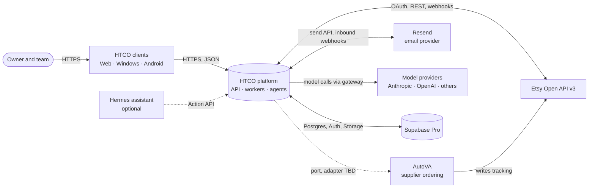
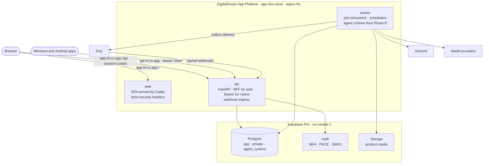
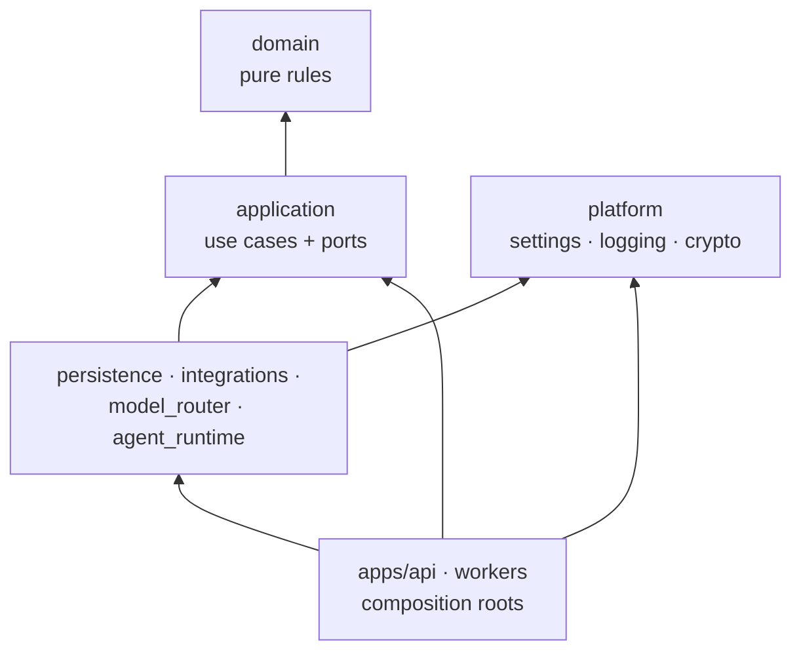
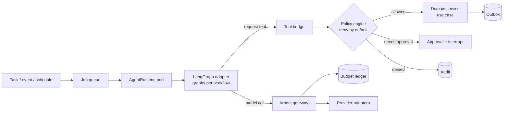
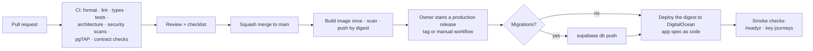

# HTCO OS — Software Design

| | |
|---|---|
| **Status** | Draft 1.0 — the baseline every phase builds on |
| **Last updated** | 2026-10-14 |
| **Related** | [PRD](../product/PRD.md) · [Engineering rules](../engineering/ENGINEERING_RULES.md) · [Threat model](THREAT_MODEL.md) · [Data model](DATA_MODEL.md) · [Event catalog](EVENT_CATALOG.md) · [Permission matrix](PERMISSION_MATRIX.md) · [ADRs](../adr/README.md) |

This document describes how HTCO OS is built: its structure, the rules that keep it secure and maintainable for years, and the reasons behind each choice. It is written so that a new developer, or an AI agent starting a fresh session, can understand the system before changing it. Decisions with real trade-offs are recorded as ADRs and linked here.

---

## 1. Architectural drivers

When two goals conflict, the higher one wins.

| Rank | Quality attribute | What it means for HTCO |
|---|---|---|
| 1 | **Security and tenant isolation** | Shop data never leaks across tenants; agents cannot exceed their permissions; secrets never leave the server. |
| 2 | **Correctness of money and orders** | No duplicate orders, no float money, every figure traceable to its source. |
| 3 | **Reliability under failure** | Every step survives retries, crashes, duplicate events and slow external APIs. |
| 4 | **Auditability** | Every external action, approval and agent decision has a durable receipt. |
| 5 | **Maintainability** | Clear boundaries enforced by tools, so many sessions of AI-assisted work do not erode the design. |
| 6 | **Cost control** | Small fixed infrastructure, AI spend capped and attributed per unit of work. |
| 7 | **Evolvability** | New marketplaces, model providers or agent runtimes plug in behind ports. |

## 2. System context



Trust boundaries: everything outside the HTCO platform box is either untrusted (Etsy webhooks until verified, emails, supplier pages, model outputs) or semi-trusted infrastructure (Supabase, DigitalOcean, providers) reached with least-privilege credentials.

## 3. Containers and deployment



| Component | Type | Source | Responsibility | Scale-out path |
|---|---|---|---|---|
| `web` | Service (Caddy serving the built SPA) or static site | `htco-clients/apps/web` | Serves the web app with CSP, HSTS and frame-ancestors headers | Static assets, CDN |
| `api` | Web service | `htco-platform/apps/api` | HTTP API, BFF session handling for the web, bearer auth for native apps, webhook ingress, health | More instances; dedicated CPU when needed |
| `worker` | Worker | `htco-platform/workers` | Job consumers (ingest, sync, inspectors, outbox delivery), scheduled jobs, and from Phase 8 the agent runtime | Split into `automation-worker` and `agent-worker` when load or isolation requires (ADR) |
| `browser-runner` | Isolated worker or job, later | `htco-platform/workers/browser` | Playwright automation only if an approved AutoVA path needs it | Possibly a separate droplet for sandboxing (ADR) |

Routing: `app.ht-co.app/` goes to `web`, `app.ht-co.app/api` to `api` (same origin, so the web session cookie needs no CORS), and `api.ht-co.app` to `api` for native clients and webhooks. `office.ht-co.app` and `agents.ht-co.app` are **mail domains only** (MX, SPF, DKIM, DMARC) and never get web records.

Why this shape ([ADR-0002](../adr/0002-modular-monolith-hexagonal.md), [ADR-0005](../adr/0005-hosting-digitalocean-supabase.md)): one API and one worker are cheap, simple to operate, and enough for the pilot. Eighteen agents are eighteen *profiles* running in one worker, not eighteen services.

## 4. Code structure

### 4.1 Repositories

| Repository | Contents |
|---|---|
| `htco-platform` | Backend, workers, agent runtime, database migrations, contracts (OpenAPI and event schemas), infrastructure as code, and the system-level docs (product, plan, architecture, engineering) |
| `htco-clients` | Web, Windows and Android apps, design tokens and components, generated API clients, client docs |

Why two ([ADR-0001](../adr/0001-two-repositories.md)): different toolchains and release cycles, while each repository stays coherent. Contracts flow one way: `htco-platform` publishes the OpenAPI document; `htco-clients` pins a copy and generates clients from it.

### 4.2 Platform layout

```text
htco-platform/
  apps/api/                 FastAPI app: routers, request/response schemas, BFF session, composition root
  workers/runner/           Worker process: job consumers, schedules, composition root
  workers/browser/          Later: isolated Playwright runner
  packages/domain/          Pure domain: entities, value objects, policies, state machines, domain events
  packages/application/     Use cases (commands and queries), ports (interfaces), unit of work
  packages/contracts/       openapi.yaml, event JSON Schemas, shared error codes (language-neutral)
  packages/persistence/     Postgres adapters: repositories, inbox and outbox, job queue, audit writer
  packages/integrations/    Etsy, AutoVA, email adapters implementing application ports
  packages/model-router/    Model gateway: routing policy, provider adapters, price table, budget ledger client
  packages/agent-runtime/   Agent runtime port implementation (LangGraph), graphs, tool bridge
  packages/platform/        Cross-cutting infrastructure: settings, logging, tracing, crypto, clock, IDs
  supabase/migrations/      SQL migrations (single source of truth for the schema)
  supabase/tests/           pgTAP database tests
  infra/digitalocean/       App spec and environment documentation
  tests/                    All tests: one folder per package, plus architecture and end-to-end tests
  tools/                    Repository scripts used by Git hooks and CI
  docs/                     Product, plan, architecture, engineering, ADRs, feature docs
```

This refines the folder list in the original planning brief: `packages/application`, `packages/persistence` and `packages/platform` are added so that use cases, database code and cross-cutting infrastructure each have one home ([ADR-0002](../adr/0002-modular-monolith-hexagonal.md)). Python packages use the `htco_` prefix (`htco_domain`, `htco_application`, …) inside one `uv` workspace.

### 4.3 Dependency rule



Arrows point from the dependent module to its dependency. Enforced by `import-linter` contracts in CI:

1. `htco_domain` imports only the standard library.
2. `htco_application` imports only `htco_domain` (and typing helpers).
3. Adapters never import each other (Etsy code never imports the model gateway); they meet only through ports wired in a composition root.
4. Only `htco_model_router` may import model provider SDKs; only `htco_agent_runtime` may import LangGraph; only `htco_persistence` may import the database driver.
5. Nothing imports from `apps` or `workers`.

### 4.4 Bounded contexts

Each context is a sub-package inside `domain`, `application` and the relevant adapters, with its own tables and events.

| Context | Owns | Key aggregates |
|---|---|---|
| Identity & Access | Organizations, users, memberships, roles, service identities | `Organization`, `Membership` |
| Shops | Shops, marketplace integrations, capabilities, sync cursors | `Shop`, `ShopIntegration` |
| Orders & Fulfillment | Orders, items, shipments, tracking, SLA windows | `Order`, `Fulfillment` |
| Catalog | Products, variants, listings, assets, listing audits | `Product`, `Listing` |
| Sourcing | Supplier quotes, supplier mappings | `QuoteRequest`, `SupplierMapping` |
| Finance | Financial entries, fees, payouts, cost snapshots, budgets | `LedgerEntry`, `Budget` |
| Support | Tickets, customer messages, consents | `Ticket` |
| AI Workforce | Agent profiles and versions, tasks, approvals, agent runs, memory | `Task`, `Approval`, `AgentProfile` |
| Observability & Incidents | Incidents, remediations, audit log, alerts | `Incident` |
| Media & Marketing | Images and provenance, campaigns | `Asset` |

## 5. Domain design

### 5.1 Rules of the domain layer

- Plain Python: dataclasses (frozen where possible), enums, `Decimal`. No framework or I/O imports.
- Invariants are enforced in constructors and methods; invalid objects cannot exist.
- Every lifecycle is an explicit state machine with a transition table; illegal transitions raise a typed error.
- Domain events are values (`OrderIngested`, `TrackingDetected`, `IncidentOpened`) returned by aggregates and published by the application layer through the outbox.

### 5.2 State machines

| Entity | States | Notes |
|---|---|---|
| Order | `PAID → INGESTED → AWAITING_SHIPMENT → SHIPPED → DELIVERED`; terminal `CANCELLED`, `REFUNDED`; `SUPPLIER_ORDERED` added in Phase 11 when supplier evidence exists | Only observable facts drive transitions; each records `source` and `observed_at`; problems are linked incidents |
| Task | `CREATED → QUEUED → CLAIMED → RUNNING → COMPLETED`, with `WAITING_FOR_EXTERNAL`, `WAITING_FOR_AGENT`, `WAITING_FOR_APPROVAL`, `RETRY_SCHEDULED`, `BLOCKED`, `FAILED`, `ESCALATED`, `CANCELLED` | Business-level state; separate from the technical job queue |
| Approval | `PENDING → APPROVED │ REJECTED │ EXPIRED │ CANCELLED` | Decision stores approver, MFA level, policy version |
| Incident | `DETECTED → TRIAGED → INVESTIGATING → REMEDIATION_PROPOSED → (AUTO_REMEDIATING │ APPROVAL_REQUIRED │ DEVELOPER_REQUIRED) → VERIFYING → RESOLVED`, or `ESCALATED` | Resolved only on verified evidence |
| Quote request | `REQUESTED → WAITING_FOR_QUOTES → QUOTES_READY → EVALUATING → APPROVAL_PENDING → APPROVED → ACTIVE`; `EXPIRED`, `REJECTED`, `FAILED` | Re-opened by price, SKU, shipping or SLA change |

## 6. Data architecture

Details: [DATA_MODEL.md](DATA_MODEL.md).

- **One Postgres database** (Supabase) with schemas: `app` (business tables), `private` (security-definer helpers, never exposed), `audit` (append-only), `jobs` (technical queue), `agent_runtime` (LangGraph checkpoints and store, never exposed through the Data API).
- **Tenancy**: every business row carries `organization_id`; every commercial row also carries `shop_id`. Both are `NOT NULL`, foreign-keyed and indexed as the leading column of the indexes that RLS uses.
- **Row-level security** on every table, written `TO authenticated` with helper functions wrapped in `(select …)` for performance, and restrictive policies requiring `aal2` where MFA is mandatory.
- **How the API applies RLS**: user-scoped requests run inside a transaction that sets `role authenticated` and the verified JWT claims (`set local`), so RLS is enforced even if a query forgets a filter. Workers use their own database role, with explicit tenant filters in every query and integration tests that prove it.
- **Supabase Data API exposure is minimized**: clients never query tables directly; they go through the HTCO API. Only what is needed for Auth is exposed.
- **Migrations**: SQL files in `supabase/migrations`, created with the Supabase CLI, tested with pgTAP, applied by CI after approval, always expand-then-contract.
- **Identifiers**: UUID v7 for internal IDs (time-ordered, index-friendly); external IDs unique per `(shop_id, source, external_id)`.
- **Money**: `NUMERIC(14,4)` plus `currency CHAR(3)`; conversion rates stored with source and timestamp.
- **Time**: `timestamptz`, UTC.
- **Personal data**: classified per column, masked in logs and exports, retained per [data retention rules](DATA_MODEL.md#6-retention).
- **Backups**: Supabase Pro daily backups (7 days). Storage objects are not part of database backups, so media gets its own backup job. A restore drill runs before production data is relied on. Point-in-time recovery is a cost decision recorded before launch.

## 7. Integration architecture

All external systems sit behind ports owned by the application layer.

| Port | Adapter(s) | Notes |
|---|---|---|
| `MarketplacePort` | `EtsyAdapter` (later `ShopifyAdapter`) | OAuth with PKCE, token refresh with a per-shop lock, `x-api-key` header, rate-limit budget per shop read from response headers, typed errors for 401, 403, 404, 409, 429 and 5xx |
| `WebhookVerifier` | Standard Webhooks (HMAC-SHA256 over `id.timestamp.body`) | Shared by Etsy and Resend webhooks; 5-minute timestamp tolerance; raw body only |
| `AutoVaPort` | `ManualAutoVaAdapter` first; API adapter if AutoVA offers one; browser adapter only by ADR | Tracking does not need AutoVA access: AutoVA writes tracking to Etsy and we read it there |
| `EmailPort` | `ResendAdapter` | Idempotency keys on send; inbound via `email.received` webhook then fetch content; attachments copied within one hour |
| `ModelGateway` | `AnthropicAdapter`, `OpenAIAdapter` (official SDKs) | Only path to models; see §9 |
| `DecisionPort` | Experimental adapters (TypeSafe Jev, OpenAI Decisions) | Typed decisions with a structured-output fallback; benchmark before use |
| `BlobStore` | Supabase Storage | Product media with provenance metadata |
| `Clock`, `IdGenerator` | System and test implementations | Determinism in tests |

### 7.1 Etsy ingest design

1. `POST /webhooks/etsy` verifies the signature on the raw body, inserts the event into `inbox` (`ON CONFLICT (source, event_id) DO NOTHING`), enqueues a job keyed by `(shop_id, receipt_id)`, and returns 2xx quickly.
2. The ingest job fetches the receipt and upserts order, items and shipments in one transaction, applying changes only when Etsy's `updated_timestamp` is newer than the stored one. The raw payload hash is kept for audit.
3. A reconciliation job per shop runs every few minutes, asking for receipts modified since the saved cursor minus a safety margin, so missed webhooks are always recovered. A nightly sweep re-checks the last 30 days.
4. If webhooks are not available to our app type, the reconciliation interval shortens and becomes the primary path. Nothing else changes.

## 8. Jobs, events and reliability

### 8.1 Two levels of work

- **Business tasks** (`app.tasks`) are domain records with business states, owners, SLAs and approvals. Humans see them.
- **Technical jobs** (`jobs` schema) are at-least-once execution units: "ingest receipt 123", "deliver outbox message 456", "resume agent thread 789". Workers claim them.

### 8.2 Job queue

A Postgres-native queue with atomic claims (`FOR UPDATE SKIP LOCKED`), visibility timeouts or leases, retries with exponential backoff and jitter, a dead-letter state, per-resource locks (for example one sync per shop at a time), and scheduled jobs. Candidates are a small in-house queue, the `procrastinate` library, or Supabase Queues (pgmq, still public alpha in October 2026, with no built-in dead-letter queue). The choice is made by a spike at the start of Phase 5 ([ADR-0007](../adr/0007-job-queue.md)); the application layer only sees a `JobQueue` port either way.

### 8.3 Inbox and outbox

- **Inbox**: every external event is stored once by `(source, event_id)` before processing. Re-delivery becomes a no-op.
- **Outbox**: every external side effect (Etsy write, email, notification) is written as an outbox row in the same transaction as the state change, with a deterministic idempotency key and a unique constraint. A delivery job sends it, records the result and retries safely. Etsy shipment writes, which have no server-side idempotency, additionally re-read the receipt before writing.

### 8.4 Event envelope

```json
{
  "event_id": "0192f3c1-…",
  "event_type": "orders.ingested.v1",
  "organization_id": "…",
  "shop_id": "…",
  "occurred_at": "2026-10-14T18:00:00Z",
  "correlation_id": "…",
  "causation_id": "…",
  "idempotency_key": "etsy:shop123:receipt456:paid",
  "actor": {"type": "worker", "id": "ingest"},
  "payload_version": 1,
  "payload": {}
}
```

Every event type has a JSON Schema in `packages/contracts/events/` and an entry in the [event catalog](EVENT_CATALOG.md). Schemas are versioned; consumers accept the versions they declare.

### 8.5 Scheduling

Recurring work (reconciliation, SLA inspection, token refresh, retention) is enqueued as jobs by the queue's scheduler or by `pg_cron`; DigitalOcean cron jobs are not used for frequent work (their minimum interval is 15 minutes). Only one scheduler instance enqueues a given schedule (unique keys per period).

## 9. AI workforce architecture

### 9.1 Agent runtime behind a port



- **Runtime**: LangGraph 1.2.x with `AsyncPostgresSaver` checkpoints in the `agent_runtime` schema, over a direct (IPv4 add-on) or session-mode connection, because checkpoints need prepared statements. `LANGGRAPH_STRICT_MSGPACK=true` and an encrypted serializer are mandatory. No `langchain` package at first; nodes call our own ports ([ADR-0003](../adr/0003-agent-runtime-langgraph.md)).
- **Graphs**: `listing_health`, `catalog`, `supplier_quote`, `fulfillment_inspection`, `incident`, `manager`, later `support` and `marketing`. Graphs exchange events and resource references through the database, never whole state blobs.
- **Threads**: one `thread_id` per business resource run (for example `quote:{variant_id}:{request_id}`). A row lock in `app.agent_threads` guarantees that only one run touches a thread at a time (open-source LangGraph does not prevent concurrent runs on a thread).
- **Waiting**: long waits use `interrupt()` and are resumed by an event or a delayed job. Because a node restarts from the beginning on resume, everything before an interrupt must be idempotent.
- **Durability**: `durability="sync"` for supplier quotes, inspections and incidents; `"async"` elsewhere.
- **Graph versioning**: each thread is stamped with `graph_version`. Nodes are renamed by adding the new one and removing the old one later; CI refuses to remove a node while threads are interrupted at it. Old checkpoints are kept as test fixtures.
- **Recursion limit**: 25–50 per graph, not the default.

### 9.2 Tools and the policy engine

- A tool is a typed capability (`listing.read`, `listing.propose_fix`, `listing.update`, `incidents.open`, `orders.read`) with Pydantic input and output schemas, a timeout, retry limit, side-effect level (`none`, `internal`, `external`, `financial`) and required autonomy level.
- The **policy engine** (in `htco_application`, pure rules plus data from the database) decides per call: allow, require approval, or deny. Inputs: actor identity and role, agent profile version, capability, shop, risk, budget state, policy version. Every decision is audited.
- Tools never receive raw credentials. They call use cases, which run under the agent's service identity with its own permissions. The tenant and acting user come from the authenticated run, never from arguments the model produced.
- External side effects requested by agents always go through the outbox.
- **Rule of Two.** Within one agent run, at most two of these three may be true: it reads untrusted content, it can see sensitive data, it can change state outside HTCO or communicate externally. A workflow that needs all three is split (for example a quarantined extractor that turns an email into a validated schema with no tools, followed by an agent that never sees the raw email) or gets a human approval before the third.

### 9.3 Model gateway and router

- **Port** `ModelGateway.complete(request) -> result`, where the request names a *capability tier* (`economy`, `balanced`, `advanced`, `critical`, `vision`, `image`), data class, budget and output schema, never a model name.
- **Router**: deterministic, versioned policy that first checks whether the task is `NO_AI`, then picks a tier and a fallback chain from the model catalog. The catalog is data (provider model IDs, prices with as-of dates, limits, health, eval scores), seeded and reviewed by pull request.
- **Adapters**: official Anthropic and OpenAI SDKs. Provider quirks live here (for example, restrictions on forcing a tool choice with some models and settings), so the rest of the system only sees structured outputs.
- **Budget ledger**: reserve an estimated cost before the call, settle the actual cost after, at organization, shop, agent, task, day and month levels. Calls are refused when the reservation would exceed a cap; a safety reserve remains for critical tasks.
- **Logging**: every call writes a `routing_decisions` row and a `model_usage` row with trace ID, tokens, cache hits, cost and outcome.
- **No gateway proxy service**: we do not run the LiteLLM proxy (it has had serious 2026 vulnerabilities and a compromised release). A library may be wrapped as one adapter later, exact-pinned.

### 9.4 Memory

| Layer | Storage | Rules |
|---|---|---|
| Working memory | LangGraph checkpoints | Pruned after completion plus a retention period |
| Professional memory | LangGraph store or `app.agent_memory` | Written only by validated code paths, with source, shop, version, confidence and expiry |
| Organizational memory | Versioned policy and runbook documents | Read-only for agents |
| Business state | Postgres business tables | The only source of truth for orders, money and customers |

### 9.5 Evaluation

Each agent capability has a gold dataset, metrics and thresholds (for example precision on "high risk" listing findings, false-approve rate, cost per item, p95 latency). Evals run nightly and before any autonomy promotion. Deterministic fakes drive unit and graph tests; evals are the only place real models run in automation.

## 10. Security architecture

Details and threat analysis: [THREAT_MODEL.md](THREAT_MODEL.md). Permissions: [PERMISSION_MATRIX.md](PERMISSION_MATRIX.md).

### 10.1 Identity and sessions

| Actor | Authentication | Token handling |
|---|---|---|
| Web user | Supabase Auth (email and password, TOTP MFA) through the **API acting as a backend-for-frontend** | The API performs the PKCE exchange server-side, keeps Supabase tokens encrypted server-side, and gives the browser only an opaque `__Host-` session cookie (`Secure`, `HttpOnly`, `SameSite=Strict`, `Path=/`). Unsafe methods require a custom CSRF header and a same-site `Sec-Fetch-Site`/`Origin` check ([ADR-0006](../adr/0006-web-auth-bff.md)). |
| Native user | Supabase Auth through native sign-in screens, or through the HTCO web sign-in page in the system browser with PKCE (Supabase does not host a sign-in page; the choice is made by ADR at the start of Phase 14) | Bearer access token; refresh token in Android Keystore-backed encrypted storage or Windows Credential Locker / DPAPI; step-up through a biometric-protected device key verified by the server |
| API → database | Dedicated database role; user requests run with `role authenticated` and verified claims | Connection secrets in DigitalOcean encrypted environment variables |
| Workers | Dedicated database role per worker type | Same |
| Agents | Service identity per agent profile, checked by the policy engine on every tool call | No credentials in prompts, memory or tool results |

JWTs are verified against the project's JWKS (asymmetric signing keys), checking `iss`, `aud`, `exp` and `aal`. Authorization always comes from database memberships, never from editable user metadata.

### 10.2 Authorization

Role-based access per organization plus explicit per-shop grants, evaluated by the policy engine in the API and backed by RLS in the database. Deny by default. Owner-only and money actions require `aal2`; high-risk approvals additionally require recent re-authentication.

### 10.3 Secrets and keys

- Supabase: publishable key for Auth flows only; one secret key per component; legacy `anon`/`service_role` keys deactivated.
- Etsy and email provider tokens: encrypted at the application level (envelope encryption with a key from the environment), so a database dump alone does not expose them; rotated and revocable.
- No secret ever reaches a client, a log line, an agent prompt, a fixture or a repository. gitleaks runs in a pre-commit hook and in CI on every push (GitHub's own push protection needs a paid plan for private repositories).

### 10.4 Edge and transport

TLS everywhere (managed certificates); HSTS; strict CSP and `frame-ancestors 'none'` on the web app; rate limits on authentication, webhooks and expensive endpoints; request size limits; CORS closed except the exact native-app needs.

### 10.5 AI-specific controls

Mapped to the OWASP Top 10 for Agentic Applications (2026) in the threat model: untrusted content stays in data fields (goal hijack, memory poisoning), per-role tool allowlists and scoped identities (tool misuse, privilege abuse), pinned and audited dependencies (agentic supply chain), no code execution tools (unexpected code execution), circuit breakers and budgets (cascading failures), evidence and diffs in approvals (human-trust exploitation), and a global and per-agent kill switch (rogue agents).

## 11. API design

- REST over HTTPS, JSON, versioned path `/v1`. The OpenAPI 3.1 document in `packages/contracts/openapi.yaml` is the contract; the implementation is tested against it.
- Errors: RFC 9457 problem details with a stable `type` URI, `title`, `status`, `detail`, `request_id`.
- Pagination: cursor-based (`?cursor=…&limit=…`), maximum limit enforced.
- Idempotency: `Idempotency-Key` header required on unsafe `POST` endpoints that create or trigger work; stored responses replayed on retry.
- Every response carries `X-Request-Id`; the ID propagates to logs, jobs and agent runs.
- Shop scope comes from the path or query and is authorized server-side (`/v1/shops/{shop_id}/orders`).
- Breaking-change detection (`oasdiff`) and fuzzing (Schemathesis) run in CI.

## 12. Observability

| Signal | Tooling | Rules |
|---|---|---|
| Logs | structlog JSON to stdout, forwarded by DigitalOcean | `request_id`, `correlation_id`, `trace_id`, `organization_id`, `shop_id`; never PII or secrets |
| Traces | OpenTelemetry (FastAPI, HTTP client, database, jobs, agent runs) | Context propagated into jobs and agent threads |
| Errors | Sentry (or equivalent) | PII scrubbing on |
| Metrics | Job queue depth and age, retries, DLQ size, webhook lag, sync freshness per shop, budget consumption, agent run outcomes | Alerts link to runbooks |
| Audit | `audit` schema, append-only | Every money, permission, publishing, approval and external action |
| Health | `/healthz` (process), `/readyz` (database and critical config); worker heartbeat rows | DigitalOcean liveness and readiness checks |

## 13. Delivery pipeline



- `deploy_on_push` is off. Images are built once in GitHub Actions (DigitalOcean's own builder lacks BuildKit features our Dockerfile uses), scanned, pushed to a registry and deployed by digest, so what runs in production is exactly what CI tested.
- **The owner is the production gate.** GitHub's environment approval rules are not available for private repositories on the Free, Pro or Team plans, so production migrations and deploys run only from a workflow the owner starts (a release tag or a manual dispatch). Pull requests still require green checks through a branch ruleset (GitHub Pro).
- The app spec lives in `infra/digitalocean/app.yaml`; secrets are injected from GitHub secrets at deploy time and stored encrypted in DigitalOcean.
- Migrations run before the deploy and are always compatible with the previous release, because a DigitalOcean rollback restores code and configuration but never the database.
- Release builds attach a CycloneDX SBOM. Signed provenance (artifact attestations) needs GitHub Enterprise for private repositories and is revisited if the repositories become public.

## 14. Clients

Three native clients share design tokens and generated API clients, never business rules:

- **Web**: Vite, React, TypeScript, TanStack Router and Query, React Aria Components, Tailwind with logical properties, Lingui for Hebrew and English.
- **Android**: Kotlin, Jetpack Compose, Hilt, Retrofit with kotlinx.serialization, Room, DataStore with Tink, Auth Tab with App Links, FCM.
- **Windows**: C#/.NET 10, WinUI 3 on Windows App SDK 2.x, CommunityToolkit.Mvvm, Kiota-generated client, loopback PKCE, MSIX signed with Azure Artifact Signing.

Details: `htco-clients/docs/architecture/CLIENT_ARCHITECTURE.md`.

## 15. Decisions

| ADR | Decision | Status |
|---|---|---|
| [0001](../adr/0001-two-repositories.md) | Two repositories: platform and clients | Accepted |
| [0002](../adr/0002-modular-monolith-hexagonal.md) | Modular monolith with hexagonal boundaries, enforced in CI | Accepted |
| [0003](../adr/0003-agent-runtime-langgraph.md) | LangGraph behind an `AgentRuntime` port; no LangChain package at first | Accepted; validated by the Phase 8 gates |
| [0004](../adr/0004-model-gateway.md) | Own model gateway on official SDKs; catalog as data; budget ledger | Accepted |
| [0005](../adr/0005-hosting-digitalocean-supabase.md) | DigitalOcean App Platform and Supabase Pro, IPv4 add-on, same region | Proposed until the owner chooses the region |
| [0006](../adr/0006-web-auth-bff.md) | Web authentication through a backend-for-frontend with session cookies | Accepted |
| [0007](../adr/0007-job-queue.md) | Postgres-native job queue behind a port; implementation chosen by spike | Proposed, decided in Phase 5 |
| [0008](../adr/0008-etsy-integration.md) | Etsy Seller App, webhooks plus reconciliation polling, read-first tracking | Accepted; validated in Phases 0 and 4 |
| [0009](../adr/0009-autova-integration.md) | AutoVA behind a port; read tracking from Etsy; manual adapter first | Accepted |
| [0010](../adr/0010-test-first-development.md) | Test-first development with enforced quality gates | Accepted |
| [0011](../adr/0011-data-access-and-migrations.md) | psycopg with explicit SQL; Supabase CLI migrations as the single schema source | Accepted |

## 16. Known risks and open questions

| Item | Owner | Resolved by |
|---|---|---|
| Whether Etsy webhooks and shipment writes are available to a Seller App in the shop's region | Owner + platform | Phase 0 spike, Phase 4 probe |
| AutoVA integration options (API, export, partner program) | Owner | Phase 0 inquiry |
| Region choice (Frankfurt vs US East) | Owner | Phase 0 |
| Job queue implementation | Platform | Phase 5 spike |
| Server-sent events through DigitalOcean's request timeout vs Supabase Realtime for live updates | Platform | Phase 13 spike |
| Point-in-time recovery cost vs recovery objectives | Owner | Before Phase 16 |
| Catalog model vs Etsy reselling policy | Owner | Before Phase 10 |
