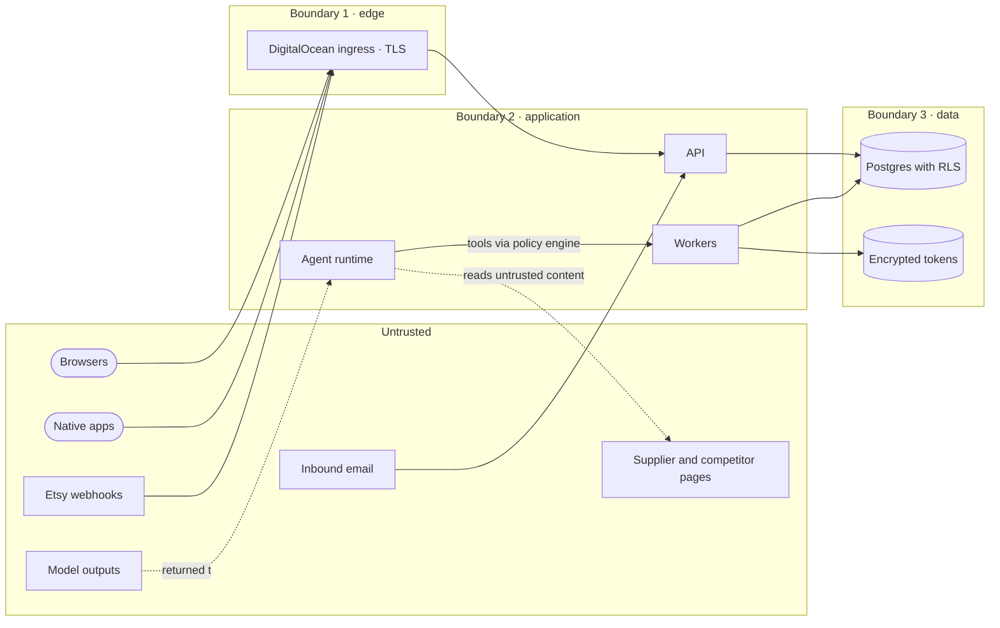

# HTCO OS — System Threat Model

| | |
|---|---|
| **Status** | Baseline 1.0; reviewed at the end of every phase |
| **Last updated** | 2026-10-14 |
| **Method** | The four questions of the Threat Modeling Manifesto; STRIDE per element; LINDDUN GO for personal data; OWASP Top 10 for Agentic Applications (2026) for the agent layer |
| **Standards** | OWASP ASVS 5.0 Level 2 (plus pulled-forward items, see ER-SEC-11), OWASP AISVS 1.0 for AI components, OWASP Multi-Tenant Security Cheat Sheet |

Each feature adds its own one-page threat model in `docs/features/<feature>/security.md`. This document is the system baseline those pages build on.

## 1. What are we working on?

### Assets

| Asset | Why it matters |
|---|---|
| Etsy OAuth tokens and API keys | Full control of a shop's listings and orders |
| Buyer personal data (names, addresses, messages) | Privacy law, Etsy terms, trust |
| Money figures and supplier mappings | Wrong numbers lead to losses; a swapped supplier mapping redirects purchases |
| Approval decisions and audit log | The basis of accountability for autonomous work |
| Model provider keys and budgets | Direct financial exposure |
| Agent policies, prompts and memory | Control over what agents do |
| Owner account and MFA factors | Root of trust for everything above |

### Trust boundaries

## 2. What can go wrong? (STRIDE)

| # | Element | Threat (STRIDE) | Control | Verification |
|---|---|---|---|---|
| T1 | API, data | **Information disclosure**: one tenant reads another tenant's data (IDOR, missing filter) | Server-side authorization from the verified identity; RLS with `set local` claims; tenant IDs from clients are only selectors | Two-tenant test matrix over every route; pgTAP RLS tests on every table; `rls_enabled` inventory test |
| T2 | Webhook endpoint | **Spoofing / tampering**: forged or replayed Etsy or email webhooks | Standard Webhooks signature on the raw body; 5-minute timestamp tolerance; inbox unique on event ID | Tests with invalid, expired, replayed and modified payloads |
| T3 | Order ingest | **Tampering / repudiation**: duplicate events inflate sales or duplicate work | Idempotent upserts keyed by external IDs; `updated_timestamp` comparison; audit | Replay 10× test; out-of-order test |
| T4 | Agent runtime | **Elevation of privilege**: a model requests a tool it is not allowed to use | Deny-by-default policy engine per call; capabilities per agent profile; tenant and actor from the run | Unauthorized tool call denied and audited, even when the model insists |
| T5 | Agent inputs | **Tampering** (prompt injection) through product pages, emails or messages | Untrusted content kept in data fields and marked; Rule of Two; no tools in quarantined extractors; schema-validated outputs; approvals for external effects | Injection fixture corpus in CI asserts no side effect and no permission change |
| T6 | Tokens and keys | **Information disclosure**: OAuth or API secrets leak through logs, repos, clients or prompts | Application-level encryption of tokens; secrets only in environment stores; log redaction; secret scanning | Log-scan test for token patterns; gitleaks on every push; tokens never present in tool results |
| T7 | Outbox, Etsy writes | **Tampering / repudiation**: duplicate external writes (two shipment emails to a buyer) | Outbox with unique idempotency keys; re-read before non-idempotent writes; human confirmation for shipment writes | Crash-between-steps tests; replay of outbox delivery |
| T8 | Amir (Debugger & Reliability Engineer) | **Elevation of privilege**: an automatic fix changes money, permissions or production code | Allowlisted, reversible remediations only; everything else needs approval or a developer | Attempted non-allowlisted remediation is blocked |
| T9 | Workers and queue | **Denial of service**: poison messages, retry storms, backlog | Bounded retries with backoff and jitter; dead-letter state; per-shop locks; alerts on queue age | Poison message lands in dead-letter; backlog alert test |
| T10 | Model gateway | **Denial of service (financial)**: runaway agent loops or prompt amplification | Budget reservation before calls; caps per task, employee, shop and day; per-employee routing policies; recursion limits; kill switch | Cap reached → call refused; loop test hits recursion limit |
| T10a | Registry (employees, tools, automations) | **Tampering**: a profile or grant changed outside review widens an employee's access | Registry changes only through reviewed pull requests; the registry check refuses unknown tools, unknown automations and grants to automations not callable as agent tools; profile versions recorded on every session; employees have no tool that edits the registry | `tests/tools/test_registry_files.py`; `registry.read` is the only registry tool |
| T10b | Engineering employees (Alex, Amir, Iris) | **Elevation of privilege / repudiation**: the office changes its own code, tests or permissions | Work only through pull requests; CI, review and the owner's release gate; test-integrity check fails a weakened test; no tool that merges, deploys or edits permissions; every change linked to an engineering request | Scenario I (Phase 19) |
| T10c | Decision Advisor | **Elevation of privilege**: an advisor's answer used as an authorization | Advisors answer typed triage and ranking questions only; access decisions never take advisor input; schema validation; fallback chain | `test_advisor_answers__never_change_authorization` |
| T10d | Office view | **Spoofing (of state)**: the office shows invented or inferred activity | The office renders only activity records and verified states; offline worker means read-only office | FR-OFC-01, FR-OFC-02 tests (Phase 15) |
| T10e | Automation triggers | **Tampering / replay**: a replayed or forged trigger repeats a business action | One entry point with authorization; executions unique per idempotency key; inbox for external events | Scenario G |
| T11 | Web client | **Spoofing / information disclosure**: XSS steals sessions, clickjacking | BFF with `__Host-` HttpOnly cookies; CSP; `frame-ancestors 'none'`; output encoding; CSRF header | Cookie attribute tests; CSP header test; CSRF rejection tests |
| T12 | Native clients | **Information disclosure**: stolen device, deep-link hijack, clipboard and screenshot leaks | Keystore or Credential Locker; verified App Links; re-authentication for high-risk approvals; masked PII | Platform security test checklist per release |
| T13 | Supply chain | **Tampering**: a compromised dependency, action or image | Pinned versions with minimum release age; SHA-pinned actions; scanners; SBOM | Renovate policy; zizmor and actionlint in CI |
| T14 | Owner account | **Spoofing**: account takeover | Mandatory TOTP; leaked-password protection; session limits; new-device sign-in recorded (Phase 3) and emailed (Phase 6) | MFA-required tests on owner-only routes; new-device notification test |
| T15 | Audit log | **Repudiation**: actions without a trace or edited history | Append-only schema with no update or delete grants for application roles | Grant test; audit written for every money, permission, publishing and approval action |
| T16 | Backups and restore | **Denial of service / information disclosure**: data loss, or restored data crossing tenants | Daily backups, media backup job, restore drills, tenant checks after restore | Restore drill record before production data is relied on |
| T17 | Browser worker (later) | **Elevation of privilege**: automated browser used to reach internal services or act beyond scope | Separate container, outbound allowlist, no internal network, URL and action allowlists, stops at CAPTCHA and MFA | Isolation test before enabling (ADR required) |

## 3. Agent-specific risks (OWASP Top 10 for Agentic Applications, 2026)

| ID | Risk | HTCO control |
|---|---|---|
| ASI01 | Agent goal hijack | Untrusted content in data fields with spotlighting; goals come only from tasks created by authorized actors |
| ASI02 | Tool misuse and exploitation | Narrow typed tools only (no generic HTTP, SQL or shell); strict schemas; policy check on every call |
| ASI03 | Identity and privilege abuse | Separate service identity per employee and per automation; tenant and actor taken from the run; least-privilege database roles; tool grants per employee in the registry |
| ASI04 | Agentic supply chain | Pinned agent framework and SDK versions; no third-party tool servers in production without review; prompts and policies versioned in the repository |
| ASI05 | Unexpected code execution | No code-execution tools; no `eval`; browser worker isolated |
| ASI06 | Memory and context poisoning | Memory writes only through validated code paths with source, shop, confidence and expiry; memory scoped per tenant |
| ASI07 | Insecure inter-agent communication | Handoffs through database events and resource references, authorized like any other write |
| ASI08 | Cascading failures | Circuit breakers per provider; bounded retries; dead-letter; budgets |
| ASI09 | Human-agent trust exploitation | Approvals show the raw action, parameters, evidence and diff, not just an agent's summary; what was shown is logged with the decision |
| ASI10 | Rogue agents | Global, per-employee and per-automation kill switches (tested); behaviour baselines from evals; Noa's independent supervision; each profile has a version, an owner and a review date |

## 4. Privacy (LINDDUN GO summary)

| Threat type | Where it applies | Control |
|---|---|---|
| Linking and identifying | Buyer data across shops and orders | Data minimization; buyer data stays shop-scoped; no cross-shop buyer profiles |
| Data disclosure | Logs, exports, model prompts, support views | Masking by default; export permission plus audit; PII masked before model calls unless required |
| Unawareness | Buyers do not know HTCO processes their data | Processing limited to fulfilling and servicing their orders, as Etsy's terms allow; privacy notice for the owner's business |
| Non-compliance | Retention beyond need; marketing use of buyer data | Retention policy per data class; consent ledger; no marketing lists from Etsy buyer data |

## 5. What are we going to do about it?

Controls are built into the phases where the risk first appears:

| Phase | Controls delivered |
|---|---|
| 1 | Secret scanning (gitleaks), dependency and static-analysis scans, SHA-pinned actions, error envelope without internals, structured logs without PII, error monitoring with PII scrubbing; exception messages from libraries (a database error's DETAIL line can quote a buyer row) are replaced by their type and SQLSTATE in logs and Sentry (`htco_platform.scrubbing`, slice 5.9) |
| 2 | RLS and authorization model, MFA enforcement, audit schema, two-tenant test matrix |
| 3 | BFF sessions, CSRF, CSP and security headers, step-up re-authentication, password reset and MFA recovery, new-device sign-in records |
| 4 | Token encryption, OAuth state and PKCE, capability probes |
| 5 | Webhook verification and rate limits, inbox and outbox, idempotency keys, dead-letter, queue alerts, restore and kill-worker drills; the Action Gateway as the single path for actions (Scenario H at the gateway), secret types that cannot serialize, no tool output that can carry a secret |
| 6 | Security notifications by email (new device, MFA change, shop connected or disconnected) |
| 7 | Approvals with server-side re-checks, policy engine, self-approval prevention |
| 8 | Agent controls ASI01–ASI10, tool bridge and registry, injection corpus, kill switches, validated memory writes |
| 8A | Browser environments ([ADR-0020](../adr/0020-per-shop-browser-environment.md)): sealed profiles, one engine per profile (advisory lock), no OAuth tokens in browser workers, URL and action allowlists per recipe, page content as untrusted data, challenges to a person, fixed egress checked by preflight, dependency allowlist (no stealth or proxy packages), Etsy actions only inside the recorded scope with flags off by default |
| 8B | Authenticator ([ADR-0021](../adr/0021-authenticator-service.md)): TOTP secrets sealed by the vault, single-use injection grants, replay protection per period, rate limits, step-up for views, audit of every use, model-input scanner for codes and secrets |
| 9 | Budgets, per-employee routing and data classes, PII masking before model calls, Decision Advisor isolation |
| 10 | Supervision: monitors cannot be disabled by employees; findings close only on evidence |
| 19 | Engineering safety: Scenario I; no self-granted permissions |
| 10 | Media backup job and restore test |
| 12 | Inbound email quarantine and attachment policy |
| 16 | External security review against ASVS L2, restore drill, incident response runbook |

## 6. Did we do a good enough job?

At the end of every phase: re-read this page, add new elements and threats, confirm each control in the phase has a passing test, and record residual risks in [ASSUMPTIONS.md](../product/ASSUMPTIONS.md) with an owner.

## 7. Additions for the unified execution architecture (2026-10-23)

| Asset or element | Threat | Control | Phase |
|---|---|---|---|
| Browser profile (cookies, sessions) | Theft gives a live Etsy session | Sealed at rest under the browser worker's own key ring, bound to its organization, shop and environment; kept in `app.browser_profile_archives`, which only the `htco_browser` role reaches (no Storage key in the worker); unpacked only in tmpfs for one session and wiped after it; the role has no right on `shop_integrations` or any token; the browser worker logs in as its own role (a member of `htco_browser` only, password set out of band), never as `postgres` with `set role`, so a compromised browser process cannot `reset role` | 8A (8A.1 built) |
| Shop password and TOTP secret | Exposure lets an attacker sign in as the shop | Vault sealing with associated data; grants bound to one execution; never in prompts, logs or tools | 8A, 8B |
| TOTP code view | Shoulder-surfing, scraping by malware in the owner's browser | Step-up, per-period fetch, `no-store`, rate limits, audit | 8B |
| Browser agent | Prompt injection from Etsy pages, buyer messages or partner sites | Recipe allowlists, quoted page content, schema-validated outputs, no secret in model input | 8A |
| Knowledge base (RAG) | Cross-tenant retrieval; buyer PII embedded; retrieved text steering an employee; poisoned sources | pgvector in our Postgres under RLS by organization and shop, with the filter in the same SQL statement as the ranking (pgTAP, zero-leakage eval). The worker's RLS is organization-wide, so a search's shop scope comes only from the task's session and a model-supplied scope is rejected. A source-kind allowlist of owner-written content only (policies, FAQs, listings, products): no buyer message and no reply text of any kind in v1; deterministic redaction plus gateway masking of chunks and queries; quarantine on a residual hit. Ingestion under the `knowledge-ingest` system policy (`max_data_class = internal`). Retrieved text quoted as data with provenance; injection corpus tested; `tsquery` only through `websearch_to_tsquery` or `plainto_tsquery`, length-capped; search records hold a keyed query hash (HMAC) only ([ADR-0024](../adr/0024-knowledge-base-and-retrieval.md)) | 9 (9.10) |
| Model routing modes | A pinned model silently swapped; an employee raised above its cap; a mode changed by someone other than the Owner | Pinned calls keep every control (gateway, budget, masking, recording, limits) and use only the fallbacks the policy names, or stop. Assessed difficulty is clamped at `max_tier`. Only the Owner changes a mode (`aal2`, step-up, audited, negative tests) ([ADR-0023](../adr/0023-routing-modes-and-difficulty-assessment.md)) | 9 (9.3, 9.8) |
| Browser provider (contract) | A provider that disguises the browser, or that reaches tokens, secrets, the database or the network around the controls; a provider whose code we did not review; business logic coupled to Chromium | `BrowserController` stays the only entry point, and a provider gets only what the contract passes: no OAuth token, no Secret Broker, no database role, egress only through `NetworkProvider`, and a secret only as a one-use value for one field. Only `managed-chromium` is enabled; the provider is chosen per environment, Owner-only and audited. One shared contract suite per layer, and the capabilities checked, not trusted. Import contracts keep Playwright and Browser Use in the browser worker and the model SDKs in the gateway. Any future provider must implement the contract and pass the same gates ([ADR-0025](../adr/0025-browser-and-network-providers.md) §1) | 8A (8A.2a) |
| Browser configuration | A setting that makes shops look like different devices (User-Agent, screen, time zone, geolocation); settings that conflict; drift between sessions; one Chromium update breaking every shop | One platform baseline for every shop and one pinned Chromium; only the locale, language and egress set per shop. Never-configurable keys refused at save and at session start. Versions changed by the Owner or an Admin with step-up, audited, never by an agent or automation. Each session records its configuration, Chromium and egress versions, and drift raises a finding. A canary check and kept pre-update archives before a fleet update (ADR-0025 §2; AC-8A.2.10 to AC-8A.2.13) | 8A (8A.2b) |
| Browser dispatch (job and outcome) | A forged or replayed browser job runs an action without authorization, or changes what runs; a run after a kill switch, a flag change, an approval's revocation or a deadline; a lost write re-sent; a tampered outcome; a session setting used to pick another organization | The job is a locator only (execution ID and attempt). The binding and the request are loaded from the stored claim. `start_browser_run` derives the execution and the organization from the job leased with the caller's token, never from `htco.organization_id`. Only the caller whose `insert … on conflict do nothing returning` created the `started` row gets the binding and a run token, so a redelivered job gets nothing. `finish_browser_run` takes that run token, independent of the queue lease, and a lease heartbeat keeps live runs from being redelivered. Approvals are re-checked for every Etsy browser action, reads included (D-16). The browser worker re-checks the claim (`DISPATCHED`, same request hash) and the deadline, status, flag, scope and every kill switch before acting. For every approval-gated run (every Etsy browser action, reads included) it also re-checks the approval, read-only. Revoking an approval cancels the dispatched action in the same transaction (`approval_revoked`), unless its attempt has already started. Cancellation and start are serialized on the action execution's row, and an attempt that has started is handed to a person, never silently cancelled. A deadline watchdog, enqueued at dispatch, resolves runs that were never claimed or were dead-lettered. Only the watchdog sets `interrupted`, by time, at the deadline plus grace, which is at least the session's maximum duration, and under the profile lock. A redelivered job never does, because a partition can free the lock while a session still acts. So a slow live session never writes after a person has redone the work. A durable started marker is committed before any approval-gated run or write touches a page, so a redelivered job never runs a started attempt twice. A started write with no outcome goes to a person for reconciliation. Outcomes are idempotent per execution and attempt; the resume validates them against the action's schema and verifies them. The `htco_browser` role cannot write action executions or approvals (pgTAP) (ADR-0025 §3; AC-8A.2.14 to AC-8A.2.19) | 8A (8A.2c) |
| CDP connection and private network | A debugging endpoint that another session, a page or a process can reach gives full control of a signed-in browser, across organizations, because sessions share a worker. A page that reaches the worker's own services or the cloud metadata endpoint, through a redirect, a subresource, a WebSocket, IPv6 or DNS rebinding | CDP on a pipe only (`--remote-debugging-pipe`): no TCP or loopback port and no WebSocket URL. A Browser Use version that needs a CDP URL is not adopted. Egress rules, after DNS resolution, for Chromium's own OS user drop loopback, private, link-local and multicast addresses on IPv4 and IPv6, and the controller refuses such IP-literal hosts. Tests cover session A versus B, DNS rebinding, and a redirect to loopback or to the metadata endpoint (AC-8A.2.5, AC-8A.2.20) | 8A |
| Per-shop egress | A shop silently on the wrong IP; an egress used to disguise linkage; proxy or VPN services | `NetworkProvider` with shared egress by default and an optional HTCO-owned static IP per shop; a consistency check before every session (`egress_mismatch`), the egress ID recorded per session, owner-only audited changes, and no proxy-service or VPN client (AC-8A.3.4 to AC-8A.3.7; D-18) | 8A |
| Browser Use model calls before Phase 9 | Provider keys in the browser worker; unbounded spend; buyer PII in prompts or screenshots; the agent steered by page text | Calls only through the Model Gateway with a short-lived per-run token; provider API hosts blocked from the browser worker; the pinned `browser-agent-default` alias with no fallback; hard caps reserved before each call; DC1 masking, and no screenshot of any signed-in page (a recipe's declaration is not a guarantee); recording; five kill switches; the 8A.7 guards (AC-8A.6.3 to AC-8A.6.9) | 8A (8A.6) |
| Valkey (if added) | Loss or tampering of shared state; buyer data in a cache | Only a limiter and a cache behind existing ports; never durable state, buyer data or secrets; TLS and authentication. Limiter keys are per upstream bucket (the Etsy app credential, shared by every organization), cache keys per organization, and every key has a TTL. It fails closed: losing it pauses Etsy calls, never splits the shared limit across per-worker fallbacks, and switching back to Postgres is one recorded operator action for every worker (ADR-0025 §6) | 8A.8 or 10 (conditional) |
| Browser Live View (ADR-0026) | The frames of a signed-in session leak to someone without the right; a stolen viewing ticket; the WebSocket hijacked from another origin; frames stored or sent to a model; a secret visible while it is typed | Frames go through the backend relay only, never over CDP. Each viewer needs a single-use, 60-second ticket bound to user, organization, shop and session, plus an `Origin` check. Frames of any signed-in page go only to buyer-data viewers, whatever the recipe declares. Frames are held in memory only, and no frame goes to a model. The stream pauses while a secret is typed. Every view is audited (AC-8A.11.1, 11.2) | 8A (8A.11) |
| Human Takeover (ADR-0026) | Someone without the right controls a signed-in shop session; a Controller reaches the owner's whole seller account (refunds, coupons, Ads, deletions, money and account pages) outside the gateway; a person and the agent act at once; the run resumes on a changed page and repeats a write; keystrokes leak; a disconnect or crash leaves a half-done state | `CONTROL_BROWSER_SESSION` with `aal2` and a step-up: the Owner for any purpose, and an Admin only for sign-in, MFA, a challenge or a stuck step (D-25). A deny-by-default path scope per purpose, with the W3, money and account pages blocked for every Controller (AC-8A.11.13). One leased Controller with a timeout and a maximum duration. One input gate, with the agent paused at a safe point. A closed set of typed events, with no raw CDP. Return Control re-checks the page, permissions, flags, kill switches and D-16 approvals. The same attempt resumes with its run token, and an uncertain write goes to a person. Keystrokes are never logged or stored. A disconnect keeps the run paused, and a crash resolves through the started marker and the watchdog. Every takeover is audited (AC-8A.11.3 to 11.10) | 8A (8A.11) |
| Etsy account standing | A browser action outside Etsy's approval leads to suspension of the shop and related shops | Scope table filled in by the owner, flags off by default, written confirmation before writes, global kill switch, challenge counter | 8A |
| Action Gateway | A bypass (an adapter called directly) skips approvals and audit | The Etsy adapter refuses every method except GET; Scenario H at the gateway. The architecture test `tests/architecture/test_gateway_bypass.py` lets only the composition roots import the adapter, keeps every direct call of an adapter operation on a documented list (the gateway path, or a named read bypass from the [2026-10-23 architecture audit](../reviews/2026-10-23-architecture-audit.md)), and lets an operation that sends a write (any write flag but a literal `False` handed to the adapter's pinned choke point `_request` → `_send`) be referenced only from the gateway's API channel; references count whether called or not (aliases, callbacks, `partial`, `getattr` with a written name; any other `getattr` fails closed), and only the adapter names Etsy's shop API host. The scan is static and by name: dispatch beyond those forms is out of its reach | 5, 6 |
