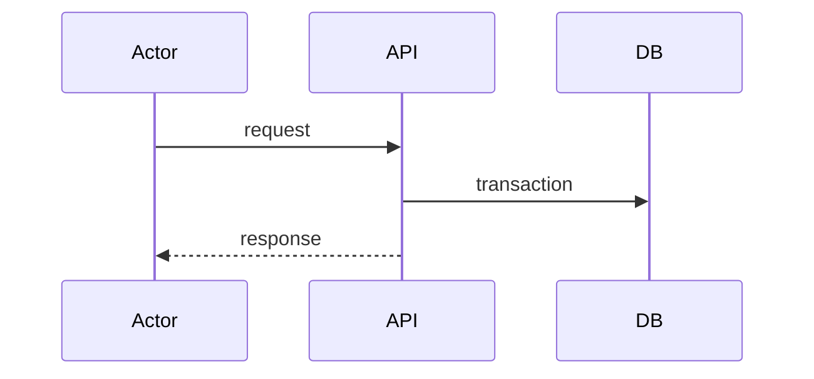

# <Feature name> — Design

## Components and layers

| Layer | Module | Responsibility |
|---|---|---|
| Domain | `htco_domain.<context>…` | … |
| Application | `htco_application.<context>…` | Use cases, ports |
| Adapters | `htco_persistence…`, `htco_integrations…` | … |
| Transport | `apps/api…`, `workers/…` | … |

## Contracts

- **Endpoints:** `METHOD /v1/…` — request, response, errors (see `packages/contracts/openapi.yaml`).
- **Events:** `context.fact.v1` — producer, consumers (see `docs/architecture/EVENT_CATALOG.md`).
- **Tables:** `app.…` — columns that matter, constraints, indexes, RLS policy (see `docs/architecture/DATA_MODEL.md`).

## Flow

## State machine

<Only if the feature owns a lifecycle: states, transitions, guards.>

## Decisions and alternatives

| Decision | Alternatives considered | Why |
|---|---|---|
| … | … | … |

Link ADRs for anything structural.
