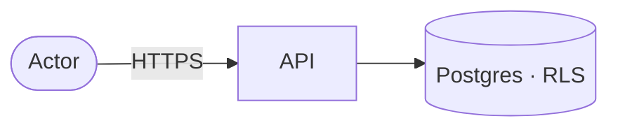

# <Feature name> — Security

## Data flow and trust boundaries

## Threats (STRIDE)

| Element | Threat | Control | Test |
|---|---|---|---|
| … | Spoofing / Tampering / Repudiation / Information disclosure / Denial of service / Elevation of privilege | … | `test_…` |

## Personal data (LINDDUN, if the feature touches personal data)

| Data | Class (DC0–DC4) | Who can see it | Retention | Masking |
|---|---|---|---|---|

## Agent risks (if agents are involved)

- **Rule of Two:** untrusted input [yes/no] · sensitive data [yes/no] · external effect [yes/no] → <how at most two hold, or which approval covers the third>
- **OWASP Agentic risks addressed:** ASI0x …

## ASVS 5.0 requirements covered

| Requirement | How it is met | Evidence |
|---|---|---|
| v5.0.0-8.4.1 | … | `test_…` |
