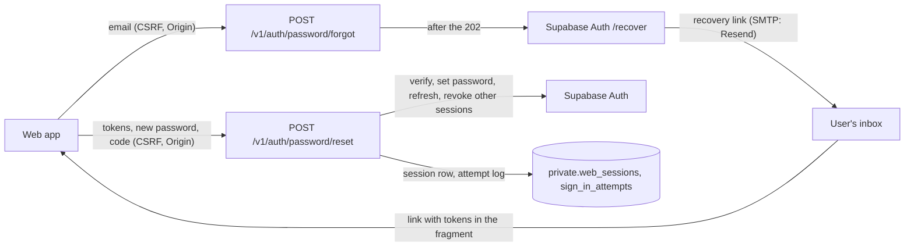

# Web sign-in (BFF) — Security

The design-level threat model for the BFF is in [ADR-0006](../../adr/0006-web-auth-bff.md) and the [threat model](../../architecture/THREAT_MODEL.md); this page records the threats of the password reset (slice 3.5 part 3) and of the failure throttles shared by every credential check.

## Data flow

Trust boundaries: the browser and the inbox are untrusted; the API and Supabase Auth are trusted; Resend is a sub-processor that sees the email address and the link.

## Threats (STRIDE), slice 3.5 part 3

| Element | Threat | Control | Test |
|---|---|---|---|
| Forgot endpoint | Information disclosure: account enumeration through the answer | Always 202 with an empty body and the same headers; Supabase's errors are swallowed and logged; the email is sent after the response, so timing does not depend on the account | `test_forgot__unknown_email__the_same_answer`, `test_forgot__supabase_fails__still_202_and_logged_without_the_email` |
| Forgot endpoint | Denial of service and spam: flooding a victim's inbox, burning the SMTP quota | 5 requests per email and 20 per address in 15 minutes (the address limit shared with failed sign-ins), checked before Supabase is asked; Supabase's own email rate limit behind it | `test_admit__too_many_requests_for_one_email__throttled_from_any_address`, `test_admit__address_limit_is_shared_with_failed_sign_ins`, `test_forgot__too_many_for_one_email__429_with_retry_after` |
| Forgot endpoint | Denial of service: a parallel burst passing the per-email limit | The check and the count are one locked transaction | `test_admit__a_burst_at_once__admits_only_the_limit`, `test_admit_attempt__concurrent_burst__admits_only_the_limit` |
| Forgot endpoint | Denial of service: an attacker locking a victim out of sign-in by asking for resets | Reset requests are counted under their own key (`password-reset-request:`), never the email's sign-in key | `test_admit__requests_do_not_lock_the_emails_sign_in` |
| Forgot endpoint | Spoofing (login CSRF): a cross-site page triggering emails | `X-HTCO-CSRF` header and `Origin` / `Sec-Fetch-Site` checks | `test_forgot__fails_csrf_checks__403` |
| Reset link | Spoofing: a forged, expired or replayed link | The access token is verified like a bearer token; the refresh token is exchanged once (a used link fails); the refreshed tokens must belong to the same user; failures throttled per link and per address | `test_reset__invalid_link__refused_without_any_change`, `test_reset__used_link__refused`, `test_reset__repeated_failures_of_one_link__throttled` |
| Reset or invitation link | Tampering: replaying a used link while its access token is still valid, or racing the legitimate user with the same link, to change the password again | The link is claimed atomically (advisory lock, success row under its key, 24 hours) before Supabase is asked; a second claim is refused | `test_reset__the_same_link_twice_at_once__only_one_changes_the_password`, `test_claim_link__concurrent_claims__one_wins`,  `test_reset__replayed_link__refused_before_any_change`, `test_accept_invitation__replayed_link__refused_before_setting_the_password_again`, `test_reset__replayed_link__401_reset_link_refused` |
| Sign-in, invitation and reset links, step-up and reset codes | Spoofing and denial of service: a parallel burst of guesses passing the per-email, per-link, per-user or per-address failure limit by the number of requests in flight | Every attempt is reserved before Supabase is asked: under Postgres advisory locks on the key and the address, the failures and the attempts in flight are counted and a pending row is written in one transaction (`SessionStore.reserve_attempt`); the outcome settles it (`settle_attempt`: a refusal stays a failure, a success becomes one, anything else such as Supabase being down is dropped; a request cancelled in flight stays counted) | `test_reserve_attempt__concurrent_burst__reserves_only_the_limit`, `test_reserve_attempt__concurrent_burst_from_one_address__reserves_only_its_limit`, `test_settle_attempt__failed_is_kept_the_others_free_their_place`, `test_sign_in__concurrent_wrong_passwords__only_the_limit_reaches_supabase` (Postgres); `test_sign_in__a_burst_for_one_email__only_the_limit_reaches_supabase`, `test_sign_in__a_burst_from_one_address__only_the_limit_reaches_supabase`, `test_accept_invitation__a_burst_with_one_bad_link__only_the_limit_is_tried`, `test_reset__a_burst_with_one_bad_link__only_the_limit_is_tried`, `test_step_up__a_burst_of_wrong_codes__only_the_limit_is_verified`, `test_reset__a_burst_of_wrong_codes_over_many_links__only_the_users_limit` |
| Reset link | Elevation of privilege: a stolen inbox bypassing the authenticator app | Supabase changes the password of a user with an authenticator app only from an `aal2` session; the API asks for the code (403 `mfa-code-required`) and verifies it with the recovery session; wrong codes count against the user's code limit shared with step-up | `test_reset__authenticator_user_without_a_code__asked_for_it_and_not_counted`, `test_reset__wrong_code__refused_and_counted_for_the_link_and_the_user`, `test_reset__too_many_wrong_codes_for_the_user__throttled_before_verifying` |
| Sessions | Elevation of privilege: whoever knew the old password keeps a session after the reset | Every other active session of the user is revoked here and signed out at Supabase | `test_reset__ends_every_other_session_of_the_user_here_and_at_supabase`, `test_reset__signs_out_the_users_other_sessions` |
| Logs | Information disclosure: emails or tokens in logs | The forgot route logs only `auth.password_reset_email_sent` / `_failed`; the Supabase client's errors never carry the email; tokens are never logged | `test_forgot__sent__logged_without_the_email`, `test_send_password_reset__failure__is_an_auth_service_error` |
| Configuration | Tampering: our own misconfiguration hidden behind the generic 202 | A missing `HTCO_PASSWORD_RESET_REDIRECT_URL` answers 503 `auth-unavailable` | `test_forgot__redirect_not_configured__503` |

Known limits: a recovery link is a bearer credential until it is used or expires (Supabase's email OTP expiry); the URL fragment is never sent to a server, and the web page strips it on load. Native apps holding a bearer token from Supabase directly are not ended by the session revocation (they have no web session row); they are ended when their refresh token is refused.

## ASVS 5.0 requirements covered

| Requirement | How it is met | Evidence |
|---|---|---|
| 6.3.8 (forgot password does not reveal valid users) | Same 202 for every email; the reset needs the emailed link | forgot and reset tests above |
| 6.4.3 (reset does not bypass MFA) | `aal2` needed for users with an authenticator app | MFA reset tests above |
| 7.4.3 (terminate other sessions after a password change) | Done without asking: other sessions are revoked here and at Supabase | session revocation tests above |
| 6.1.1, 6.3.1 (brute-force protection without malicious lockout) | Per email, per address, per link and per user code limits | throttle tests above |
