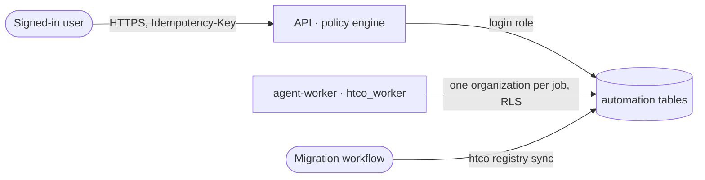

# Durable automation engine — Security

## Data flow and trust boundaries

## Threats (STRIDE)

| Element | Threat | Control | Test |
|---|---|---|---|
| Trigger route | Elevation of privilege: a role starts an automation it may not | Each definition names its `user_capability`; absent means nobody; the policy engine decides (403) | `test_start__a_role_without_the_capability__403` |
| Trigger route | Cross-tenant access through a shop ID | The shop's organization is read from the database; another organization's or an ungranted shop is 404 | `test_start__a_shop_the_user_may_not_use__404` |
| Execution keys | One tenant replaying into another's execution | User keys are prefixed with the organization; the store's unique key is per automation | `test_trigger_as_user__a_role_with_the_capability__creates_one_user_action_execution` |
| Engine | Running an automation that is not ready or not deployed | `authorize` refuses before anything is written, and logs the reason | `test_trigger__refused__nothing_written_and_the_reason_logged` |
| Executions | Tampering with the state history | The database refuses transitions outside the machine; events are append-only | `test_database__refuses_a_transition_outside_the_machine_and_event_edits`, pgTAP |
| Executions | Repudiation of an admin retry | Audited (`automation.execution_retried`) with the user, before and after | `test_admin_retry__reuses_the_dead_lettered_execution_and_is_audited` |
| Worker | Reading another organization's executions | RLS on `htco.organization_id` | `test_worker__cannot_load_another_organizations_execution`, pgTAP |
| Definitions | Unreviewed definitions | Written only by the sync from the reviewed files, with the commit; the worker and users cannot write them | pgTAP, `test_sync__*` |
| Payloads, errors | Information disclosure | Payloads are IDs and parameters (≤ 16 KB); `last_error` keeps exception types unless marked safe; executions show no payload in the API | `test_describe_error__*` |

## Personal data

None stored by the engine itself. Trigger payloads must not carry buyer contact data ([ADR-0018](../../adr/0018-order-history-and-buyer-data.md)).

## ASVS 5.0 requirements covered

| Requirement | How it is met | Evidence |
|---|---|---|
| v5.0.0-8.2.1, 8.2.2 (function and data-level access) | Policy engine per user action; RLS on executions for users and the worker | API and pgTAP tests |
| v5.0.0-8.3.1 (server-side enforcement) | Capabilities from the stored definition, never from the client | `test_trigger_as_user__*` |
| v5.0.0-15.4.1 to 15.4.3 (safe concurrency) | Unique execution key, optimistic state checks | `test_trigger__concurrently__*`, `test_execute__another_run_moved_it_first__changes_nothing` |
| v5.0.0-16.3.x (security events logged) | Refusals logged with reason and actor; admin retries audited | `test_trigger__refused__*` |
