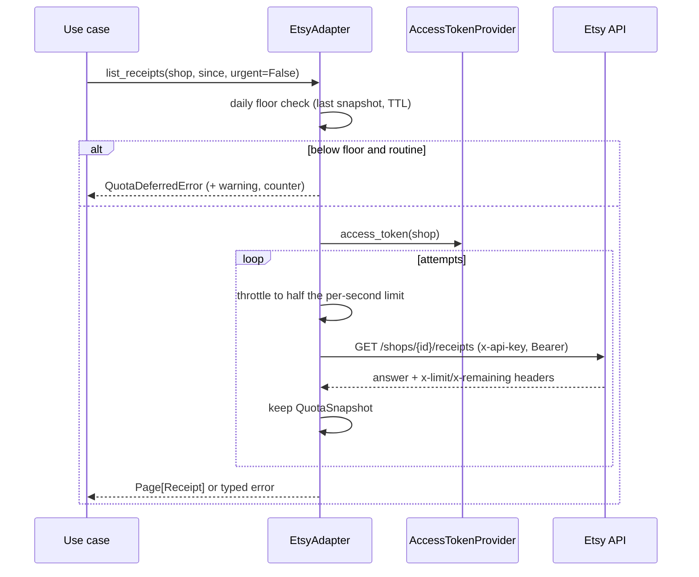

# Etsy integration — Design

## Components and layers

| Layer | Module | Responsibility |
|---|---|---|
| Application | `htco_application.marketplace` | `MarketplacePort` and `AccessTokenProvider` (protocols); value types `MarketplaceShop`, `Receipt`, `ReceiptLine`, `Listing`, `ListingState`, `MarketplaceMoney`, `Page[T]`, `QuotaSnapshot`; typed errors |
| Adapters | `htco_integrations.etsy` (new workspace package `packages/integrations`) | `EtsyAdapter` on `httpx.AsyncClient`; `EtsyCredentials`, `EtsyConfig`, `Timekeeping` |
| Platform | `htco_platform.http` | The outgoing client (timeouts, no redirects, trace propagation) the composition root passes in |
| Transport | `htco_api.settings` | `HTCO_ETSY_KEYSTRING`, `HTCO_ETSY_SHARED_SECRET`, `HTCO_ETSY_DAILY_QUOTA_FLOOR` |

`htco_integrations` sits beside `htco_persistence` and `htco_agent_runtime` in the import-linter layers contract: it imports the application layer, never another adapter. It is not wired into the API yet; slice 4.3 builds it in the composition root together with the token vault.

## Contracts

### Port

```python
class AccessTokenProvider(Protocol):
    async def access_token(self, shop_id: int) -> str: ...


class MarketplacePort(Protocol):
    async def get_shop(self, shop_id: int, *, urgent: bool = False) -> MarketplaceShop: ...
    async def list_receipts(
        self,
        shop_id: int,
        *,
        min_last_modified: datetime | None = None,
        max_last_modified: datetime | None = None,
        limit: int = 25,
        offset: int = 0,
        urgent: bool = False,
    ) -> Page[Receipt]: ...
    async def list_listings(
        self,
        shop_id: int,
        *,
        state: ListingState = ListingState.ACTIVE,
        limit: int = 25,
        offset: int = 0,
        urgent: bool = False,
    ) -> Page[Listing]: ...
    def last_seen_quota(self) -> QuotaSnapshot | None: ...
```

- IDs are Etsy's integers. Datetimes must be timezone-aware (UTC out). `limit` is 1–100, `offset` ≥ 0, and `min_last_modified` must not be after `max_last_modified`; invalid arguments raise `ValueError` before any call.
- Money stays exact: `MarketplaceMoney(amount, divisor, currency_code)`, with `as_decimal()` for arithmetic (golden rule 3).
- `Receipt` carries no buyer name, email or address; Phase 5 adds fields only when a feature needs them.

### Errors

| Etsy answer | Error | Retried |
|---|---|---|
| 401 | `MarketplaceAuthError` | No |
| 403 | `MarketplacePermissionError` | No |
| 404 | `MarketplaceNotFoundError` | No |
| 409 | `MarketplaceConflictError` | No |
| Other 4xx | `MarketplaceRequestError` | No |
| 429 | `MarketplaceRateLimitedError` (`retry_after_seconds`) | Yes, waiting `retry-after` (seconds or HTTP date), else backoff; a wait above `max_retry_after_seconds` fails at once |
| 5xx | `MarketplaceUnavailableError` (`status`) | Yes, with backoff |
| Timeout, connection or protocol failure | `MarketplaceUnavailableError` (`status=None`) | Yes, with backoff |
| 2xx with unreadable JSON or missing fields | `MarketplaceResponseError` | No |
| Daily budget below the floor (routine call) | `QuotaDeferredError` (`remaining_today`, `floor`) | Not called |

All derive from `MarketplaceError` with a `status` attribute. Backoff is `0.5 s × 2^(attempt−1)`, capped at 8 s, for at most 4 attempts (configurable). Only reads exist; Etsy writes have no idempotency and must not reuse this retry loop.

## Flow



## Rate-limit budget

- Etsy's limits are per app key, so one `EtsyAdapter` instance serves every shop and keeps one budget. (ADR-0008 decision 6 says "per shop"; the 2026-10-15 research shows the headers describe the app key. The adapter follows the research; the next ADR touching Etsy should record this.)
- **Throttle:** at most `limit_per_second // 2` calls in any one-second window (sliding, monotonic clock). Until Etsy reports a limit, `assumed_limit_per_second` (10) is used.
- **Daily floor:** each answer replaces the `QuotaSnapshot`. When `remaining_today < daily_quota_floor`, `etsy.daily_quota_low` is logged once (and counted) until the budget recovers. Routine calls are deferred while the snapshot is younger than `quota_snapshot_ttl` (15 minutes); after that one routine call may go through to refresh it, so a rolling or reset window cannot leave routine work blocked forever. A floor of 0 turns deferral off.
- **Shop card:** `last_seen_quota()` returns the snapshot (limits, remaining, observed time) for slice 4.6.

## Configuration and signals

| Setting / field | Default | Effect |
|---|---|---|
| `HTCO_ETSY_KEYSTRING`, `HTCO_ETSY_SHARED_SECRET` | unset | The app credentials (secrets, set together; required once Phase 4 connects a shop) |
| `HTCO_ETSY_DAILY_QUOTA_FLOOR` | 500 | Requests left today below which routine calls are deferred |
| `EtsyConfig.timeout_seconds` | 10 | Per-request timeout (connect, read, write, pool) |
| `EtsyConfig.max_attempts` / backoff | 4 / 0.5 s doubling to 8 s | Retries for 429, 5xx and transport failures |
| `EtsyConfig.max_retry_after_seconds` | 60 | Longer `retry-after` waits fail at once |
| `EtsyConfig.quota_snapshot_ttl` | 15 min | How long a low snapshot keeps deferring routine calls |

| Signal | Kind | Meaning |
|---|---|---|
| `htco.etsy.calls_deferred` (attribute `operation`) | OpenTelemetry counter | Routine calls deferred by the floor |
| `htco.etsy.daily_quota_low` | OpenTelemetry counter | The budget crossed below the floor |
| `etsy.daily_quota_low`, `etsy.call_deferred` | Warning log events | Same, with `remaining_today`, `floor`, `operation`, `shop_id` |
| `etsy.retry` | Info log event | One retry: `operation`, `attempt`, `status`, `wait_seconds` |

Counters use the global OpenTelemetry meter provider unless one is injected; no exporter is configured yet (SOFTWARE_DESIGN §12), so they become visible when the metrics backend is chosen.

## Decisions and alternatives

| Decision | Alternatives considered | Why |
|---|---|---|
| Adapter in a new `packages/integrations` workspace package | `packages/platform` | Platform may not import the application layer (import-linter `platform-is-infrastructure`), and SOFTWARE_DESIGN §4 already places Etsy adapters in `packages/integrations` |
| `httpx.MockTransport` for contract tests | `respx` | Not a dependency yet; MockTransport is part of httpx and is already used by the platform tests |
| Access token from an `AccessTokenProvider` per call | Token passed by each caller | Keeps tokens out of use cases; the vault (4.2) and refresh lock (4.4) plug in behind it |
| Typed errors live in the application layer | Errors in the adapter | Use cases catch them without importing an adapter |
| Snapshot TTL for deferral | Defer until an urgent call refreshes the budget | Without urgent traffic, routine work would stay blocked after the window resets |
| Lower-case receipt status | Keep Etsy's casing | Etsy's examples mix cases; one spelling simplifies Phase 5 mapping |
