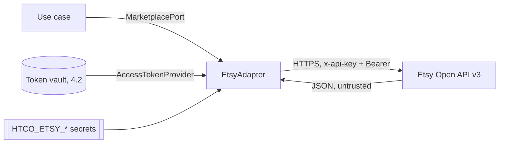

# Etsy integration — Security

Slice 4.1 adds outgoing, read-only calls to Etsy. The token vault (4.2) has its own threat table in [token vault](token-vault.md#security); the OAuth connect flow and refresh (4.3, 4.4), including ASVS V10, in [connect flow](connect-flow.md#security). This page grows with every Phase 4 slice.

## Data flow and trust boundaries

Etsy's answers cross a trust boundary: they are parsed field by field into typed values, and anything unexpected becomes `MarketplaceResponseError` instead of flowing on.

## Threats (STRIDE)

| Element | Threat | Control | Test |
|---|---|---|---|
| Credentials | Information disclosure: keystring, shared secret or access token in logs, errors or `repr` | `EtsyCredentials` fields `repr=False`; settings are `SecretStr`; error messages name only operation and status; log events carry counts, never headers or URLs; httpx loggers stay at WARNING (`htco_platform.logs`) | `test_credentials__repr__hides_both_values`, `test_errors__never_carry_credentials_or_tokens`, `_assert_no_secrets` in the quota tests, `test_etsy_settings__secrets__never_appear_in_repr` |
| Fixtures | Information disclosure: real buyer data or tokens committed with recorded responses | Hand-written fixtures with obviously fake values; a scan of every file in `tests/fixtures/` for emails, street addresses and token-shaped strings | `test_committed_fixture__is_scrubbed`, `test_find_unscrubbed__*` |
| Etsy answers | Tampering: malformed or hostile payloads | Strict per-field type checks; unknown shapes raise `MarketplaceResponseError`; no redirects followed (`htco_platform.http`) | `test_get_shop__malformed_payload__is_a_response_error_without_retry` |
| Etsy API | Denial of service (self-inflicted): exhausting the app's limits for every shop | Throttle at half the per-second limit; daily floor defers routine calls; capped `retry-after`; bounded attempts | `test_throttle__*`, `test_daily_quota_*`, `test_rate_limited__*` |
| Retries | Tampering: duplicated side effects | Only GETs exist; retries are documented as read-only, writes need their own idempotent path (ADR-0008) | — (no write exists) |
| Live shop (slices 4.5, 4.7) | Tampering / buyer notification: any HTCO request changing shop data or notifying a buyer | Only GET leaves HTCO: the adapter refuses other methods unless a per-call flag no code sets, and a client hook stops non-GET requests to the shop API | `tests/integrations/test_etsy_read_only.py` (strict mock that fails on any non-GET; source scan for the flag) |
| Capability probes | Information disclosure: buyer address or name stored or logged by the address check | Presence only (`first_line`, `city` non-blank); values dropped; details are codes (database check `^[a-z0-9_]{1,64}$`) | `test_check_receipt_addresses__fields_present__reports_presence_only`, pgTAP `07_capabilities_disconnect` |
| Re-check | Denial of service: the button spending the app's Etsy budget | Owner/Admin only, 30 s per shop cooldown (429 with `Retry-After`) | `test_recheck__within_the_cooldown__refused_with_the_wait`, `test_recheck__twice_at_once__429_with_retry_after` |
| Disconnect | Elevation / repudiation: someone else disconnects, or a disconnected shop is still called | Owner + `aal2` + step-up + CSRF; tokens deleted with the audit record in one transaction; the token provider refuses before any request | `tests/application/test_shop_disconnect.py`, `tests/api/test_capability_disconnect_routes.py`, `tests/integration/test_capabilities_disconnect.py` |

## Personal data (LINDDUN)

| Data | Class | Who can see it | Retention | Masking |
|---|---|---|---|---|
| Receipt buyer email, address, messages | DC3 | Not read: neither `Receipt` nor `OrderReceipt` carries them; the probe's address check keeps only whether the fields hold text | — | Not mapped |
| Buyer display name (first name, last initial), tracking number | DC3 | Owner, Admin, Operations, Support, live on the Orders screen ([dashboard data](dashboard-data.md#personal-data)) | In API memory at most 1 hour; never stored, logged or audited; answers `no-store` | Name shortened at the adapter; left out for Finance, Developer and Viewer |
| Review text | DC2 (public on Etsy) | Members who see the shop | In API memory at most 6 hours | Kept out of `repr` and logs |
| Shop name, listing titles, prices | DC1 (business data) | Shop members (from Phase 5 storage) | Per Etsy API Terms (no data older than 6 h / 24 h shown) | — |

## ASVS 5.0 requirements covered

| Requirement | How it is met | Evidence |
|---|---|---|
| v5.0.0-13.3.1 (secrets in a secret store, not source) | Keystring and shared secret come from `HTCO_ETSY_*` environment secrets; nothing committed | `.env.example` lists them without values |
| v5.0.0-16.2.5 (no sensitive data in logs) | No credential, token or payload in log events or exceptions | Log-capture tests above |
| v5.0.0-15.3.2 (no unexpected redirects from outbound calls) | The client from `htco_platform.http` does not follow redirects; 3xx becomes `MarketplaceResponseError` | `tests/platform/test_http.py` |
| v5.0.0-12.3.1 (TLS to external services) | Base URL is `https://openapi.etsy.com` | `ETSY_BASE_URL` |
