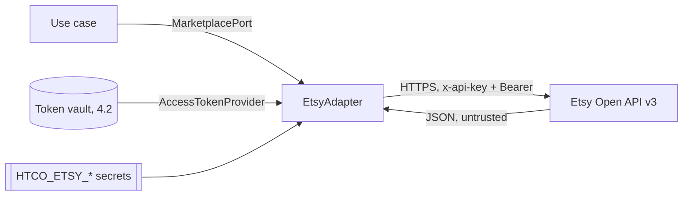

# Etsy integration — Security

Slice 4.1 adds outgoing, read-only calls to Etsy. The token vault (4.2) has its own threat table in [token vault](token-vault.md#security); the OAuth connect flow and refresh (4.3, 4.4), including ASVS V10, in [connect flow](connect-flow.md#security). This page grows with every Phase 4 slice.

## Data flow and trust boundaries

Etsy's answers cross a trust boundary: they are parsed field by field into typed values, and anything unexpected becomes `MarketplaceResponseError` instead of flowing on.

## Threats (STRIDE)

| Element | Threat | Control | Test |
|---|---|---|---|
| Credentials | Information disclosure: keystring, shared secret or access token in logs, errors or `repr` | `EtsyCredentials` fields `repr=False`; settings are `SecretStr`; error messages name only operation and status; log events carry counts, never headers or URLs; httpx loggers stay at WARNING (`htco_platform.logs`) | `test_credentials__repr__hides_both_values`, `test_errors__never_carry_credentials_or_tokens`, `_assert_no_secrets` in the quota tests, `test_etsy_settings__secrets__never_appear_in_repr` |
| Fixtures | Information disclosure: real buyer data or tokens committed with recorded responses | Hand-written fixtures with obviously fake values; a scan of every file in `tests/fixtures/` for emails, street addresses and token-shaped strings | `test_committed_fixture__is_scrubbed`, `test_find_unscrubbed__*` |
| Etsy answers | Tampering: malformed or hostile payloads | Strict per-field type checks; unknown shapes raise `MarketplaceResponseError`; no redirects followed (`htco_platform.http`) | `test_get_shop__malformed_payload__is_a_response_error_without_retry` |
| Etsy API | Denial of service (self-inflicted): exhausting the app's limits for every shop | Throttle at half the per-second limit; daily floor defers routine calls; capped `retry-after`; bounded attempts | `test_throttle__*`, `test_daily_quota_*`, `test_rate_limited__*` |
| Retries | Tampering: duplicated side effects | Only GETs exist; retries are documented as read-only, writes need their own idempotent path (ADR-0008) | — (no write exists) |

## Personal data (LINDDUN)

| Data | Class | Who can see it | Retention | Masking |
|---|---|---|---|---|
| Receipt buyer name, email, address | DC3 | Not read: the port's `Receipt` does not carry them | — | Not mapped |
| Shop name, listing titles, prices | DC1 (business data) | Shop members (from Phase 5 storage) | Per Etsy API Terms (no data older than 6 h / 24 h shown) | — |

## ASVS 5.0 requirements covered

| Requirement | How it is met | Evidence |
|---|---|---|
| v5.0.0-13.3.1 (secrets in a secret store, not source) | Keystring and shared secret come from `HTCO_ETSY_*` environment secrets; nothing committed | `.env.example` lists them without values |
| v5.0.0-16.2.5 (no sensitive data in logs) | No credential, token or payload in log events or exceptions | Log-capture tests above |
| v5.0.0-15.3.2 (no unexpected redirects from outbound calls) | The client from `htco_platform.http` does not follow redirects; 3xx becomes `MarketplaceResponseError` | `tests/platform/test_http.py` |
| v5.0.0-12.3.1 (TLS to external services) | Base URL is `https://openapi.etsy.com` | `ETSY_BASE_URL` |
