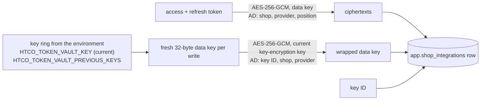

# Etsy integration — Token vault (slice 4.2)

The token vault keeps each shop's Etsy OAuth tokens encrypted at the application level, so a database dump, a backup or a mistaken query alone exposes no token ([phase 4](../../plan/phases/phase-04-etsy-connection.md), [ADR-0008](../../adr/0008-etsy-integration.md), [SOFTWARE_DESIGN §10.3](../../architecture/SOFTWARE_DESIGN.md#103-secrets-and-keys), data class DC0 in [DATA_MODEL](../../architecture/DATA_MODEL.md)). The connect flow (slice 4.3) stores tokens through it, refresh (4.4) updates them, disconnect (4.7) deletes them. This slice adds no endpoint.

| AC | Status |
|---|---|
| AC-4.2.1 Reading `shop_integrations` directly in SQL shows no plaintext token | Done |
| AC-4.2.2 Rotating the encryption key re-encrypts stored tokens without downtime (two keys) | Done |
| AC-4.2.3 Tokens never appear in logs, errors or API responses (log-capture test) | Done (no endpoint returns tokens; see Tests) |

## Design

### Envelope encryption



- `htco_platform.crypto.KeyRing` holds the key-encryption keys: the current key wraps new data keys, previous keys only unwrap. `EnvelopeSealer` seals a list of values with a fresh data key per call, opens them, and `rewrap`s a row's data key under the current key without touching the ciphertexts.
- Every stored part uses the existing `Sealer` layout: version byte `1`, 12-byte random nonce, ciphertext and tag. The database refuses a value that does not start with the version byte (`shop_integrations_sealed_check`), so a plaintext token cannot be written by accident.
- Associated data binds the parts to their row: the wrapped key to its key ID, shop ID and provider; each ciphertext to the shop ID, provider and its position. An envelope copied to another shop's row, a relabelled key ID, or the access and refresh ciphertexts swapped all fail to open.
- Each write (connect, reconnect, refresh) generates a new data key, so rows also move to the current key as tokens are refreshed (every hour for an active shop).

### Table `app.shop_integrations`

Migration `supabase/migrations/20261015140000_shop_integrations.sql`. One row per shop and provider (`unique (shop_id, provider)`), with the composite foreign key `(shop_id, organization_id) → app.shops` keeping the row inside its organization.

| Column | Type | Notes |
|---|---|---|
| `id` | `uuid` | Primary key (UUIDv7 from the API) |
| `organization_id`, `shop_id` | `uuid` | Tenant and shop; cascade on shop delete |
| `provider` | `text` | `etsy` (mirrors `IntegrationProvider`) |
| `etsy_shop_id`, `etsy_user_id` | `bigint` | Etsy's IDs, positive |
| `key_id` | `text` | ID of the key-encryption key wrapping `wrapped_data_key`; `[A-Za-z0-9._-]{1,32}` |
| `wrapped_data_key` | `bytea` | The row's data key, sealed by the key-encryption key |
| `access_token_ciphertext`, `refresh_token_ciphertext` | `bytea` | Sealed tokens; there is no plaintext token column |
| `scopes` | `text[]` | Granted scopes |
| `access_expires_at`, `refresh_expires_at` | `timestamptz` | Token expiry (1 hour and 90 days at Etsy) |
| `status` | `text` | `connected`, `needs_reauth`, `disconnected` (mirrors `IntegrationStatus`) |
| `failure_count` | `integer` | Failed refreshes since the last success (slice 4.4 marks `needs_reauth` after three) |
| `last_successful_call_at` | `timestamptz` | Shown on the shop card |
| `created_at`, `updated_at` | `timestamptz` | `updated_at` set by trigger |

`shop_integrations_tokens_check`: a `disconnected` row holds no key ID, wrapped key, ciphertext or expiry; any other status holds all of them.

Access: RLS is on. The sealed columns and `key_id` are granted to no client role; only the API's login role (the table owner) reads them, so `select *` as a user fails. `authenticated` may select the other columns, and the `shop_integrations_select` policy limits rows to organizations where the caller is Owner or Admin (for the shop card in slice 4.6). No client role may insert, update or delete; `anon` and `service_role` have nothing.

### API surface

Port in `htco_application.shop_integrations` (`TokenVault`), adapter `htco_persistence.shop_integrations.PostgresTokenVault(database, EnvelopeSealer(key_ring))`:

| Method | Does |
|---|---|
| `store(connection: EtsyConnection) -> ShopIntegration` | Connect or reconnect: upsert by shop and provider, new envelope, status `connected`, failures reset, scopes replaced |
| `load(shop_id) -> ShopIntegration \| None` | The row with tokens opened (`tokens` is `None` once disconnected); raises `TokenVaultError` naming the shop only |
| `update_tokens(shop_id, tokens: OAuthTokens) -> bool` | After a refresh: new envelope, failures reset; `False` if the shop is no longer `connected`, so a refresh finishing after a disconnect never restores tokens |
| `record_refresh_failure(shop_id) -> int` | Increment and return `failure_count` |
| `record_successful_call(shop_id, *, at)` | Set `last_successful_call_at` |
| `mark_needs_reauth(shop_id)` | Status `needs_reauth` (tokens kept until reconnect or disconnect) |
| `disconnect(shop_id)` | Delete key ID, wrapped key, ciphertexts and expiry; status `disconnected`; the row stays |
| `rotate_keys(*, batch_size) -> int` | Re-wrap every row on a previous key (see Operations) |
| `rotate_batch(*, limit) -> int` | One batch of the above, in one transaction with the rows locked (adapter only) |
| `key_usage() -> dict[str, int]` | Rows per key ID (IDs are not secret) |

`OAuthTokens`, `EtsyConnection` and `ShopIntegration` are frozen dataclasses whose token fields are excluded from `repr`.

## Security

| Threat | Mitigation | Test |
|---|---|---|
| Database dump, backup or SQL access reveals tokens | Application-level envelope encryption; keys only in the API's environment | `test_store_then_load__round_trips_and_the_row_holds_no_plaintext_token` (AC-4.2.1, searches the row text for the token in plain, hex and base64 form) |
| A user reads tokens through the API's user-scoped transactions | Sealed columns not granted to `authenticated`; RLS limits rows to Owner/Admin | pgTAP `05_shop_integrations.test.sql` |
| Swapping a sealed envelope into another shop's row | Associated data binds every part to shop, provider, position and key ID | `test_load__ciphertext_moved_to_another_shops_row__fails_without_showing_a_token`, `test_open__*` in `tests/platform/test_envelope.py` |
| Tokens or keys in logs, errors, reprs | `repr=False` fields, `SecretStr` settings with `hide_input_in_errors`, errors name only the shop or key ID, the vault logs only counts and key IDs | `test_vault_operations__never_log_a_token`, `test_reprs__*`, `test_vault_error__carries_no_token`, `test_token_vault_keys__invalid__name_the_setting_but_never_the_value`, `test_main__vault_keys__turn_the_vault_on_and_never_reach_the_log`, `test_rotate__invalid_key__configuration_error_without_the_value` |
| Key compromise | Rotation to a new key without downtime; previous key removed afterwards | `test_rotation__rows_on_key_a_stay_readable_while_it_runs_and_end_on_key_b` (AC-4.2.2) |
| Lost key | Rows on that key cannot be opened; the owner reconnects the shop (tokens are re-issued by Etsy) | Runbook below |

ASVS 5.0 (chapter level; exact requirement IDs to be confirmed in the phase security review): V11 Cryptography (key inventory with key IDs, rotation, AES-256-GCM authenticated encryption with associated data), v5.0.0-13.3.1 (secrets from a secret store, never in code), V14 Data protection and V16.2 Logging (no tokens or keys in logs or errors).

## Tests

| AC | Tests |
|---|---|
| AC-4.2.1 | `tests/integration/test_token_vault.py::test_store_then_load__round_trips_and_the_row_holds_no_plaintext_token`, `::test_store__reconnecting__updates_the_one_row_with_new_tokens_and_scopes`; pgTAP `supabase/tests/database/05_shop_integrations.test.sql` (bytea columns, no text token column, grants, RLS, constraints) |
| AC-4.2.2 | `tests/integration/test_token_vault.py::test_rotation__rows_on_key_a_stay_readable_while_it_runs_and_end_on_key_b` (rows on key A stay readable for the rotating configuration and for one with key A alone; a refresh during rotation writes with B; afterwards every row is on B and opens with B alone), `::test_key_usage__counts_rows_per_key_id`; `tests/platform/test_envelope.py::test_previous_key__still_opens_and_rewrap_moves_to_the_current_key`; `tests/api/test_cli_rotate.py` |
| AC-4.2.3 | `tests/integration/test_token_vault.py::test_vault_operations__never_log_a_token` (DEBUG log capture), `tests/application/test_shop_integrations.py`, `tests/platform/test_envelope.py::test_reprs__show_key_ids_but_never_keys_or_plaintext`, `tests/api/test_settings.py::test_token_vault_keys__*`, `tests/api/test_token_vault_wiring.py`. No endpoint returns tokens in this slice; slice 4.3 adds the API-response check for its endpoints |

Database tests run in CI's `database` job (`just test-db`, `just db-test`); they need Docker locally.

## Operations

### Configuration

| Setting | Value | Effect |
|---|---|---|
| `HTCO_TOKEN_VAULT_KEY` | Secret: `<key ID>:<32 random bytes, base64>` | Turns the vault on (`etsy_token_vault` in `api.starting`). Unset or blank: the API starts with the Etsy integration off |
| `HTCO_TOKEN_VAULT_PREVIOUS_KEYS` | Secret: comma-separated entries in the same format; blank normally | Keys that still open rows during a rotation |

Both come from GitHub Actions secrets of the same names through `.github/workflows/deploy.yml` into `infra/digitalocean/app.yaml` (type `SECRET`). An invalid value stops the API at startup with exit code 78, naming the setting but never the value.

Create the key (the owner, once, before slice 4.3 goes live):

```sh
printf 'etsy-2026-10:%s' "$(openssl rand -base64 32)" | gh secret set HTCO_TOKEN_VAULT_KEY --repo Tzvi1234/htco-platform
```

The key ID is a label (letters, digits, `.`, `_`, `-`, at most 32); a date makes rotations easy to follow. The key itself never leaves the secret store; do not paste it into chat, issues or logs.

### Runbook: rotate the key

Rotation needs no downtime: rows not yet re-wrapped stay readable because the ring still holds the previous key.

1. **Add the new key as current, keep the old one:** set `HTCO_TOKEN_VAULT_PREVIOUS_KEYS` to the old entry (comma-separate if several), set `HTCO_TOKEN_VAULT_KEY` to the new entry, and run the deploy workflow. New writes and refreshes now use the new key.
2. **Re-wrap the rest:** with the same three settings (`HTCO_DATABASE_URL` plus the two keys) run `uv run htco admin rotate-token-keys` (default batch 100 rows per transaction). It prints `{"rotated": n, "current_key_id": "...", "rows_by_key_id": {...}}`. It is safe to run again at any time.
3. **Check:** `rows_by_key_id` lists only the current key ID.
4. **Remove the old key:** blank `HTCO_TOKEN_VAULT_PREVIOUS_KEYS` and deploy again.

During step 1 the single API instance is replaced; for the few seconds both versions run, the old one cannot open rows the new one wrote with the new key. To avoid even that, first deploy with the new key only in `HTCO_TOKEN_VAULT_PREVIOUS_KEYS`, then swap. Running the command in production uses the database password, so it is an owner action (a workflow like `admin-bootstrap.yml` can be added when the first rotation is due).

### Runbook: `TokenVaultError` ("cannot be opened")

1. **Check:** `rotate-token-keys` output or the row's `key_id` (a key ID is not secret) against the configured key IDs.
2. **Likely cause:** the key with that ID was removed before rotation finished, or the row was altered.
3. **Fix:** put the missing key back into `HTCO_TOKEN_VAULT_PREVIOUS_KEYS` and rotate. If the key is lost, disconnect and reconnect the shop; Etsy issues new tokens.

### Rollback

Rolling back the code leaves the encrypted rows intact and unused. The migration is additive; the table can stay.
