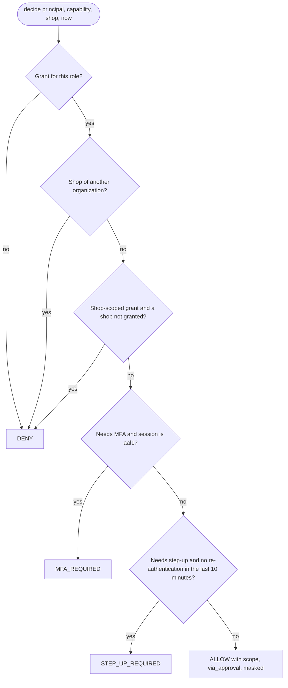

# Identity and access — Design

## Database workflow (slice 2.1)

- **Schema source of truth:** SQL migrations in `supabase/migrations`, created and applied with the Supabase CLI (version in [TOOLCHAIN](../../engineering/TOOLCHAIN.md); `just` calls it through `npx`). The first migration creates the `app`, `private` and `audit` schemas, closed to `anon`, `authenticated` and `service_role` until a slice grants exactly what it needs ([ADR-0011](../../adr/0011-data-access-and-migrations.md)).
- **Data API exposure:** only `public` is exposed by PostgREST (`supabase/config.toml`), and no business table lives there (pgTAP test). Clients use the HTCO API.
- **Local Auth settings** mirror the production requirements: sign-ups closed (users are invited), passwords of at least 12 characters with mixed case and digits, TOTP MFA on, email confirmations on.
- **Readiness:** `htco_persistence.readiness.DatabaseReadinessCheck` opens a fresh connection and runs `select 1` with a one-second connect timeout, in a worker thread (psycopg's async mode cannot use the Windows event loop used in development). The composition root adds it when `HTCO_DATABASE_URL` is set; staging and production refuse to start without it. `/readyz` uses a one-second overall timeout.
- **Layers:** `htco_persistence` is the only package that imports psycopg (import-linter contract `db-driver-only-in-persistence`); it sits in the adapter layer beside the agent runtime.
- **Tests:** pgTAP files in `supabase/tests/database`; Python tests that need Postgres carry `@pytest.mark.database`. Without `HTCO_TEST_DATABASE_URL` they are deselected and reported, so the agent hooks work without Docker; the CI `database` job sets `HTCO_REQUIRE_DATABASE_TESTS=1`, so they can never be silently skipped there.
- **Deployed migrations:** `.github/workflows/migrate.yml`, started only by the owner, links the project, prints `supabase db push --dry-run`, applies only when "apply" is ticked, and records `supabase migration list` in the run summary.

### Database roles and pool sizes (planned, confirmed when the development project exists)

| Component | Database role | Connection | Pool size |
|---|---|---|---|
| `api` | `htco_api` (login, no `bypassrls`); user requests switch to `authenticated` with the verified claims via `set local` | Supabase IPv4 add-on, session or direct mode | 5 per instance (Supabase Pro small compute allows about 60 direct connections) |
| `agent-worker` | `htco_worker` (login, explicit tenant filters, no `bypassrls`) | same | 5 |
| migrations | the project owner role, only inside `migrate.yml` | direct | 1 |
| readiness probe | the component's own role | one short-lived connection per probe | — |

Roles are created by the slice that first connects with them (2.3 for the API). Assumption A-13 tracks the connection limits.

## Identity schema and RLS (slice 2.2)

Tables, keys and policies are listed in [DATA_MODEL §3.1](../../architecture/DATA_MODEL.md#31-created-identity-and-access-slice-22). The design choices:

- **The API is the client.** User requests run as `authenticated` with the verified JWT claims (slice 2.3), so every query is filtered by RLS even if application code forgets a filter. The Data API exposes none of these tables.
- **Helpers instead of policy subqueries.** Policies call `private.*()` helpers inside `(select …)`. The helpers are security definers, so a policy on `memberships` can read memberships without recursing into its own policy, and the planner evaluates each helper once per statement.
- **Two kinds of policy.** Permissive policies say who may read or write; restrictive policies add the MFA rule (`aal2`) to every write on owner-administered tables. Reading never needs MFA.
- **Organization integrity in the keys.** `shop_access` references `(organization_id, id)` of both the membership and the shop, so a grant cannot join two organizations even if the API had a bug.
- **Audit is append-only twice:** no update or delete grant for `authenticated`, and triggers that refuse updates, deletes and truncates for every role, including the table owner. Retention purges (DATA_MODEL §6) will need a reviewed, owner-run procedure.
- **What RLS does not do:** stop an Admin from granting the Owner role or demoting the Owner. That rule lives in the use cases of slice 2.6 (the policy engine), with its own tests.

## Policy engine v0 (slice 2.4, part 1)

| Type | Layer | Meaning |
|---|---|---|
| `Role`, `AssuranceLevel` | `htco_domain.identity` | The seven roles; `aal1` or `aal2` |
| `Capability` | `htco_application.access.policy` | The 20 human capabilities of the matrix |
| `Grant` | same | One matrix cell: organization-wide or granted shops; MFA; step-up; approval instead of acting; masked |
| `Principal` | same | The acting user as the server knows them: organization, role, assurance, granted shops (from the database, never from token claims alone) |
| `ShopRef` | same | The targeted shop and its owning organization, read from the database |
| `Decision` | same | `ALLOW` (with scope and flags), `DENY`, `MFA_REQUIRED` or `STEP_UP_REQUIRED` |
| `PERMISSIONS` | same | The matrix, read-only (`MappingProxyType`) |

How the API will map decisions (part 2): `DENY` on a specific resource is 404 (no hint it exists), on a function 403; `MFA_REQUIRED` and `STEP_UP_REQUIRED` are 403 problems with their own types (`mfa-required`, `step-up-required`); `via_approval` creates an approval instead of acting; `masked` hides buyer data.

## Decisions and alternatives

| Decision | Alternatives considered | Why |
|---|---|---|
| The matrix as a literal table in code, checked against the Markdown table | Generate code from the doc; read the doc at runtime | A reviewed table in code is simple and fast; the parsing test makes any drift between doc and code fail CI. |
| The target shop carries its organization, and a mismatch is denied for every role | Trust the caller to pre-filter by tenant | An organization-wide grant must never cross tenants; the engine checks it itself instead of relying on every caller (and RLS adds a second layer). |
| Assurance checked before step-up | Either order | A step-up re-enters the second factor, so it presupposes an `aal2` session. |
| A re-authentication time in the future counts as none | Trust it | Clock skew or tampering must never extend an elevation. |
| A naive clock is refused | Assume UTC | Time is UTC and injected (golden rule 3); a naive time is a bug to surface. |
