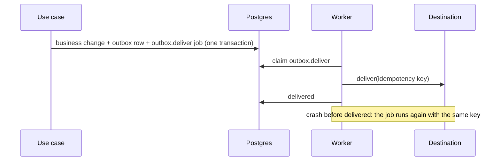

# Job queue and worker — Design

## Components and layers

| Layer | Module | Responsibility |
|---|---|---|
| Domain | `htco_domain.jobs` | `JobState` machine, `plan_after_failure` (retry with jitter or dead), `Schedule` periods and keys; `RetryPolicy.jittered_backoff` in `htco_domain.automation` |
| Application | `htco_application.jobs` | `JobSpec`, `ClaimedJob`, `DeadLetter`, the `JobQueue` and `WorkerHeartbeats` ports, `describe_error`, `due_schedule_jobs` |
| Application | `htco_application.maintenance` | The maintenance schedules, the daily fan-out and the per-shop jobs (probe, expiry check, purge) |
| Adapters | `htco_persistence.jobs`, `htco_persistence.maintenance`, `htco_persistence.database` | The queue on Postgres, heartbeats, the shop lists and the purge; the worker's role-switched pool and `tenant_scope` |
| Transport | `workers/runner` (`htco_worker`) | The loop (`runner.py`), the health port (`health.py`), settings and the composition root (`main.py`) |

## Contracts

- **Tables** (`supabase/migrations/20261023120000_job_queue.sql`):
  - `jobs.jobs`: `kind` (`<area>.<action>`), `idempotency_key` (unique with `kind`), `organization_id` and `shop_id` (foreign keys, nullable for system jobs), `lock_key`, `payload` (an object, at most 16 KB, IDs and parameters only), `state` (`queued`, `running`, `retry_scheduled`, `succeeded`, `dead`), `priority`, `attempts`, `max_attempts`, `initial_backoff_ms`, `max_backoff_ms`, `run_at`, `leased_by`, `lease_expires_at`, `last_error` (≤ 500 characters), `finished_at`, and the optional `correlation_id` and `causation_id` that the gateway carries from the trigger to the job, the action and the outbox ([ADR-0019](../../adr/0019-unified-execution-engine-and-action-gateway.md)). Checks: a running job has a holder and a lease, a finished one has `finished_at`, a shop's job names its organization. Indexes: due jobs, expired leases, dead letters per organization, finished jobs; **a partial unique index allows one running job per `lock_key`**.
  - `jobs.worker_heartbeats`: one row per worker (`worker_id`, `release`, `started_at`, `last_beat_at`, `current_job_id`, `stopping`).
  - `jobs.connected_shops()`, `jobs.purgeable_shops(now)`: security-definer functions returning `(organization_id, shop_id)` only.
- **Role** `htco_worker` (no login): the queue tables; `app.shops` (read), `app.shop_integrations` (read, update), `app.shop_capabilities` (all), `audit.audit_log` (insert), each through a policy that compares `organization_id` with the session setting `htco.organization_id`.
- **Events:** none yet; the outbox (slice 5.2) publishes the first ones.
- **Command:** `htco admin dead-letters [--organization ID] [--limit N]`.

## Flow

```mermaid
sequenceDiagram
  participant W as Worker loop
  participant Q as jobs.jobs
  participant H as Handler
  loop every poll (1 s)
    W->>Q: enqueue this period's schedule jobs (no-op when present)
    W->>Q: release jobs whose lease expired (retry, or dead on the last attempt)
    W->>Q: claim the next due job of my kinds whose lock is free (SKIP LOCKED)
    W->>H: run it inside its organization (tenant_scope)
    par heartbeat every lease/3
      W->>Q: extend the lease; upsert worker_heartbeats
    end
    alt handler returned
      W->>Q: succeeded (only while I still hold the lease)
    else handler raised
      W->>Q: retry_scheduled at now + backoff with jitter, or dead
    end
  end
```

The daily maintenance runs as fan-out: `maintenance.capability_probes`, `maintenance.refresh_token_expiry` and `maintenance.purge_disconnected_shops` list shops by ID through the security-definer functions and enqueue one per-shop job (`etsy.capability_probe`, `etsy.refresh_token_check`, `shops.purge`) keyed by shop and day, with the lock key `shop:<id>:etsy`. `maintenance.prune_finished_jobs` deletes succeeded jobs after 14 days (dead jobs stay).

## State machine

`queued → running → succeeded`; `running → retry_scheduled → running`; `running → dead`; `dead → queued` (an admin's retry, slice 5.9). An expired lease moves `running` to `retry_scheduled` (or `dead` on the last attempt): a crash counts as an attempt, so a job that kills its worker every time still ends in the dead-letter state.

Retry delays use "equal jitter": between half and all of the policy's capped exponential backoff (`RetryPolicy.jittered_backoff`).

## Decisions and alternatives

| Decision | Alternatives considered | Why |
|---|---|---|
| In-house table with `SKIP LOCKED` | pgmq, procrastinate | [ADR-0007](../../adr/0007-job-queue.md): tenancy columns, one schema source, enqueue inside the business transaction |
| Per-resource locks as a partial unique index on running jobs | Advisory locks; a lock table | Enforced by Postgres even if two workers race; needs no held connection (works through the session pooler); visible in the table |
| Worker role through `set role` on a login connection | A separate login role with its own password | No new secret to store or rotate now; the role's rights are still its own. A separate login can be added by giving `htco_worker` a password (see [operations](operations.md)) |
| One organization per job through a session setting and RLS | Explicit filters only | Defense in depth: a query that forgets the organization still reaches nothing else (ER-SEC-08); the worker's own SQL also names the organization |
| Fan-out to per-shop jobs | One job looping over all shops | Each shop's job runs in its own tenant scope, is retried alone and holds the shop's lock |
| Polling every second | `LISTEN/NOTIFY` | Works through the session pooler and keeps the loop simple; at pilot volume a poll is one indexed query |
| `last_error` keeps the exception type only, unless the code marks the message safe (`JobError`) | The full message | Messages from libraries can carry buyer data or tokens |

## Inbox, outbox and Idempotency-Key (slice 5.2)

- **`jobs.inbox`** (`source`, `event_id` unique together, `event_type`, optional `organization_id`/`shop_id`, `payload` ≤ 64 KB, `payload_hash` SHA-256 of the canonical JSON, `received_at`, `processed_at`, `job_id`). `PostgresInbox.record(event, job)` inserts the row and enqueues the processing job in one transaction; a duplicate returns the first row and job. Cross-tenant for the worker (events may arrive before their organization is known).
- **`jobs.outbox`** (`organization_id`, `shop_id`, `destination` `<system>.<effect>`, `idempotency_key` unique, `payload` ≤ 16 KB, `status` `pending`/`delivered`/`dead`, `attempts`, `next_attempt_at`, `last_error`, `delivered_at`, and the gateway's optional `action_execution_id` and `correlation_id`, ADR-0019). The `destination` of an Etsy write is its action name (for example `etsy.inventory.update`); the API channel registers one `Deliverer` per write action in 5.13. `add_outbox_in(connection, message)` writes it inside the business transaction with the `outbox.deliver` job (`outbox:<id>`). The worker reaches a message only inside its organization's job.
- **Delivery** (`deliver_outbox_message`): a delivered message is skipped (a replayed job); otherwise the destination's `Deliverer` gets the message with its idempotency key; a failure is recorded on the message and re-raised so the job retries, and the job's last attempt marks the message `dead`. No destination is registered yet. A trigger on `jobs.jobs` keeps the message's `next_attempt_at` equal to its delivery job's next run and marks the message `dead` when the job dies, also when a crash on the last attempt bypassed the delivery code.
- **`private.idempotency_keys`** (`user_id`, `key` unique together, `method`, `path`, `request_hash`, `state`, `response_status` < 500, `response_body`, `expires_at` = `created_at` + 24 h). `run_idempotently` (API) claims the key with one insert, replays a completed response with `Idempotent-Replayed: true`, refuses another body with 422 `idempotency-key-reused`, answers 409 `idempotency-in-progress` while the first runs, and releases the key when the work raises or answers 5xx. Each claim also drops up to 100 expired rows.



## Queue, execution and sync health (slice 5.9)

One read for the Owner and Admins, `GET /v1/operations/health` (`htco_application.operations_health`, `htco_persistence.operations_health`), answers the admin screen:

| Part | Source | Notes |
|---|---|---|
| `jobs` | `jobs.jobs` grouped by kind and state | The organization's jobs and the system's (no organization) |
| `dead_letters` | `jobs.jobs` in `dead`, newest 50 | Kind, attempts, last error (a type or a safe code), and for the engine's jobs the `execution_id` |
| `workers` | `jobs.worker_heartbeats`, last 7 days | `alive` false after two minutes without a beat (`WORKER_STALE_AFTER`), or while stopping |
| `shops` | `app.sync_cursors` with `app.sync_drifts` counts | `stale` after 13 hours without a success (reconciliation runs twice a day) |
| `webhooks` | `jobs.inbox` by source and type | Received in the last day; unprocessed |
| `executions` | `app.automation_executions`, newest 25 | Each opens in the chain view, `GET /v1/executions/{id}` |
| `outbox_failures` | `jobs.outbox` dead, or pending after a failed attempt | Destination, attempts, last error |
| `automations` | `app.automation_executions` of the last 7 days (at most 5,000) | Executions, succeeded, dead-lettered, retries (attempts beyond the first), success rate among finished ones, p50 and p95 seconds from trigger to the last change |

IDs, kinds, states, counts, times and error codes only: no job or outbox payload is read beyond the engine's execution ID, and nothing about a buyer. The retry, `POST /v1/operations/dead-letters/{job_id}/retry`, moves a dead job to `queued` and writes the audit record in one transaction (`409 job-not-dead`, `409 retry-through-execution`, `404` for another organization's job). Capability: `retry_sync` with organization scope (Owner, Admin).

Moved by the owner's decision of 2026-10-23: AC-5.9.1's alert goes through the one alert model (Phase 6.4 notifications now, Phase 10's monitors later), and AC-5.9.4's Prometheus `/metrics` goes with Phase 8A's monitoring slice once a monitoring host is chosen.
