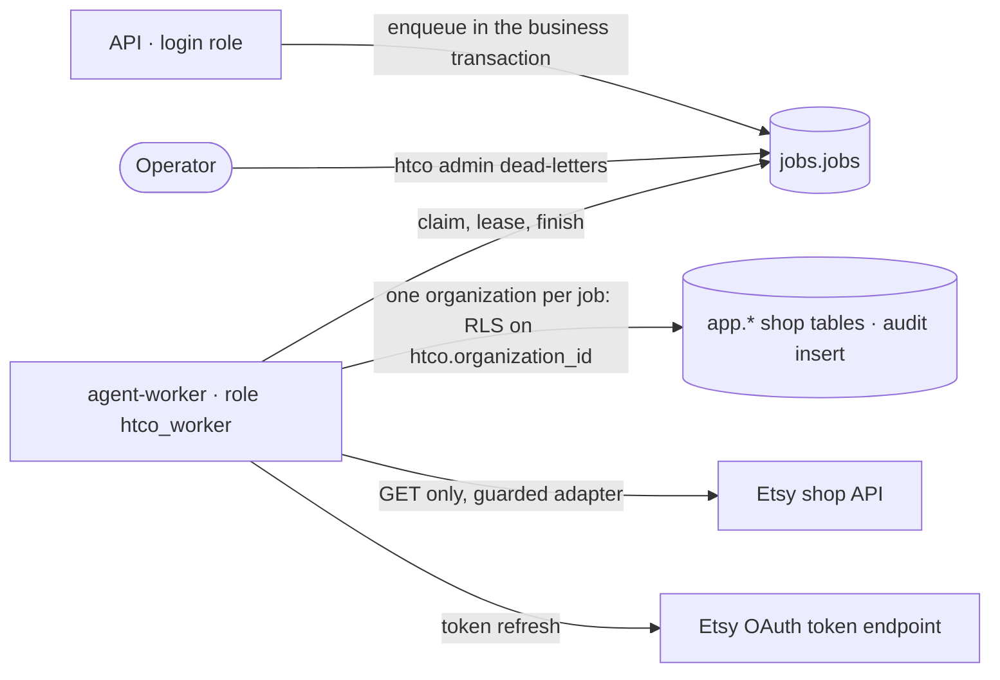

# Job queue and worker — Security

## Data flow and trust boundaries

## Threats (STRIDE)

| Element | Threat | Control | Test |
|---|---|---|---|
| Worker role | Elevation of privilege: a job reads or changes another organization's rows | Policies compare `organization_id` with the job's organization (`htco.organization_id`, set per pooled connection from `tenant_scope`); no organization means no tenant row; the worker's own SQL names the organization too | `test_worker_role__sees_only_the_jobs_organization`, `test_worker_role__cannot_write_another_organizations_rows`, pgTAP |
| Worker role | Information disclosure: sessions, OAuth state, memberships, users | No grant on `private.*`, memberships, organizations or `auth.users`; no delete on the audit log | `test_worker_role__has_no_access_to_sessions_identities_or_audit_history` |
| Worker role | Spoofing a user | The role cannot log in, is no superuser and does not bypass RLS; `authenticated` is not among its memberships | pgTAP |
| Queue | Information disclosure through payloads and errors | Payloads carry IDs and parameters (≤ 16 KB); `last_error` keeps the exception type unless the code marks the message safe (`JobError`); the CLI never prints payloads | `test_describe_error__an_unmarked_exception__keeps_only_its_type` |
| Queue | Tampering by client roles | The `jobs` schema is invisible to `anon`, `authenticated` and `service_role`; RLS is on | pgTAP |
| Queue | Denial of service: a poison job kills workers in a loop | A crash counts as an attempt; the job ends `dead` | `test_crash_on_the_last_attempt__ends_dead` |
| Etsy | Tampering with the live shop | The probes are GETs through the guarded adapter; any other method to the shop API is refused before a token is asked for and again in the HTTP client | `test_daily_probe_job__reaches_etsy_with_gets_only`, `tests/integrations/test_etsy_read_only.py` |
| Purge | Deleting the wrong shop's data | Runs in the shop's organization, names organization and shop in every statement, re-checks `disconnected` and the purge date under a row lock, audits the counts | `test_purge__*`, `test_reconnect_before_the_purge__keeps_the_shops_data` |
| Outbox | Information disclosure across tenants | The worker reaches outbox rows of its job's organization only (RLS) | `test_outbox__the_worker_delivers_inside_the_organization_only`, pgTAP 11 |
| Outbox | Duplicate external effects | One message per idempotency key; the key goes to the destination on every attempt | `test_crash_after_the_business_commit__*` |
| Idempotency-Key | Replaying another user's response | Keys are per signed-in user; the request hash must match | `test_same_key_from_another_user__is_a_new_request` |
| Idempotency-Key | Storing personal data | Only routes whose responses hold no buyer contact data opt in; responses ≥ 500 are not stored; 24-hour lifetime enforced by a check | `test_server_error__is_not_stored_and_the_retry_runs_for_real` |
| Schedules | Repudiation | Probe and expiry results are audited with actor `system:scheduler` and the job ID as correlation | `test_check_refresh_token__expired__marks_needs_reauth_with_an_audit_record` |

## Personal data

| Data | Class | Who can see it | Retention | Masking |
|---|---|---|---|---|
| Job payloads | DC4 (IDs, parameters) | The worker role, the login role | Succeeded jobs 14 days; dead jobs until handled | Never buyer contact data (DC1) or tokens (DC0) |
| `last_error` | DC4 | Admins via the dead-letter list | With the job | Exception type only unless marked safe |
| Worker heartbeats | DC4 (host-derived worker ID) | Operators | Until replaced | — |

## ASVS 5.0 requirements covered

| Requirement | How it is met | Evidence |
|---|---|---|
| v5.0.0-8.2.2 (data-level access) | The worker reaches one organization's rows per job through RLS | Worker-role integration tests and pgTAP |
| v5.0.0-13.2.2 (least-privilege service accounts) | A dedicated worker role with grants per table, reached through its own login `htco_worker_login` with no rights of its own (architecture audit 5.1) | Migrations `20261023120000_job_queue.sql`, `20261028210000_worker_login_role.sql`, pgTAP, the worker's startup check |
| v5.0.0-15.4.1 to 15.4.3 (safe concurrency) | Atomic claims (`SKIP LOCKED`), lease checks on every finish, one running job per lock enforced by a unique index | `test_claim__many_workers_at_once__*`, `test_lock_key__*` |
| v5.0.0-16.2.5 (no sensitive data in logs) | Logs carry job IDs, kinds and exception types | `htco_worker.runner` |
