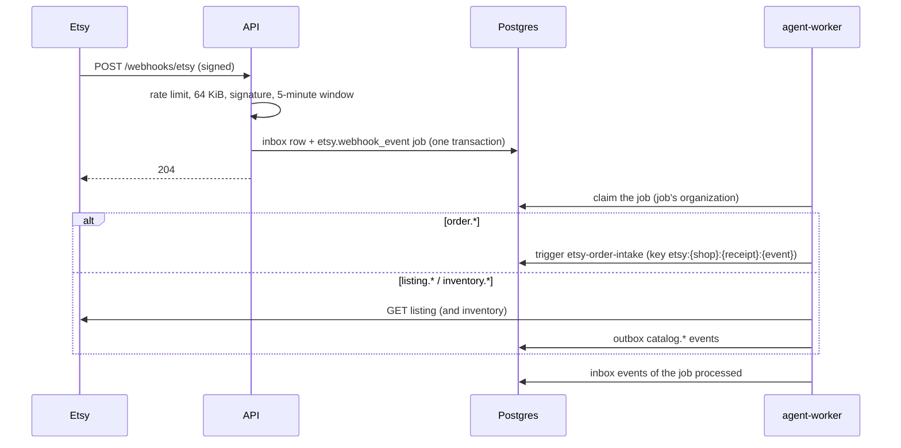

# Orders ingest — Design

## Components and layers

| Layer | Module | Responsibility |
|---|---|---|
| Application | `htco_application.etsy_webhooks` | Standard Webhooks verification (`verify_signature`, `WebhookSecret`), event parsing, the routing table (`ROUTES`), `EtsyWebhookIngress` (inbox and job), `WindowLimiter`, and the worker's `WebhookProcessor` and `EngineOrderIntake` |
| Adapters | `htco_persistence.etsy_webhooks` | The connected shop of an Etsy shop ID (API role), events kept without a job, the inbox's processed mark and the worker's shop lookup (`htco_worker`) |
| Adapters | `htco_integrations.etsy` | `get_listing` and `get_listing_inventory`: GETs through the guarded `_request` |
| Transport | `htco_api.webhooks` | `POST /webhooks/etsy`: flag, rate limit, body limit, problem answers |
| Transport | `htco_worker.main` | The `etsy.webhook_event` handler, wired to the real adapter and the engine |

## Contracts

- **Endpoint:** `POST /webhooks/etsy` — Etsy's raw JSON body with the `webhook-id`, `webhook-timestamp` and `webhook-signature` headers; `204` on acceptance; problems `400 webhook-invalid`, `401 webhook-signature-invalid`, `404 not-found` (off), `413 webhook-too-large`, `429 webhook-rate-limited` with `Retry-After`. Not signed in, no CSRF (Etsy calls it).
- **Job:** `etsy.webhook_event` — payload: `event_type`, Etsy `shop_id`, `receipt_id` or `listing_id` (and `product_id`), `webhook_id`. Key: `etsy:{shop_id}:{receipt_id}:{event_type}` for orders; `etsy:{shop_id}:{listing_id}[:{product_id}]:{event_type}@{webhook-timestamp}` for listings and stock.
- **Events:** `catalog.listing_changed.v1`, `catalog.inventory_changed.v1`, `catalog.out_of_stock.v1` through the outbox (`events.publish`), IDs and re-read facts only (state, quantities, Etsy's update time). Order events (`orders.*`) are Etsy Order Intake's (5.4).
- **Tables:** `jobs.inbox` (slice 5.2) with `source = 'etsy'`, `event_id = webhook-id`, the event's IDs as payload, and a new index on `job_id`; the worker may now insert `app.automation_executions` of its job's organization (migration `20261024100000_etsy_webhook_intake.sql`).

## Flow

## Routing (phase-05 §5.3)

| Etsy event | The job does | Publishes |
|---|---|---|
| `order.paid`, `order.canceled`, `order.shipped`, `order.delivered` | Triggers Etsy Order Intake for the receipt (named in the resource URL); a refusal (not active yet) is logged, not retried | Intake's `orders.*` (5.4) |
| `listing.created`, `listing.updated`, `listing.deleted` | GET the listing; a 404 confirms a deletion; a listing of another shop publishes nothing | `catalog.listing_changed.v1` |
| `inventory.created`, `inventory.updated`, `inventory.deleted` | GET the listing and its inventory | `catalog.inventory_changed.v1` |
| `inventory.out_of_stock` | As above | plus `catalog.out_of_stock.v1`, only when the re-read shows no stock |
| Anything else, or a shop not connected to HTCO | Stored in the inbox with no job and counted (`unrouted`) | — |

## Decisions

- **Re-read, never trust.** The payload only names a resource. Orders go through Etsy Order Intake, which re-reads the receipt itself; listings and stock are read with GETs before anything is published.
- **Duplicate deliveries.** Etsy retries with the same `webhook-id`: the inbox's `(source, event_id)` keeps one row. The same order change announced with two IDs shares one job and one execution key.
- **Rate limits per instance.** Fixed one-second windows. `do-connecting-ip` may be forged, so the client IP never decides whether a signed request is checked. A request without the three signature headers is refused at once, before its body is read; one with them always gets the bounded body read and the HMAC check. Only failures (missing headers, too large, bad signature or timestamp) are charged to their IP (`HTCO_ETSY_WEBHOOK_IP_RATE_PER_SECOND`, 20; IPv6 by its /64), and past that window a failure answers 429. Only a verified delivery is charged to the Etsy-wide window (`HTCO_ETSY_WEBHOOK_RATE_PER_SECOND`, 50), so neither unsigned traffic nor a flood under Etsy's IP can starve Etsy's deliveries (Codex security review P2). Etsy retries a 429 later.
- **Catalog re-reads use the adapter directly** in the worker, like the daily probes. Moving them onto the gateway needs `etsy.listings.read` action contracts; that follows with the catalog slices.

## Etsy Order Intake (slice 5.4)

| Layer | Module | Responsibility |
|---|---|---|
| Domain | `htco_domain.orders` | `OrderState` and its transitions (FR-ORD-03), `observed_state` from Etsy's facts, `ingest_path` (a new paid order passes `PAID → INGESTED`, a jump passes every state in between), `order_count` and `units_sold` (sales only), `Money` (Decimal, floats refused) |
| Application | `htco_application.order_ingest` | `plan_ingest`: write or not (older or identical copy: nothing), transitions, estimated entries, `orders.*` events (IDs and states only); the facts hash excludes buyer data |
| Application | `htco_application.order_receipts` | The order history form of a receipt as JSON (the gateway's R1 output) and back |
| Application | `htco_application.order_intake` | The handler (`OrderIntake`), `GatewayReceipts` (the #57 `ReceiptSource` over the gateway), `QueuedSyncRequests` (the API asks the queue), `EngineSyncTrigger` (the worker's `etsy.order_sync` job) |
| Application | `htco_application.execution.channels` | `etsy.receipts.read` with `order_history: true`: whole receipts through `get_order_receipt` / `list_order_receipts`, for the automation actor only |
| Adapters | `htco_persistence.etsy_orders` | `_ingest`: one transaction per page or receipt, select-for-update then insert or update (no `on conflict do update`, so the worker never reads money columns), children replaced, transitions, entries, outbox |
| Adapters | `htco_persistence.worker_gateway` | The shop's Etsy ID and probed capabilities for the worker's gateway |
| Transport | `htco_worker.main` | `worker_gateway` (real for reads, `HTCO_WORKER_ACTION_GATEWAY`), `intake_handlers`, `order_sync_handlers` |

**Gateway in the worker.** `ActionGatewayService` with the registry and action contracts copied into the image (`/app/registry`, `/app/packages/contracts/actions`), the Postgres action store, breakers, rate budget (`etsy:app`, 5/s and 5,000/day placeholders) and slots, and the shared approval contract (#70) in memory: a write waits for an approval no one can give in the worker, so no write runs. Users never act in the worker.

**Keys.** A webhook's run: `etsy:{shop_id}:{receipt_id}:{event_type}` (5.11). A requested history run: `etsy:{shop_id}:history:{job key}` with one `etsy.order_sync` job per shop and 10 minutes (stale reads), or per minute (the Owner's manual sync). Each gateway read is keyed by the execution, its attempt and the page.

**Locks.** The history run keeps the #57 per-shop advisory lock, shared with the API process's fallback run, so the two never sync one shop at once.

**Reconciliation (slice 5.5).** The hourly tick `RECONCILIATION_TICK` (`orders.reconciliation`) asks `due_reconciliations` which times of `HTCO_RECONCILIATION_SCHEDULE` (`parse_reconciliation_times`, local times in `HTCO_RECONCILIATION_TZ`, so a DST change moves nothing) fall in its hour (every one of them, each enqueued to run at its own time): the day's last time is the `sweep`, any earlier one a `reconcile`. `enqueue_reconciliations` then enqueues one `etsy.order_sync` job per connected shop and slot, with the lock key `shop:{shop_id}:orders`; `EngineSyncTrigger` maps the job's reason to the run (`reconcile`, `sweep`; `stale` and `manual` to `history`) and triggers it with the `schedule` kind. The run holds the shop's advisory lock, reads through `GatewayReceipts` (the sweep's `open_orders` adds Etsy's `was_paid`/`was_shipped` filters) and ingests with `detect_drift`: `detect_drifts` compares status and shipped flag, item quantities and shipment carriers and times, never compares a copy older than the stored one, and calls a receipt missing once it is older than 20 minutes (a younger one may simply be in flight). A run that finds the shop's lock held fails with `ShopBusyError` into the execution's retry, so it is never lost. A drift is unique per receipt, kind and Etsy update time. Budget: `daily_etsy_calls` is calls per run times runs per day against the `etsy:app` placeholder of 5,000 a day; every read also passes the gateway's limiter.

**Tables (migration `20261024210000_order_intake.sql`).** `app.etsy_orders` gains `order_state` and `receipt_sha256`; `app.order_status_events` (source, `observed_at`, Etsy's update time and the facts hash as proof; a trigger refuses illegal pairs); `app.financial_entries` (revenue and refunds, `estimated`, `numeric(20,6)`). The worker gets column-level grants: no money column, no buyer value readable.
