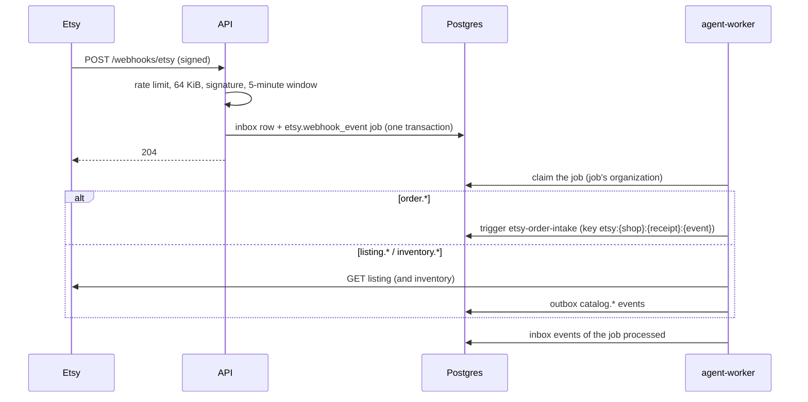

# Orders ingest — Design

## Components and layers

| Layer | Module | Responsibility |
|---|---|---|
| Application | `htco_application.etsy_webhooks` | Standard Webhooks verification (`verify_signature`, `WebhookSecret`), event parsing, the routing table (`ROUTES`), `EtsyWebhookIngress` (inbox and job), `WindowLimiter`, and the worker's `WebhookProcessor` and `EngineOrderIntake` |
| Adapters | `htco_persistence.etsy_webhooks` | The connected shop of an Etsy shop ID (API role), events kept without a job, the inbox's processed mark and the worker's shop lookup (`htco_worker`) |
| Adapters | `htco_integrations.etsy` | `get_listing` and `get_listing_inventory`: GETs through the guarded `_request` |
| Transport | `htco_api.webhooks` | `POST /webhooks/etsy`: flag, rate limit, body limit, problem answers |
| Transport | `htco_worker.main` | The `etsy.webhook_event` handler, wired to the real adapter and the engine |

## Contracts

- **Endpoint:** `POST /webhooks/etsy` — Etsy's raw JSON body with the `webhook-id`, `webhook-timestamp` and `webhook-signature` headers; `204` on acceptance; problems `400 webhook-invalid`, `401 webhook-signature-invalid`, `404 not-found` (off), `413 webhook-too-large`, `429 webhook-rate-limited` with `Retry-After`. Not signed in, no CSRF (Etsy calls it).
- **Job:** `etsy.webhook_event` — payload: `event_type`, Etsy `shop_id`, `receipt_id` or `listing_id` (and `product_id`), `webhook_id`. Key: `etsy:{shop_id}:{receipt_id}:{event_type}` for orders; `etsy:{shop_id}:{listing_id}[:{product_id}]:{event_type}@{webhook-timestamp}` for listings and stock.
- **Events:** `catalog.listing_changed.v1`, `catalog.inventory_changed.v1`, `catalog.out_of_stock.v1` through the outbox (`events.publish`), IDs and re-read facts only (state, quantities, Etsy's update time). Order events (`orders.*`) are Etsy Order Intake's (5.4).
- **Tables:** `jobs.inbox` (slice 5.2) with `source = 'etsy'`, `event_id = webhook-id`, the event's IDs as payload, and a new index on `job_id`; the worker may now insert `app.automation_executions` of its job's organization (migration `20261024100000_etsy_webhook_intake.sql`).

## Flow

## Routing (phase-05 §5.3)

| Etsy event | The job does | Publishes |
|---|---|---|
| `order.paid`, `order.canceled`, `order.shipped`, `order.delivered` | Triggers Etsy Order Intake for the receipt (named in the resource URL); a refusal (not active yet) is logged, not retried | Intake's `orders.*` (5.4) |
| `listing.created`, `listing.updated`, `listing.deleted` | GET the listing; a 404 confirms a deletion; a listing of another shop publishes nothing | `catalog.listing_changed.v1` |
| `inventory.created`, `inventory.updated`, `inventory.deleted` | GET the listing and its inventory | `catalog.inventory_changed.v1` |
| `inventory.out_of_stock` | As above | plus `catalog.out_of_stock.v1`, only when the re-read shows no stock |
| Anything else, or a shop not connected to HTCO | Stored in the inbox with no job and counted (`unrouted`) | — |

## Decisions

- **Re-read, never trust.** The payload only names a resource. Orders go through Etsy Order Intake, which re-reads the receipt itself; listings and stock are read with GETs before anything is published.
- **Duplicate deliveries.** Etsy retries with the same `webhook-id`: the inbox's `(source, event_id)` keeps one row. The same order change announced with two IDs shares one job and one execution key.
- **Rate limit per instance.** A fixed one-second window per source (`HTCO_ETSY_WEBHOOK_RATE_PER_SECOND`, 50) guards against floods; Etsy retries a 429 later.
- **Catalog re-reads use the adapter directly** in the worker, like the daily probes. Moving them onto the gateway needs `etsy.listings.read` action contracts; that follows with the catalog slices.
