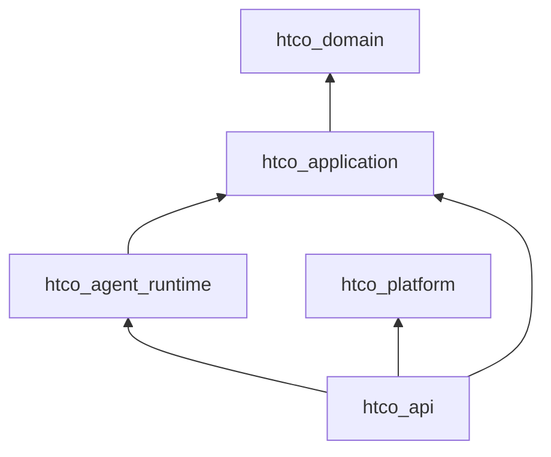
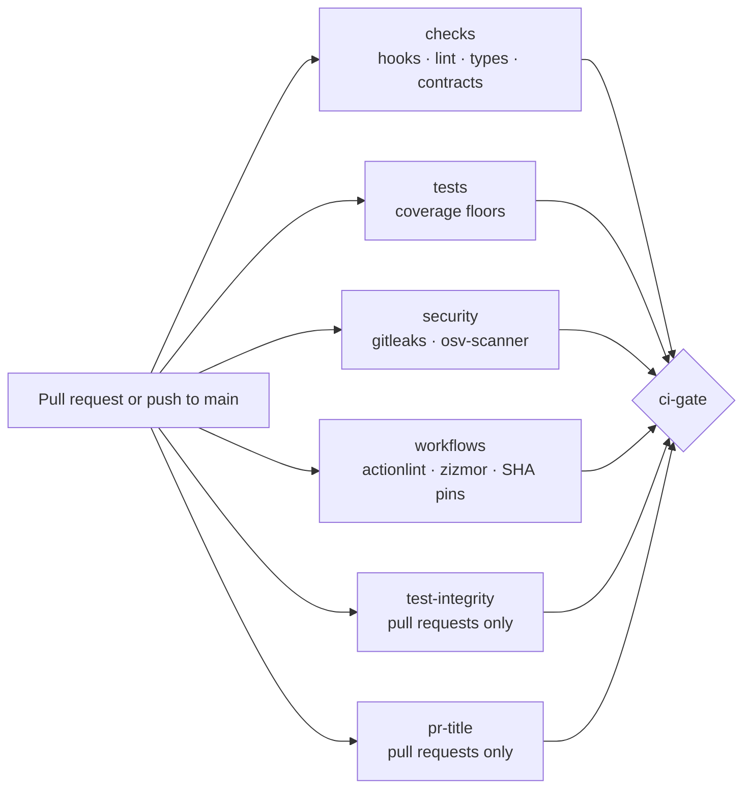

# Platform skeleton — Design

## Components and layers

| Layer | Package (workspace member) | Python package | Responsibility today |
|---|---|---|---|
| Domain | `packages/domain` (`htco-domain`) | `htco_domain` | Empty until Phase 2; standard library only |
| Application | `packages/application` (`htco-application`) | `htco_application` | Empty until Phase 2; standard library and domain only |
| Platform | `packages/platform` (`htco-platform`) | `htco_platform` | Settings, logging and health helpers from slice 1.2 |
| Adapter | `packages/agent-runtime` (`htco-agent-runtime`) | `htco_agent_runtime` | Pins LangGraph and proves it runs on our Python |
| Composition root | `apps/api` (`htco-api`) | `htco_api` | The HTTP API from slice 1.2 |

The workspace root is virtual (no package of its own). Every member has a fixed version `0.0.0` and depends on its inner layers through `{ workspace = true }` sources, so the lock resolves them from this checkout and never from an index.

## Architecture contracts

| Contract | Tool | Rule |
|---|---|---|
| `dependency-rule` | import-linter (layers) | `htco_api` → `htco_agent_runtime` → `htco_application` → `htco_domain`; nothing imports outward |
| `platform-is-infrastructure` | import-linter (forbidden) | `htco_platform` imports no business, adapter or app code |
| `inner-layers-without-platform` | import-linter (forbidden) | Domain and application never import `htco_platform` |
| `langgraph-only-in-agent-runtime` | import-linter (forbidden) | Only `htco_agent_runtime` imports `langgraph` or `langchain_core` |
| Domain imports only the standard library | `tests/architecture/test_layer_purity.py` | Every import statement (including inside functions and `TYPE_CHECKING`) |
| Application imports only the standard library and the domain | same test | same |
| Every package imports from this checkout | `tests/architecture/test_workspace_packages.py` | Catches packaging mistakes (wrong module name, stale installs) |

## Task runner and hooks

`just` recipes call tools through `uv run`, so the versions come from `uv.lock`; `just` itself is a dev dependency (`rust-just`). `check` = `lint` + `types` + `arch` + `workflows` + `test`; `check-fast` = `lint` + `types` + tests without coverage, for the agent hooks of slice 1.6.

Git hooks (prek, `.pre-commit-config.yaml`): file hygiene and private-key detection (prek built-ins), gitleaks pinned by commit SHA, Ruff format and lint, and `tools/conventional_commit.py` on `commit-msg`. CI re-runs all of them, so a skipped hook only delays the failure.

## Continuous integration (slice 1.4)

`.github/workflows/ci.yml` runs on every pull request (opened, updated, reopened or edited) and on every push to `main`.

- **One required status.** `ci-gate` runs even when a job fails (`if: always()`) and passes only if every job succeeded; on pushes to `main` the two pull-request-only jobs may be skipped. Branch rules will require only `ci-gate` (slice 1.6), so adding a job never needs a settings change.
- **Least privilege.** The workflow grants nothing by default (`permissions: {}`); each job gets `contents: read`, and `ci-gate` gets nothing. Checkouts do not keep credentials.
- **No template injection.** The pull request title, body and base commit reach scripts only through environment variables.
- **Same tools as local.** Jobs call `just` recipes through `uv run` with `UV_LOCKED=1`, so CI fails when `uv.lock` is stale and uses exactly the locked versions. gitleaks and osv-scanner are release binaries checked against pinned SHA-256 sums.
- **Re-run on edit.** Editing the title or the "Test changes" section re-runs the whole workflow instead of only the cheap jobs: a partial run could otherwise replace a red `ci-gate` with a green one for the same commit.
- **Test integrity.** `tools/test_integrity.py` reads the merge-base diff and the base and head `pyproject.toml`. It flags added skip or expected-failure markers, removed test functions, changed or removed assertions, changed coverage thresholds, and any change to the `pytest`, `coverage`, `importlinter`, `mypy` or `ruff.lint` settings. Any finding fails the job unless the pull request has a non-empty "Test changes" section.

## Decisions and alternatives

| Decision | Alternatives considered | Why |
|---|---|---|
| All tests in one `tests/` tree, one folder per package | Tests inside each package (`packages/<pkg>/tests`) | With per-package test folders, mypy sees several top-level `tests` and `conftest` modules (and hyphenated folders stop its package search), so it needs one run per package. One tree gives unique module names, one fast mypy run and one pytest configuration. |
| Layer purity as an AST test | An import-linter forbidden list of third-party packages | A forbidden list is a deny-list that silently misses every new dependency; the allow-list (standard library plus inner layers) cannot be expressed in import-linter. |
| `coverage run -m pytest` with per-layer `--fail-under` reports | pytest-cov | One tool fewer; per-layer floors need separate reports anyway. |
| `rust-just` and `prek` in the dev group | Global installs | Contributors install only uv; CI uses the locked versions. |
| Own Conventional Commits checker | commitizen | Same rule in about 80 lines, no extra dependency, reused by the CI title check. |
| `exclude-newer = "7 days"` | Release age enforced only by Renovate | Applies to every resolution, including manual `uv lock --upgrade`. |
| One `ci-gate` job as the required status | Requiring every job in the branch rules | New jobs are protected automatically; the rules never drift from the workflow. |
| Our own test-integrity and SHA-pin scripts | Marketplace actions | Small, tested, no extra third-party code with access to the workflow. |
| Scanner binaries with pinned checksums | gitleaks and osv-scanner GitHub Actions | The gitleaks action needs write access to comment on pull requests; a checksum-verified binary needs none. |
