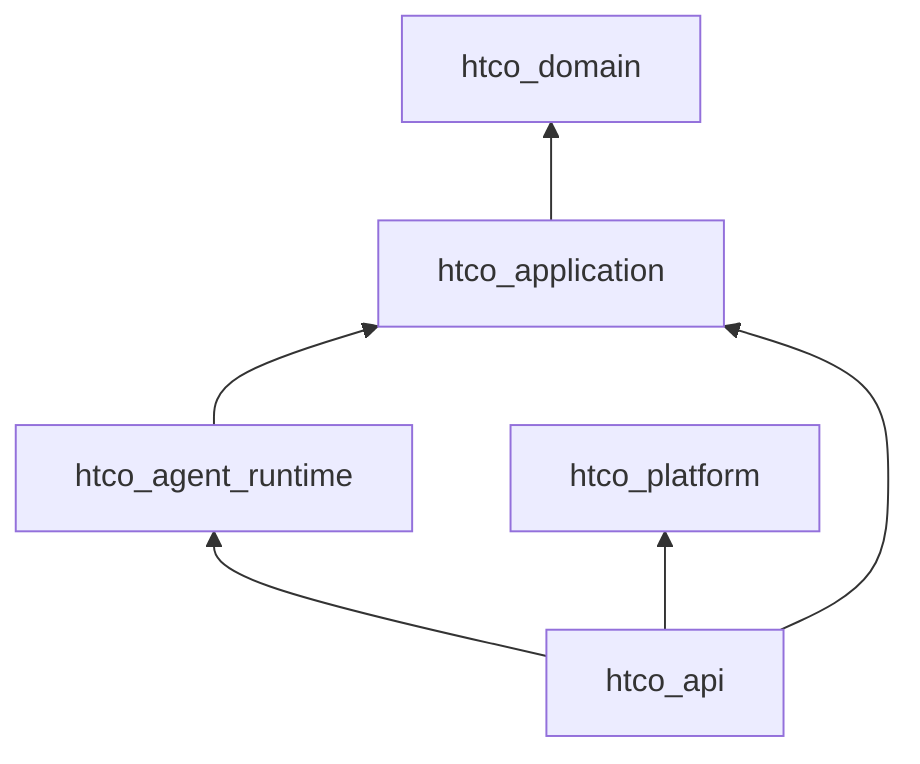
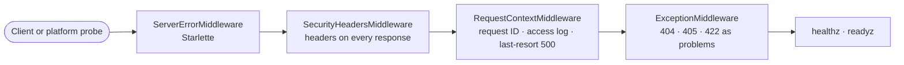
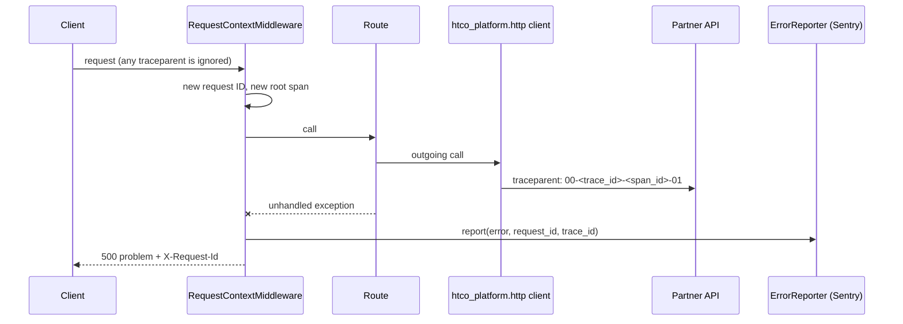
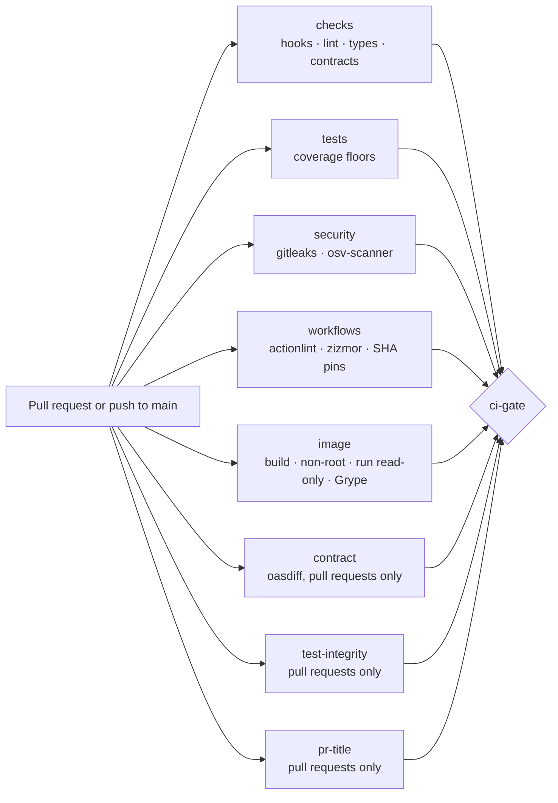

# Platform skeleton — Design

## Components and layers

| Layer | Package (workspace member) | Python package | Responsibility today |
|---|---|---|---|
| Domain | `packages/domain` (`htco-domain`) | `htco_domain` | Empty until Phase 2; standard library only |
| Application | `packages/application` (`htco-application`) | `htco_application` | Empty until Phase 2; standard library and domain only |
| Platform | `packages/platform` (`htco-platform`) | `htco_platform` | Settings, logging and health helpers from slice 1.2 |
| Adapter | `packages/agent-runtime` (`htco-agent-runtime`) | `htco_agent_runtime` | Pins LangGraph and proves it runs on our Python |
| Composition root | `apps/api` (`htco-api`) | `htco_api` | The HTTP API from slice 1.2 |

The workspace root is virtual (no package of its own). Every member has a fixed version `0.0.0` and depends on its inner layers through `{ workspace = true }` sources, so the lock resolves them from this checkout and never from an index.

## Architecture contracts

| Contract | Tool | Rule |
|---|---|---|
| `dependency-rule` | import-linter (layers) | `htco_api` → `htco_agent_runtime` → `htco_application` → `htco_domain`; nothing imports outward |
| `platform-is-infrastructure` | import-linter (forbidden) | `htco_platform` imports no business, adapter or app code |
| `inner-layers-without-platform` | import-linter (forbidden) | Domain and application never import `htco_platform` |
| `langgraph-only-in-agent-runtime` | import-linter (forbidden) | Only `htco_agent_runtime` imports `langgraph` or `langchain_core` |
| Domain imports only the standard library | `tests/architecture/test_layer_purity.py` | Every import statement (including inside functions and `TYPE_CHECKING`) |
| Application imports only the standard library and the domain | same test | same |
| Every package imports from this checkout | `tests/architecture/test_workspace_packages.py` | Catches packaging mistakes (wrong module name, stale installs) |

## Task runner and hooks

`just` recipes call tools through `uv run`, so the versions come from `uv.lock`; `just` itself is a dev dependency (`rust-just`). `check` = `lint` + `types` + `arch` + `workflows` + `test`; `check-fast` = `lint` + `types` + tests without coverage, for the agent hooks of slice 1.6.

Git hooks (prek, `.pre-commit-config.yaml`): file hygiene and private-key detection (prek built-ins), gitleaks pinned by commit SHA, Ruff format and lint, and `tools/conventional_commit.py` on `commit-msg`. CI re-runs all of them, so a skipped hook only delays the failure.

## API skeleton (slice 1.2)

| Module | Responsibility |
|---|---|
| `htco_api.main` | Composition root: load settings (exit 78 on error), configure logging, build the app, run uvicorn without its access log or `Server` header |
| `htco_api.app.create_app` | Builds the app from injected readiness checks, timeout and request-ID factory; no docs routes |
| `htco_api.middleware` | Request ID (UUIDv7, always server-generated) in `scope["state"]`, the log context and `X-Request-Id`; one `request.completed` line per request (method, path without query string, status, duration); unhandled exceptions logged with stack trace and answered with a generic 500 problem; security headers set with `setdefault` so a route may choose its own cache policy |
| `htco_api.problems` | The problem envelope, problem types and the handlers for framework errors |
| `htco_api.health` | `/healthz` (no dependency) and `/readyz` (configuration plus injected checks) |
| `htco_platform.settings` | `load_settings`: typed settings or `ConfigurationError` naming each variable, never its value |
| `htco_platform.logs` | `configure_logging`: structlog and standard-library logs as single-line JSON |
| `htco_platform.readiness` | `ReadinessCheck` protocol and `run_readiness_checks` (concurrent, per-check timeout, never raises) |

**Problem types** (`https://ht-co.app/problems/<slug>`):

| Slug | Status | When |
|---|---|---|
| `not-found` | 404 | Unknown route (later: unknown or other-tenant resource) |
| `method-not-allowed` | 405 | Method not supported; the `Allow` header is kept |
| `validation-error` | 422 | Invalid parameters; `errors` lists `location` and `message` without input |
| `internal-error` | 500 | Unhandled exception |
| `not-ready` | 503 | `/readyz` with a failing check; `checks` maps each check to `ok` or `failed` |
| HTTP phrase (for example `bad-request`) | other 4xx | Any other error raised by the framework |

**Log line** (one JSON object per line): `timestamp` (ISO 8601 UTC), `level`, `event`, `logger`, `request_id` (null outside requests) and event fields. Exceptions add a structured `exception` list (type, value, frames).

**Settings** (`HTCO_*`): `HTCO_ENVIRONMENT` (required: `local`, `test`, `staging`, `production`), `HTCO_LOG_LEVEL` (`INFO`), `HTCO_HOST` (`127.0.0.1`), `HTCO_PORT` (`8000`).

## Contract (slice 1.3)

- `packages/contracts/openapi.yaml` is generated from the app (`just openapi`, which runs `tools/openapi.py --write`) and committed. YAML without anchors or aliases, keys in FastAPI's order, so diffs read naturally.
- `HtcoAPI` (a `FastAPI` subclass) adjusts the generated document to what the app really sends: every response documents the required `X-Request-Id` header (UUID), and error responses carry their schema under `application/problem+json`. Operation IDs are the route function names (`healthz`, `readyz`).
- Three guards: `test_contract__committed_file__matches_the_app` fails on any drift (with a diff and the command to run); Schemathesis generates requests from the committed file, including methods the contract does not allow, and validates every response; the CI `contract` job runs `oasdiff breaking` against the pull request's base.

## Container image (slice 1.5, part 1)

| Stage | From | Does |
|---|---|---|
| `uv` | `ghcr.io/astral-sh/uv:0.13.0@sha256:…` | Provides the uv binary |
| `build` | `python:3.14.8-slim-trixie@sha256:…` | `uv sync --locked --no-dev --no-editable --package htco-api` into `/app/.venv` with bytecode compiled; the build context is an allow-list (`pyproject.toml`, `uv.lock`, `.python-version`, `apps/`, `packages/`) |
| `runtime` | same Python image | Copies only `/app/.venv` (owned by root); runs `python -m htco_api` as user `10001` on port 8080 (`HTCO_HOST=0.0.0.0`, `HTCO_PORT=8080`) |

`HTCO_ENVIRONMENT` is deliberately not set in the image: the platform must say which environment it runs, and the image refuses to start (exit 78) until it does.

## Agent guardrails (slice 1.6, part 1)

`.claude/settings.json` wires two hooks to `tools/claude_hooks.py` (run with `uv run --directory "$CLAUDE_PROJECT_DIR"`):

| Event | Hook | Effect |
|---|---|---|
| `PostToolUse` on `Edit` or `Write` | `format` | A Python file inside the project is formatted (`ruff format`) and safe fixes are applied (`ruff check --fix`). Never blocks. |
| `UserPromptSubmit` | `turn-start` | Records the commit the turn starts from (in the git directory, per worktree). |
| `Stop` | `stop` | If any file changed during the turn (uncommitted, or committed since the recorded start; an unreachable start counts as a change), runs `just check-fast`. On failure: exit 2 with the last 60 lines of output, so the agent must keep working. If it still fails on the next attempt (`stop_hook_active`), the turn may end, but the user sees a warning (`systemMessage`), never silence. |

Documentation-only turns skip the check, so the hook costs nothing when no code changed. Claude Code also caps consecutive stop-hook continuations (8 by default).

## Tracing and error monitoring (slice 1.7, part 1)

- **Spans:** the middleware starts one `SERVER` span per request with an empty parent context (`http.request.method`, `url.path`, `htco.request_id`, then `http.response.status_code`), records exceptions on it and sets an error status. Spans are not exported yet.
- **Logs:** a structlog processor adds `trace_id` (null outside a trace) and `span_id` from the active span to every line, including library lines.
- **Outgoing calls:** `new_async_http_client(tracer_provider=…)` wraps the transport with `AsyncOpenTelemetryTransport`, so each call is a child span and carries `traceparent`; 10-second timeout; redirects are never followed.
- **Errors:** the middleware reports every unhandled exception to the injected `ErrorReporter`; a failing reporter is logged (`error_reporting.failed`) and never changes the response. `main` uses `SentryErrorReporter` when `HTCO_SENTRY_DSN` is set and not blank, otherwise `NoErrorReporter`, and closes the reporter after the server stops so reports queued during shutdown are delivered. Every operation in the contract documents the 500 problem the middleware can send.
- **Diagnostics:** `POST /_diagnostics/error` (not in the contract) raises on purpose; `main` registers it in every environment except `production`.

## Continuous integration (slice 1.4)

`.github/workflows/ci.yml` runs on every pull request (opened, updated, reopened or edited) and on every push to `main`.

- **One required status.** `ci-gate` runs even when a job fails (`if: always()`) and passes only if every job succeeded; on pushes to `main` the pull-request-only jobs (`contract`, `test-integrity`, `pr-title`) may be skipped. Branch rules will require only `ci-gate` (slice 1.6), so adding a job never needs a settings change.
- **Least privilege.** The workflow grants nothing by default (`permissions: {}`); each job gets `contents: read`, and `ci-gate` gets nothing. Checkouts do not keep credentials.
- **No template injection.** The pull request title, body and base commit reach scripts only through environment variables.
- **Same tools as local.** Jobs call `just` recipes through `uv run` with `UV_LOCKED=1`, so CI fails when `uv.lock` is stale and uses exactly the locked versions. gitleaks and osv-scanner are release binaries checked against pinned SHA-256 sums.
- **Re-run on edit.** Editing the title or the "Test changes" section re-runs the whole workflow instead of only the cheap jobs: a partial run could otherwise replace a red `ci-gate` with a green one for the same commit.
- **Test integrity.** `tools/test_integrity.py` reads the merge-base diff and the base and head `pyproject.toml`. It flags added skip or expected-failure markers, removed test functions, changed or removed assertions, changed coverage thresholds, any change to the `justfile` (its recipes are the gates CI runs), and any change to the `pytest`, `coverage`, `importlinter`, `mypy` or `ruff.lint` settings. If a git command fails (for example no merge base), the job fails: a pull request it could not examine never passes. Any finding fails the job unless the pull request has a non-empty "Test changes" section.

## Decisions and alternatives

| Decision | Alternatives considered | Why |
|---|---|---|
| All tests in one `tests/` tree, one folder per package | Tests inside each package (`packages/<pkg>/tests`) | With per-package test folders, mypy sees several top-level `tests` and `conftest` modules (and hyphenated folders stop its package search), so it needs one run per package. One tree gives unique module names, one fast mypy run and one pytest configuration. |
| Layer purity as an AST test | An import-linter forbidden list of third-party packages | A forbidden list is a deny-list that silently misses every new dependency; the allow-list (standard library plus inner layers) cannot be expressed in import-linter. |
| `coverage run -m pytest` with per-layer `--fail-under` reports | pytest-cov | One tool fewer; per-layer floors need separate reports anyway. |
| `rust-just` and `prek` in the dev group | Global installs | Contributors install only uv; CI uses the locked versions. |
| Own Conventional Commits checker | commitizen | Same rule in about 80 lines, no extra dependency, reused by the CI title check. |
| `exclude-newer = "7 days"` | Release age enforced only by Renovate | Applies to every resolution, including manual `uv lock --upgrade`. |
| Request IDs always generated by the server | Trust a valid incoming `X-Request-Id` | A client could forge correlation or reuse another request's ID; clients quote the ID from the response instead. |
| Our own last-resort handler in the request-context middleware | Starlette's `Exception` handler | Starlette runs it in `ServerErrorMiddleware`, outside our middleware, so the 500 would lose the request ID and the log context. |
| No `/docs`, `/redoc` or `/openapi.json` | Docs in non-production environments | Less surface (ASVS 13.4.5); the reviewed contract is the committed `openapi.yaml` (slice 1.3). |
| Exit code 78 (`EX_CONFIG`) on bad settings, no traceback | Let uvicorn crash | A clear one-line reason per variable, and a code that tells a crash loop apart from a configuration error. |
| Contract generated from code and committed | Hand-written OpenAPI first, code generated from it | FastAPI's schema always matches the code; committing it makes every contract change a reviewed diff, and oasdiff guards compatibility. |
| Committed-file comparison for the contract | syrupy snapshot | The contract must live at a fixed path that clients and oasdiff read; a snapshot file would duplicate it. |
| Non-editable install into a venv copied to a clean stage | Install into the system interpreter; ship the source tree | The runtime has no uv, compilers, tests or sources (ASVS 15.2.3), and the venv is immutable (root-owned, read-only file system in CI). |
| Grype fails only on fixable high or critical findings | Fail on every finding | Unfixable base-image findings would block every build with nothing to do; they are reviewed with each base-image update. |
| Stop hook blocks once, then warns | Block until green | An environment problem (for example no network for uv) would otherwise trap the agent; the warning keeps the failure visible. |
| Our own server span instead of FastAPI instrumentation | `opentelemetry-instrumentation-fastapi` | The instrumentation continues any incoming `traceparent`; clients could then choose our trace IDs. Our span always starts a new trace, matching the request-ID rule. |
| Error monitoring behind a port with an isolated Sentry client | `sentry_sdk.init` with its integrations | The global init patches frameworks and logging and can attach request data; an isolated client sends only what we pass, and tests need no global state. |
| One `ci-gate` job as the required status | Requiring every job in the branch rules | New jobs are protected automatically; the rules never drift from the workflow. |
| Our own test-integrity and SHA-pin scripts | Marketplace actions | Small, tested, no extra third-party code with access to the workflow. |
| Scanner binaries with pinned checksums | gitleaks and osv-scanner GitHub Actions | The gitleaks action needs write access to comment on pull requests; a checksum-verified binary needs none. |
