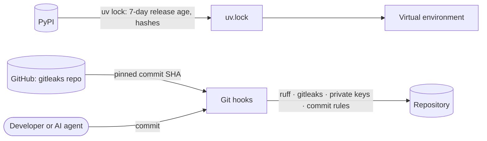

# Platform skeleton — Security

## Data flow and trust boundaries

Slice 1.1 has no runtime data flow. Its trust boundary is the software supply chain: packages from PyPI, hooks from GitHub, and code written by people and AI agents.

## Threats (STRIDE)

| Element | Threat | Control | Test |
|---|---|---|---|
| Dependencies | Tampering: a freshly published malicious release | `exclude-newer = "7 days"`; `uv.lock` with hashes; Renovate with minimum release age (slice 1.4) | Lock records `exclude-newer-span = "P7D"` |
| Dependencies | Tampering: dependency confusion for internal packages | Internal packages come only from the workspace (`{ workspace = true }`) | `test_workspace_package__import__resolves_to_this_checkout` |
| Test run | Tampering: a dependency's pytest plugin runs code in every test session | Plugins load only from the allow-list (`--disable-plugin-autoload`) | Session header lists only `anyio` and `hypothesis` |
| Repository | Information disclosure: secrets committed | gitleaks and private-key detection on every commit; CI scan from slice 1.4 | `prek run --all-files` |
| Architecture | Elevation of privilege: inner layers gaining I/O or SDK access over time | Layer purity test, import-linter contracts | `tests/architecture/` |
| Hooks | Tampering: a moved Git tag changes hook code | gitleaks hook pinned by full commit SHA | Config review |
| CI workflow | Tampering: a compromised or moved action tag runs in CI | Every action pinned to a full commit SHA; actions limited to `actions/checkout` and `astral-sh/setup-uv` | `tools/check_action_pins.py` in the `workflows` job |
| CI workflow | Elevation of privilege: a job token used to push or approve | `permissions: {}` at the top, `contents: read` per job, no persisted checkout credentials; zizmor audits the workflow | `workflows` job |
| CI workflow | Tampering: script injection through the pull request title or body | Title, body and base SHA passed as environment variables, never interpolated into scripts | zizmor `template-injection` audit |
| CI scanners | Tampering: a swapped scanner binary | Release binaries verified against pinned SHA-256 sums before use | `security` job |
| Tests | Repudiation: a test silently weakened to get green | `test-integrity` requires a written "Test changes" explanation | `tests/tools/test_test_integrity.py` |

### API (slice 1.2)

| Element | Threat | Control | Test |
|---|---|---|---|
| Error responses | Information disclosure: stack traces, exception text, internal names | One problem envelope with details we write; last-resort handler; validation errors never echo input | `test_unhandled_exception__returns_generic_500_problem`, `test_invalid_query_parameter__…` |
| Readiness | Information disclosure: dependency errors (hosts, credentials) | Only `ok` or `failed` per check; logs record the error type only | `test_readyz__check_fails__returns_503_problem_without_internals` |
| Logs | Information disclosure: secrets in URLs | No query strings in the access log; HTTP client loggers at WARNING | `test_access_log__query_string__is_never_logged`, `test_http_client_request_lines__are_not_logged` |
| Logs | Tampering: log injection through user input | JSON rendering escapes every value; one object per line | `test_every_line__is_valid_json_on_a_single_line` |
| Request IDs | Spoofing: forged correlation IDs | Always generated by the server | `test_request_id__client_supplied_header__is_not_trusted` |
| Browser contexts | Tampering: an API response rendered or framed as a page | CSP `default-src 'none'; frame-ancestors 'none'; sandbox`, `nosniff`, `X-Frame-Options: DENY` | `tests/api/test_security_headers.py` |
| Configuration | Information disclosure: secret values in startup errors | Configuration errors name variables, never values | `test_load_settings__invalid_value__names_the_variable_without_echoing_the_value` |

## Personal data

None.

## ASVS 5.0 requirements covered

| Requirement | How it is met | Evidence |
|---|---|---|
| v5.0.0-15.1.1 | Update time frames documented: seven-day release age for every dependency; remediation through Renovate (slice 1.4) | [TOOLCHAIN.md](../../engineering/TOOLCHAIN.md) |
| v5.0.0-15.1.2 | `uv.lock` is the inventory of every third-party package, including transitive ones; a CycloneDX SBOM is attached to releases later | `uv.lock` |
| v5.0.0-15.2.4 | Third-party packages resolve only from PyPI; internal packages only from the workspace, so they cannot be confused with a public package | `pyproject.toml` sources, workspace test |
| v5.0.0-13.3.1 (partial) | No secrets in the repository: gitleaks and private-key detection on commit and in CI over the full history; secret stores arrive with deployment (slice 1.5) | `.pre-commit-config.yaml`, `security` job |
| v5.0.0-15.2.1 | Known-vulnerable locked versions fail the pull request (osv-scanner on `uv.lock`) | `security` job |
| v5.0.0-16.5.1 | Generic messages for unexpected errors; no stack traces, queries or secrets | `tests/api/test_errors.py` |
| v5.0.0-16.5.4 | Last-resort handler for unhandled exceptions, logged with full detail | `RequestContextMiddleware`, `test_unhandled_exception__is_logged_…` |
| v5.0.0-16.2.1, 16.2.2, 16.2.4 | Every line carries when (UTC timestamp), where (logger, path) and the request ID; one JSON format for every component | `tests/platform/test_logs.py` |
| v5.0.0-16.4.1 | Log values are JSON-encoded, so input cannot inject lines | `test_every_line__is_valid_json_on_a_single_line` |
| v5.0.0-13.4.4 | `TRACE` is not supported | `test_trace_method__is_not_supported` |
| v5.0.0-13.4.5 | No documentation or schema endpoints exposed | `test_documentation_endpoints__are_not_exposed` |
| v5.0.0-13.4.6 (L3, adopted) | No `Server` header | `main._serve`; checked with curl (tests.md) |
| v5.0.0-3.4.1, 3.4.3, 3.4.4, 3.4.5, 3.4.6 | HSTS (one year, subdomains), CSP, `nosniff`, referrer policy, `frame-ancestors` on every response | `tests/api/test_security_headers.py` |
| v5.0.0-3.2.1 | API responses cannot be rendered as documents (CSP `sandbox`, `nosniff`, exact `Content-Type`) | same |
