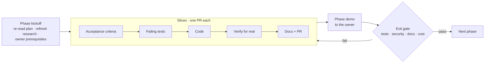
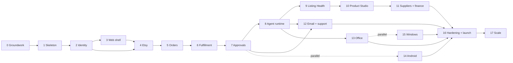

# HTCO OS — Master Plan

| | |
|---|---|
| **Status** | Version 1.0 — awaiting owner approval |
| **Last updated** | 2026-10-14 |
| **Current phase** | Phase 0 — Groundwork and decisions |
| **Related** | [PRD](../product/PRD.md) · [MVP](../product/MVP.md) · [Software design](../architecture/SOFTWARE_DESIGN.md) · [Engineering rules](../engineering/ENGINEERING_RULES.md) |

This plan supersedes the build order in the original HTCO planning brief (v5), which is kept outside the repository.

The system is built in **18 phases**. Each phase adds one working, tested increment that the owner can see and use, and ends with a gate that must pass before the next phase starts. Inside a phase, work is split into **slices**: each slice is one pull request with its own failing-tests-first acceptance criteria, so something new is tested and verified every few days.

## 1. How a phase works

Every phase file has the same structure: goal, why now, scope in and out, owner prerequisites, slices with acceptance criteria, test plan, security checklist, documentation to update, demo script, exit gate, rollback, risks and cost impact.

**Rolling-wave detail.** Phases 0–9 are planned down to slices and acceptance criteria. Phases 10–17 are planned at the level of scope, slices and gates; their acceptance criteria are refined at phase kickoff with what earlier phases taught us (Etsy access level, AutoVA answers, agent eval results). This is deliberate: detailed plans for work months away would be fiction.

## 2. Phases and milestones

| Phase | Name | Delivers (what the owner can do at the end) | Repos | Size | Milestone |
|---|---|---|---|---|---|
| [0](phases/phase-00-groundwork.md) | Groundwork and decisions | Plan approved, accounts ready, Etsy and AutoVA facts verified | both | S | **M0 Plan approved** |
| [1](phases/phase-01-walking-skeleton.md) | Platform walking skeleton | Deployed API with health checks, full CI and quality gates | platform | M | **M1 Skeleton live** |
| [2](phases/phase-02-identity-tenancy.md) | Identity, tenancy and audit | Organizations, roles, shops (shell), MFA rules, RLS, audit, `/v1/me` | platform | M | |
| [3](phases/phase-03-design-system-web-shell.md) | Design system and web shell | Sign in with MFA on `app.ht-co.app`, see org and shops, Hebrew/English, light/dark | clients, platform | L | |
| [4](phases/phase-04-etsy-connection.md) | Etsy shop connection | Connect the real shop, see scopes, capabilities and sync health | both | M | |
| [5](phases/phase-05-orders-ingest.md) | Orders CRM | Every order ingested once, visible with freshness; job queue, inbox and outbox | both | L | |
| [6](phases/phase-06-fulfillment-incidents.md) | Fulfillment monitoring and incidents | Late or missing tracking raises one incident and one email; auto-resolves on evidence | both | M | |
| [7](phases/phase-07-tasks-approvals.md) | Tasks, approvals and policy engine | Approve or reject actions safely; tasks board; audit trail | both | M | **M2 Operational core (MVP-1)** |
| [8](phases/phase-08-agent-runtime.md) | Agent runtime and model gateway | Agents run under policy, budget and checkpoints; POC gates pass | platform, clients | L | |
| [9](phases/phase-09-listing-health.md) | Listing Health (first AI workflow) | Audit every listing, approve fixes, see them applied on Etsy | both | M | **M3 MVP** |
| [10](phases/phase-10-product-studio.md) | Product Studio | One product from research to an Etsy draft and, after approval, a live listing | both | L | |
| [11](phases/phase-11-suppliers-finance.md) | Suppliers and finance | Supplier quotes and mappings; P&L with verified vs estimated figures | both | L | **M4 Commerce core** |
| [12](phases/phase-12-email-support.md) | Email and customer service | Shared inbox, tickets, drafted replies with approval | both | M | |
| [13](phases/phase-13-office-assistant.md) | Workforce, Office and Owner Assistant | Live office view, agent directory, conversations, owner chat | both | L | **M5 The office** |
| [14](phases/phase-14-android.md) | Android app | Approvals with push and biometrics, incidents, dashboard on the phone | clients | L | |
| [15](phases/phase-15-windows.md) | Windows app | Operations console: orders grid, incident center, developer console | clients | L | **M6 Native apps** |
| [16](phases/phase-16-hardening-launch.md) | Hardening and v1.0 launch | Staging, drills, security review, runbooks, signed releases | both | M | **M7 v1.0** |
| [17](phases/phase-17-optimization-scale.md) | Optimization and scale | Model A/B tests, decision-model benchmark, multi-shop, Shopify adapter | both | L | **M8 Scale** |

Sizes are relative effort for one developer working with AI agents: S ≈ under a week, M ≈ 1–2 weeks, L ≈ 2–4 weeks. They are planning aids, not commitments; actual durations are recorded at each gate.

**Parallel tracks.** Phase 14 (Android) may start any time after Phase 7, and Phase 15 (Windows) after Phase 13, if the owner wants them earlier; they consume the same API. Phase 3's design system work can overlap the end of Phase 2.

## 3. Dependency map

## 4. Gates that apply to every phase

A phase is complete only when all of these hold:

1. Every slice merged with its Definition of Done ([ER §15](../engineering/ENGINEERING_RULES.md#15-definition-of-ready-and-definition-of-done)).
2. All acceptance criteria pass in CI, and the demo script was run against the deployed environment.
3. Security checklist for the phase completed; the [threat model](../architecture/THREAT_MODEL.md) reviewed and updated.
4. Feature docs, ADRs, CLAUDE.md, README and this plan updated.
5. Cost actuals recorded in [COST_MODEL.md](../cost/COST_MODEL.md).
6. Open risks and new assumptions recorded in [ASSUMPTIONS.md](../product/ASSUMPTIONS.md).
7. The owner has seen the demo and approved moving on.

## 5. Status

| Phase | Status | Started | Finished | Notes |
|---|---|---|---|---|
| 0 | In progress | 2026-10-14 | | Docs, repositories and design system created; owner prerequisites pending |
| 1–17 | Not started | | | |

Update this table in the pull request that completes each phase.

## 6. Owner tasks now

The owner's Phase 0 tasks (approvals, accounts, Etsy Seller App, AutoVA questions, policy reading) are listed in [Phase 0 — Owner prerequisites](phases/phase-00-groundwork.md#owner-prerequisites), and open decisions in [ASSUMPTIONS.md](../product/ASSUMPTIONS.md#1-owner-decisions-needed).
