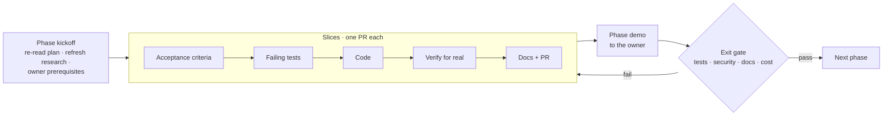

# HTCO OS — Master Plan

| | |
|---|---|
| **Status** | Version 2.1 — the living-office plan ([ADR-0012](../adr/0012-living-office-organization.md)) with the unified execution architecture ([ADR-0019](../adr/0019-unified-execution-engine-and-action-gateway.md) to [ADR-0022](../adr/0022-etsy-write-tools-and-browser-scope.md)); awaiting owner approval |
| **Last updated** | 2026-10-23 |
| **Current phase** | Phase 5 — Unified Automation Foundation (PARTIAL: PRs #53, #55, #58 open, to be aligned first); Phases 1–4 complete apart from the notes in §6 |
| **Related** | [PRD](../product/PRD.md) · [MVP](../product/MVP.md) · [Feature backlog](../product/FEATURE_BACKLOG.md) · [Execution order](EXECUTION_ORDER.md) · [Software design](../architecture/SOFTWARE_DESIGN.md) · [Execution engine](../architecture/execution-engine.md) · [Engineering rules](../engineering/ENGINEERING_RULES.md) |

This plan supersedes the build order in the original HTCO planning brief (v5), which is kept outside the repository, and version 1.0 of this plan (18 phases built around 18 agent roles). Version 2.0 reorganizes phases 5 to 21 around the four concepts of [ADR-0012](../adr/0012-living-office-organization.md): AI employees, deterministic automations, the tool library, and engineering. Phases 0 to 4 keep their numbers and scope; phase files 8 to 17 of version 1.0 were renamed and rewritten (their history is in Git).

**Version 2.1 (2026-10-23)** adds the owner's architecture upgrade: one Unified Automation & Execution Engine with an Action Gateway shared by automations and AI employees, four execution channels (API, Browser, Internal, Human), an optional honest Browser Environment per shop, and an internal Authenticator ([ADR-0019](../adr/0019-unified-execution-engine-and-action-gateway.md)–[ADR-0022](../adr/0022-etsy-write-tools-and-browser-scope.md)). Phase 5 is renamed "Unified Automation Foundation"; two phases are inserted after Phase 8 as **8A Browser Infrastructure** and **8B Authenticator**, so no existing phase number, file or acceptance-criterion ID changes. The owner's request for AdsPower anti-detect browsers and a static ISP proxy per shop is **not** planned; [ADR-0020](../adr/0020-per-shop-browser-environment.md) records why and what replaces it.

The system is built in **24 phases** (0–21 plus 8A and 8B). Each phase adds one working, tested increment that the owner can see and use, and ends with a gate that must pass before the next phase starts. Inside a phase, work is split into **slices**: each slice is one pull request with its own failing-tests-first acceptance criteria, so something new is tested and verified every few days.

## 1. How a phase works

Every phase file has the same structure: goal, why now, scope in and out, prerequisites, slices with acceptance criteria, test plan, security checklist, documentation to update, demo script, exit gate, rollback, risks and cost impact.

**Rolling-wave detail.** Phases 0–10 are planned down to slices and acceptance criteria. Phases 11–21 are planned at the level of scope, slices and gates; their acceptance criteria are refined at phase kickoff with what earlier phases taught us (Etsy access level, AutoVA answers, evaluation results). Detailed plans for work months away would be fiction.

**Employees are designed one at a time.** The registry holds draft specification sheets for all 16 employees ([`registry/employees/`](../../registry/employees)). Each employee's sheet is completed, its evaluation set built and passed, and its autonomy granted in the phase that activates it, never earlier. The same holds for each automation.

## 2. Phases and milestones

| Phase | Name | Delivers (what the owner can do at the end) | Employees and automations activated | Repos | Size | Milestone |
|---|---|---|---|---|---|---|
| [0](phases/phase-00-groundwork.md) | Groundwork and decisions | Plan approved, accounts ready, Etsy and AutoVA facts verified | — | both | S | **M0 Plan approved** |
| [1](phases/phase-01-walking-skeleton.md) | Platform walking skeleton | Deployed API with health checks, full CI and quality gates | — | platform | M | **M1 Skeleton live** |
| [2](phases/phase-02-identity-tenancy.md) | Identity, tenancy, actors and audit | Organizations, roles, shops (shell), MFA rules, RLS, audit with actor kinds, `/v1/me` | — | platform | M | |
| [3](phases/phase-03-design-system-web-shell.md) | Design system and web shell | Sign in with MFA on `dash.ht-co.app`, see org and shops, Hebrew/English, light/dark | — | clients, platform | L | |
| [4](phases/phase-04-etsy-connection.md) | Etsy shop connection | Connect the real shop, see scopes, capabilities and sync health | — | both | M | |
| [5](phases/phase-05-orders-ingest.md) | Unified Automation Foundation | Every order ingested exactly once by deterministic workflows; job queue, inbox, outbox, durable engine; Action Gateway, Execution Router (API real, Browser interface and fake, Internal, Human), approval, environment, secret and authenticator contracts; breakers, limits, idempotency | Order Intake, Deduplication & Verification, Sales Counters | both | L | |
| [6](phases/phase-06-fulfillment-incidents.md) | Fulfillment monitoring and incidents | Late or missing tracking raises one incident and one email; auto-resolves on evidence; ship-by and low-review alerts; owner-triggered shipment writes | Tracking Sync, Incident Detection & Escalation | both | M | |
| [7](phases/phase-07-tasks-approvals.md) | Tasks, approvals and activity records | Approve or reject actions safely (the shared approval contract); tasks as the Human channel; one activity trail for every actor; the owner's first Etsy writes; AutoVA quotes from email to the owner's choice | Scheduled Reporting, Task Scheduling & Recovery, Supplier Quote Request & Follow-up | both | M | **M2 Operational core (MVP-1)** |
| [8](phases/phase-08-workforce-runtime.md) | Workforce runtime and tool registry | Employees, tools and automations live in the database with versions; agents run on the Action Gateway with the LangGraph Postgres checkpointer; POC gates pass | — (runtime only) | platform, clients | L | |
| [8A](phases/phase-08a-browser-infrastructure.md) | Browser Infrastructure | Optional, honest Browser Environment per shop: Playwright or CDP Chromium, Browser Controller with profile locks, preflight and health, challenges to a person, structured extraction, injection guards, monitoring; first read-only exports where scoped; AutoVA recipes A-01 (Export first) and A-02 (approve the chosen quote) | — | platform, clients | L | |
| [8B](phases/phase-08b-authenticator.md) | Authenticator | PyOTP on the existing vault: enrolment with consent, several accounts per shop, code view with countdown, injection into the browser worker, RBAC, audit, replay protection | — | platform, clients | M | |
| [9](phases/phase-09-router-advisor.md) | Model router and Decision Advisor | Per-employee routing, budgets, tool and channel permissions, simple vs complex routing and the Jev benchmark; the first employee works | **Eitan** | both | M | |
| [10](phases/phase-10-supervision.md) | Supervision and daily reconciliation | Deterministic monitors, Noa's reviews, the nightly supervisor and the daily operations report | **Noa**; Order & Financial Reconciliation, Quality Review Scheduling | both | M | |
| [11](phases/phase-11-listing-health.md) | Listing Health (first content workflow) | Audit every listing (API, plus stats export where scoped), approve fixes, see them applied and verified on Etsy | **Daniel**, **Noam** | both | M | **M3 MVP** |
| [12](phases/phase-12-product-studio.md) | Product Studio | One product from research to an Etsy draft and, after approval, a live listing; shop structure writes | **Shon**, **Nika**; Catalog Draft Creation & Publishing | both | L | |
| [13](phases/phase-13-suppliers-finance.md) | Suppliers and finance | Tom's quote evaluation on the Phase 7 model; P&L with verified vs estimated figures (AutoVA profit cross-checked with the ledger) | **Tom**, **Roni**; Ledger Ingestion, Price Monitoring | both | L | **M4 Commerce core** |
| [14](phases/phase-14-email-support.md) | Email and customer service | Shared inbox, tickets, drafted replies with approval; Etsy replies on the central browser engine and the shared authenticator, where scoped | **Dana**; Email Intake & Routing | both | M | |
| [15](phases/phase-15-office-executive.md) | The office and the executive team | Executive office, departments, employee profiles, communication, activity feed; owner assistant and manager | **Maya**, **Lia** | both | L | **M5 The office** |
| [16](phases/phase-16-android.md) | Android app | Approvals with push and biometrics, incidents, office summary on the phone | — | clients | L | |
| [17](phases/phase-17-windows.md) | Windows app | Operations console: orders grid, incident center, engineering console | — | clients | L | **M6 Native apps** |
| [18](phases/phase-18-optimization.md) | Continuous optimization | Cost and quality measurements per unit of work; proposals with baselines, verified or rolled back | **Omer**; Optimization Review Scheduling | both | M | |
| [19](phases/phase-19-engineering.md) | Engineering department and self-improvement | Engineering requests linked to issues, PRs, tests and releases; safe self-improvement | **Alex**, **Amir**, **Iris** | both | L | |
| [20](phases/phase-20-hardening-launch.md) | Hardening and v1.0 launch | Staging, drills, security review, runbooks, signed releases | — | both | M | **M7 v1.0** |
| [21](phases/phase-21-growth-scale.md) | Growth and scale | Marketing experiments, multi-shop, Shopify adapter, model A/B tests | **Gal** | both | L | **M8 Scale** |

Sizes are relative effort for one developer working with AI agents: S ≈ under a week, M ≈ 1–2 weeks, L ≈ 2–4 weeks. They are planning aids, not commitments; actual durations are recorded at each gate. Version 2.0 adds three M phases (9, 10, 18) and one L phase (19) and removes work that version 1.0 assigned to agents but is deterministic (publishing, routine inspection, ledger recording); the net is roughly four to six weeks more, mostly in supervision and engineering, which version 1.0 left implicit.

**Web first ([ADR-0016](../adr/0016-web-first.md)).** Every feature ships on the web first and completely; the native apps implement features the web already has, against the same API, and never lead.

**Parallel tracks.** Phase 8A starts **right after Phase 6, in parallel with Phase 7** (owner, 2026-10-23): the AutoVA flow needs the browser engine, so its recipes A-01 and A-02 come as early as possible. Until Phase 7 lands, 8A's Human hand-offs use the relay item of slice 6.10. Phases 8 and 8B run in parallel after Phase 7 (8A's Browser Use slice still waits for Phase 9). AutoVA signs in with email and password only, so its recipes need the Secret Broker (5.17) and not Phase 8B.  Phase 16 (Android) may start any time after Phase 7, and Phase 17 (Windows) after Phase 15, if the owner wants them earlier; they consume the same API and implement only features the web already has. Phase 3's design system work can overlap the end of Phase 2. Phase 18 can start once Phase 13 has produced real cost data.

## 3. Dependency map

```mermaid
flowchart LR
  P0[0 Groundwork] --> P1[1 Skeleton]
  P1 --> P2[2 Identity + actors]
  P2 --> P3[3 Web shell]
  P2 --> P4[4 Etsy]
  P3 --> P4
  P4 --> P5[5 Automation engine + orders]
  P5 --> P6[6 Fulfillment]
  P6 --> P7[7 Tasks + approvals + activity]
  P7 --> P8[8 Workforce runtime + tools]
  P5 --> P8A[8A Browser infrastructure]
  P7 --> P8A
  P5 --> P8B[8B Authenticator]
  P7 --> P8B
  P8B -.TOTP injection.-> P8A
  P9 -.Browser Use slice.-> P8A
  P8 --> P9[9 Router + advisor · Eitan]
  P9 --> P10[10 Supervision · Noa]
  P10 --> P11[11 Listing Health]
  P8A -.stats export.-> P11
  P11 --> P12[12 Product Studio]
  P12 --> P13[13 Suppliers + finance]
  P10 --> P14[14 Email + support]
  P8A --> P14
  P8B --> P14
  P8A -.POD and money rows.-> P13
  P13 --> P15[15 Office + executive]
  P14 --> P15
  P7 -.parallel.-> P16[16 Android]
  P15 -.parallel.-> P17[17 Windows]
  P13 --> P18[18 Optimization · Omer]
  P15 --> P19[19 Engineering · Alex Amir Iris]
  P18 --> P19
  P19 --> P20[20 Hardening + launch]
  P16 --> P20
  P17 --> P20
  P20 --> P21[21 Growth + scale]
```

## 4. Coverage of the living-office capabilities

| Capability ([ADR-0012](../adr/0012-living-office-organization.md)) | Foundation (done) | Built in phases |
|---|---|---|
| Employee specification and configuration | Domain model, 22-section sheets, `registry/` with 16 drafts | 8 (database, versions, API), each activation phase (sheet completed and evaluated) |
| Employee runtime and communication | `AgentRuntime` port | 8 (LangGraph adapter, handoffs, messages), 15 (conversations) |
| Automation engine and workflow registry | Domain model, in-memory engine, 15 draft specifications | 5 (durable engine), 6, 7, 10, 12–14 (workflows) |
| Unified execution: Action Gateway, channels, approvals, limits | — | 5 (gateway, router, contracts), 7 (approvals, Human channel), 8 (tool bridge), 8A (Browser channel), 8B (authenticator) |
| Tool registry and capability permissions | Domain model, access rules, 81 draft tools (38 Etsy API tools covering all 104 endpoints, 2 browser tools) | 8 (database, tool bridge, invocation records) |
| Decision Advisor and model router | Advisor chain, router, per-employee policies | 9 (gateway, catalog, budgets, Jev benchmark) |
| Observability, supervision and daily reconciliation | Activity record model | 2 and 7 (stores), 10 (monitors, Noa, nightly supervisor) |
| Continuous optimization | Proposal lifecycle | 18 |
| Engineering and self-improvement workflows | — | 19 |
| Office dashboard and organizational visualization | Web shell | 15, 16, 17 |
| Integrations, production readiness and ongoing testing | CI and quality gates (Phase 1) | 4, 5, 13, 14, 20 |

## 5. Gates that apply to every phase

A phase is complete only when all of these hold:

1. Every slice merged with its Definition of Done ([ER §15](../engineering/ENGINEERING_RULES.md#15-definition-of-ready-and-definition-of-done)).
2. All acceptance criteria pass in CI, and the demo script was run against the deployed environment.
3. Security checklist for the phase completed; the [threat model](../architecture/THREAT_MODEL.md) reviewed and updated.
4. Feature docs, ADRs, CLAUDE.md, README and this plan updated.
5. Cost actuals recorded in [COST_MODEL.md](../cost/COST_MODEL.md).
6. Open risks and new assumptions recorded in [ASSUMPTIONS.md](../product/ASSUMPTIONS.md).
7. **No employee or automation is activated without** a fully defined specification, a passed evaluation and the owner's approval of its autonomy level.
8. The owner has seen the demo and approved moving on.
9. **Every user-facing slice of the phase has its web step**, built in the phase or named in a later one, or says "No UI: <reason>" ([ER-UX-07](../engineering/ENGINEERING_RULES.md#13-user-experience-accessibility-and-language-er-ux), [UI_COVERAGE.md](UI_COVERAGE.md)).

## 6. Status

Status words: **COMPLETE** (merged, verified), **PARTIAL** (some slices or parts merged or in review), **PLANNED**, **BLOCKED** (waiting for a named prerequisite).

| Phase | Status | Started | Finished | Evidence and notes |
|---|---|---|---|---|
| 0 | PARTIAL | 2026-10-14 | | Docs, repositories and design system created; owner prerequisites open ([issue #8](https://github.com/Tzvi1234/htco-platform/issues/8)) |
| 1 | COMPLETE | 2026-10-14 | 2026-10-22 | 1.1–1.6 complete (rulesets active 2026-10-14; deployed 2026-10-14, rollback drill passed); 1.7 built. AC-1.7.3 owner-verified 2026-10-28 (the alerts reach the owner). Open note: AC-1.7.1 against the real Sentry project (proven with a capturing transport so far). PRs #1–#7, #11 |
| 2 | COMPLETE | 2026-10-14 | 2026-10-22 | Policy engine v0 for human roles (2.4 part 1, PR #10); living-office domain foundation (PR for ADR-0012); 2.1 database workflow (PR #16); 2.2 identity schema with RLS (PR #21); 2.3 authentication in the API (PR #22); 2.4 part 2 `/v1/me` and `/v1/shops` (PR #23); 2.5 audit writer and owner bootstrap (PR #24); 2.6 member and shop-access management; production database migrated (2026-10-14); API deployed and connected to Supabase (2026-10-14); exit gate met (audit 2026-10-28: the DigitalOcean to Supabase connection verified 2026-10-14, the owner signs in on the web app); Supabase project `htco` created (Frankfurt, Free plan) |
| 3 | PARTIAL | 2026-10-14 | | Design system, web shell, sign-in with MFA and password reset, Design 1C on every screen (clients PRs #1–#34); deployed on `dash.ht-co.app`. Audit 2026-10-28: 3.1, 3.2, 3.3 and 3.6 delivered; 3.4, 3.5, 3.7, 3.8 and 3.9 partial, with their open acceptance criteria named in the phase file (among them AC-3.5.6, which waits for Resend, D-29; AC-3.5.8's owner-assisted MFA reset; AC-3.9.1's audit view, its API in progress) |
| 4 | PARTIAL | 2026-10-15 | | Adapter, token vault, OAuth connect, refresh, capability probes, disconnect, the shop card and the shop's live data on the dashboard ([dashboard data](../features/etsy-integration/dashboard-data.md)); LeatherPY connected in production. Audit 2026-10-28: 4.1 and 4.6 partial (AC-4.1.2 quota on the card, in progress; AC-4.6.2 probing and error screenshots). Daily backups and the restore rehearsal (AC-4.7.2) deferred by owner until first sale (D-28) |
| 5 | PARTIAL | 2026-10-22 | | Every slice is merged: 5.0–5.18 (platform PRs #53, #54, #57, #58, #62, #69, #70, #72, #86, #88, #90, #97, #106 and others; the Orders UI in htco-clients #56 and #59; Admin › Health in htco-clients #60). Activated: the three order automations and the Etsy webhooks (#157, #162). Audit 2026-10-28: 5.8 and 5.9 partial (the deployed kill-worker drill; the 5.9 alerts now AC-10.8.1 and 10.8.2, `/metrics` now AC-20.8.1); the restore drill deferred by owner until first sale (D-28). Left before COMPLETE (PLAN §5): those items, the KPI baseline, the activation's owner steps 2b and 6 recorded, the demo run and the owner's approval. History: Order history store merged ahead of the phase (PR #57); see the phase file for the alignment of #53, #55 and #58 |
| 6 | PARTIAL | 2026-10-25 | | Run in parallel with the end of Phase 5 (the owner's request). 6.2, 6.3, 6.5 and 6.9 done; 6.1 and 6.4 partial (AC-6.1.2, AC-6.4.3); 6.6 to 6.8 and 6.10 partial; both automations stay `draft` until 6.7's activation (the owner decides). In progress on 2026-10-28: the audit-log API, the Etsy quota, the tracking timeline, the failed-email view and 6.6 part B's owner write routes. AC-6.7.5 waits for 7.1 (owner decision 2026-10-28, D-26) |
| 7–21, 8A, 8B | PLANNED | | | Foundations for 7, 8, 9, 10 and 18 exist as tested domain code (ADR-0012 validation log) |

Update this table in the pull request that completes each phase. Owner steps that wait for a later moment are in [Things to remember](../operations/OWNER_REMINDERS.md).

## 7. Phase numbering after version 2.1

No phase was renumbered. The new phases use letters so every existing link, file name and acceptance-criterion ID stays valid.

| Phase | File | Note |
|---|---|---|
| 5 | `phase-05-orders-ingest.md` | Renamed "Unified Automation Foundation"; file name kept |
| 8A | `phase-08a-browser-infrastructure.md` | New; after 5 and 7, parallel with 8 |
| 8B | `phase-08b-authenticator.md` | New; after 5 and 7, parallel with 8 and 8A |

## 8. Owner tasks now

The owner's Phase 0 tasks (approvals, accounts, Etsy Seller App, AutoVA questions, policy reading) are listed in [Phase 0 — Owner prerequisites](phases/phase-00-groundwork.md#owner-prerequisites), and open decisions in [ASSUMPTIONS.md](../product/ASSUMPTIONS.md#1-owner-decisions-needed). Deferred owner steps, each with what it blocks, are in [Things to remember](../operations/OWNER_REMINDERS.md) (docs/operations/OWNER_REMINDERS.md).
