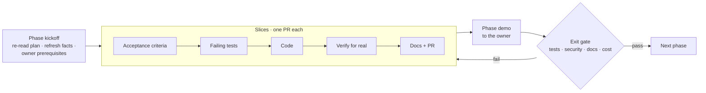

# HTCO OS — Master Plan

| | |
|---|---|
| **Status** | Version 3.0, the Claude-Native Hybrid Edition ([ADR-0016](../adr/0016-claude-native-agent-runtime.md), [ADR-0017](../adr/0017-auth-and-billing-policy.md)); awaiting owner approval |
| **Last updated** | 2026-10-14 |
| **Current phase** | Phase 0 (owner tasks open); Phase 1 (code complete, account-dependent parts open) |
| **Related** | [PRD](../product/PRD.md) · [Spec sheet](../product/SPEC_SHEET.md) · [Software design](../architecture/SOFTWARE_DESIGN.md) · [Code design](../architecture/CODE_DESIGN.md) · [Engineering rules](../engineering/ENGINEERING_RULES.md) · [Testing strategy](../engineering/TESTING_STRATEGY.md) |

Version 3.0 supersedes version 2.0 (the living-office plan, 22 phases, LangGraph runtime). The business system is unchanged ([ADR-0012](../adr/0012-living-office-organization.md)): the same 16 employees in seven departments, the same automations, tools, CRM and screens. Three things change, all from the owner's Claude-Native master plan v6.0 (kept outside the repository with its clients specification and getting-started guide):

1. **Runtime.** Employees run on the Claude Agent SDK behind the existing `AgentRuntime` port, with API-key billing. LangGraph stays as the alternative adapter.
2. **Order of work.** A **four-employee pilot** (Maya, Shon, Noa, Omer) runs right after the workforce runtime, before Etsy, catalog or money work. It proves the whole idea (assign, research, supervise, optimize) without touching money or customers.
3. **Milestones** follow the master plan: M0 Audit, M1 Foundation, M2 Workforce pilot, M3 Models & tools, M4 Commerce, M5 Governance, M6 Clients, M7 Release.

Nothing done so far is thrown away. Phases 0–3 keep their numbers, slices and pull requests. Phases 4–21 were renumbered and rewritten for the new order; version 2.0's phase files are in Git history, and the [mapping table](#7-from-version-20-to-30) shows where each piece went.

## 1. How a phase works

Every phase file is the **instruction file** for that phase. It has the same sections: header, progress, goal, why now, scope in and out, owner prerequisites, instructions for the agent, slices with acceptance criteria, test plan, security checklist, documentation to update, demo, exit gate, rollback, risks and cost impact. An agent starting a phase reads its file first, then this plan, then the documents the file links.

**Rolling-wave detail.** Phases 0–8 are planned down to slices and acceptance criteria. Phases 9–21 are planned at the level of scope, slices and gates; their acceptance criteria are refined at kickoff with what earlier phases taught us (Etsy access, AutoVA answers, pilot evaluation results).

**Employees are activated one at a time.** Each employee's specification sheet in [`registry/employees/`](../../registry/employees) is completed, its evaluation built and passed, and its autonomy approved by the owner in the phase that activates it, never earlier. The process for every employee: interview and specification → least privilege → dataset → benchmark → dry run → red team → review → staging → approved activation.

## 2. Phases and milestones

| Phase | Name | Delivers (what the owner can do at the end) | Employees and automations activated | Repos | Size | Milestone |
|---|---|---|---|---|---|---|
| [0](phases/phase-00-groundwork.md) | Groundwork, decisions and Claude-Native audit | Plan approved; accounts ready (including the Anthropic API organization); current state and migration plan recorded | — | both | S | **M0 Audit and plan** |
| [1](phases/phase-01-walking-skeleton.md) | Platform walking skeleton | Deployed API with health checks, full CI and quality gates | — | platform | M | |
| [2](phases/phase-02-identity-tenancy.md) | Identity, tenancy, actors and audit | Organizations, roles, shops (shell), MFA rules, RLS, audit with actor kinds, `/v1/me` | — | platform | M | |
| [3](phases/phase-03-design-system-web-shell.md) | Design system and web shell | Sign in with MFA, see organization and shops, Hebrew/English, light/dark; design system v2 inventory (DS0) | — | clients, platform | L | |
| [4](phases/phase-04-durable-core-order-intake.md) | Durable core and order intake | Job queue, inbox and outbox, durable automation engine; signed Etsy webhooks (recorded fixtures) become exactly one order | Order Intake, Deduplication & Verification, Sales Counters | both | L | |
| [5](phases/phase-05-tasks-messages-approvals.md) | Tasks, messages, approvals and activity | Business tasks with a dispatcher (lease, heartbeat, retry), employee messages, approvals, one activity trail for every actor | Task Scheduling & Recovery, Scheduled Reporting | both | L | **M1 Foundation** |
| [6](phases/phase-06-workforce-claude-runtime.md) | Workforce registry and Claude runtime | 16 employees as versioned DRAFT profiles in the database; the Claude runtime adapter with the AuthAndBillingPolicy, the MCP tool bridge, hooks, kill switches and the evaluation harness; proof-of-concept gates pass | — (runtime only) | platform, clients | L | |
| [7](phases/phase-07-pilot-office.md) | The pilot office | Maya assigns, Shon researches with evidence, Noa catches "done without evidence", Omer proposes an automation; a basic office dashboard shows it all from the database | **Maya**, **Shon** (research only), **Noa** (pilot scope), **Omer** (pilot scope); Quality Review Scheduling, Optimization Review Scheduling | both | L | **M2 Workforce pilot** |
| [8](phases/phase-08-models-tools.md) | Model router, Decision Advisor and tools | Model catalog, budgets and cost ledger, per-employee routing console, Jev benchmark, GPT image adapter, tool registry in the database with the MCP gateway | — | both | L | **M3 Models and tools** |
| [9](phases/phase-09-etsy-connection.md) | Etsy connection and live orders | Connect the real shop; real webhooks and reconciliation feed the order intake of Phase 4; sync health | — | both | M | |
| [10](phases/phase-10-fulfillment-incidents.md) | Fulfillment, tracking and incidents | Late or missing tracking raises one incident; auto-resolves on evidence; AutoVA fulfillment watch | **Eitan**; Tracking Sync, Incident Detection & Escalation, AutoVA Fulfillment Watch | both | L | |
| [11](phases/phase-11-listing-health.md) | Listing Health | Audit every listing, approve fixes, see them applied on Etsy | **Daniel**, **Noam** | both | M | |
| [12](phases/phase-12-product-studio.md) | Product Studio and Creative Studio | One product from research to an Etsy draft and, after approval, a live listing; GPT images with provenance | **Shon** (full scope), **Nika**; Catalog Draft Creation & Publishing | both | L | |
| [13](phases/phase-13-procurement-finance.md) | Procurement and finance | Supplier quotes and mappings; ledger; P&L with verified and estimated figures; daily reconciliation | **Tom**, **Roni**; Supplier Quotes, Ledger Ingestion, Price Monitoring, Order & Financial Reconciliation | both | L | **M4 Commerce** |
| [14](phases/phase-14-governance.md) | Governance at full scope | Noa's nightly supervision over all activity, the Quality Center and Night Shift; Omer's full optimization pipeline; ten failure-and-recovery scenarios | **Noa**, **Omer** (full scope); Product Metrics Rollup | both | M | **M5 Governance** |
| [15](phases/phase-15-mail-support.md) | Mail, customer service and the owner assistant | Shared inbox, tickets, drafted replies with approval; agent mail aliases (inbound first, outbound after abuse tests); owner assistant | **Dana**, **Lia**; Email Intake & Routing, Agent Mail Alias Routing | both | M | |
| [16](phases/phase-16-web-office.md) | The complete web office | All 43 screens of the clients specification on the web: Office 2D, departments, profiles, conversations, centers, consoles | **Maya** (full scope) | clients, platform | L | |
| [17](phases/phase-17-android.md) | Android app | Approvals with push and biometrics, incidents, office summary on the phone | — | clients | L | |
| [18](phases/phase-18-windows.md) | Windows app | Operations console: orders grid, incident center, engineering console | — | clients | L | **M6 Clients** |
| [19](phases/phase-19-engineering.md) | Engineering department and self-improvement | Engineering requests linked to issues, PRs, tests and releases; safe self-improvement | **Alex**, **Amir**, **Iris** | both | L | |
| [20](phases/phase-20-hardening-release.md) | Hardening and release | Staging end to end, restore and DR drills, load tests, security review, runbooks, signed releases, production | — | both | M | **M7 Release** |
| [21](phases/phase-21-growth-scale.md) | Growth and scale | Marketing experiments, multi-shop, more marketplaces, model A/B tests | **Gal** | both | L | |

Sizes are relative effort for one developer working with AI agents: S ≈ under a week, M ≈ 1–2 weeks, L ≈ 2–4 weeks. They are planning aids, not commitments; real durations are recorded at each gate.

**Parallel tracks.** Phase 17 (Android) may start any time after Phase 7, and Phase 18 (Windows) after Phase 16. Design work for Phase 16 (the full office screens) can start during Phase 7. Phase 9 (Etsy connection) depends only on Phase 4 and the owner's Seller App, so it may run in parallel with Phases 6–8 if the owner wants live orders earlier.

## 3. Dependency map

```mermaid
flowchart LR
  P0[0 Groundwork + audit] --> P1[1 Skeleton]
  P1 --> P2[2 Identity + actors]
  P2 --> P3[3 Design system + web shell]
  P2 --> P4[4 Durable core + order intake]
  P4 --> P5[5 Tasks · messages · approvals]
  P3 --> P5
  P5 --> P6[6 Workforce + Claude runtime]
  P6 --> P7[7 Pilot · Maya Shon Noa Omer]
  P7 --> P8[8 Router · Jev · tools · images]
  P4 --> P9[9 Etsy connection]
  P8 --> P10[10 Fulfillment · Eitan]
  P9 --> P10
  P10 --> P11[11 Listing Health · Daniel Noam]
  P11 --> P12[12 Product Studio · Shon Nika]
  P12 --> P13[13 Procurement + finance · Tom Roni]
  P13 --> P14[14 Governance · Noa Omer full]
  P8 --> P15[15 Mail + support · Dana Lia]
  P10 --> P15
  P14 --> P16[16 Web office complete]
  P15 --> P16
  P7 -.parallel.-> P17[17 Android]
  P16 -.parallel.-> P18[18 Windows]
  P16 --> P19[19 Engineering · Alex Amir Iris]
  P14 --> P19
  P19 --> P20[20 Hardening + release]
  P17 --> P20
  P18 --> P20
  P20 --> P21[21 Growth · Gal]
```

## 4. The pilot first

The getting-started guide's order of work, and where each step lands:

| # | Step | Phase |
|---|---|---|
| 1 | Audit the current state (Phase 1, LangGraph foundations, docs, database); record it; delete nothing | 0 |
| 2 | Branch for the Claude-native runtime; ADR comparing it with the existing engine | 0 ([ADR-0016](../adr/0016-claude-native-agent-runtime.md)) |
| 3 | Employee registry with 16 DRAFT profiles; fields with no production behaviour | 6 (the TOML drafts exist) |
| 4 | Task, Message, Audit and Approval contracts; `shop_id` checked on the server | 5 |
| 5 | Claude runtime adapter with official API authentication, session-level permissions, run per task | 6 |
| 6 | Dispatcher with a durable queue, lease, heartbeat, retry and idempotency | 4 (queue), 5 (task dispatcher) |
| 7 | Maya ↔ Shon pilot: Maya assigns product research; Shon returns a product with evidence; it is stored and visible in the UI | 7 |
| 8 | Noa checks a task marked DONE without evidence and opens a finding | 7 |
| 9 | Omer proposes replacing a repeated AI task with an automation; an improvement issue is opened on GitHub for Alex/Iris | 7 (proposal and issue), 19 (engineering employees do the work) |
| 10 | Basic dashboard; Jev tested on a small dataset; GPT images at the catalog stage | 7 (dashboard), 8 (Jev, image adapter), 12 (images in use) |

**Pilot definition of done** (Phase 7 exit gate): a task that crosses employees; a recorded message; budget enforced; audit complete; permissions locked; a crash in the middle of a step followed by a safe resume; a dashboard that shows the same state as the database, not a chat message.

## 5. Mandatory tests of the master plan

The fifteen business, AI and DevOps tests from master plan §13 are acceptance criteria in these phases. They are never dropped; each phase file names the ones it owns.

| # | Test | Phase |
|---|---|---|
| 1 | An Etsy webhook duplicated three times creates one order with the right unit count | 4 (fixtures), 9 (real) |
| 2 | An agent task dies mid-step: the lease expires, the dispatcher notices, the step resumes or is re-evaluated with no duplicate action | 5 (dispatcher), 6 (agent steps) |
| 3 | The Claude provider is unavailable or returns 429: automations continue; the task waits or uses an approved API fallback | 6 |
| 4 | Two employees communicate: the message is stored and acknowledged, the task is handed off, nothing leaks across shops | 6, 7 |
| 5 | Noa finds `task.done` without evidence in the database or an external system and opens a quality finding | 7 |
| 6 | Omer proposes turning an AI action into a workflow: pull request, equivalence test, measured savings | 7 (proposal), 14 (measurement), 19 (PR by an engineering employee) |
| 7 | Jev fails or returns an invalid schema: rules or fallback answer, no bypass | 8 |
| 8 | Nika generates an asset: provenance, price, permissions, marked as needing QA | 8 (adapter), 12 (real use) |
| 9 | A GitHub agent tries to push to production: policy denial and audit | 6 (policy), 19 (real runner) |
| 10 | AutoVA tracking already exists on Etsy: nothing is sent twice | 10 |
| 11 | A catalog process breaks a platform rule: blocked and reviewed, nothing published | 12 |
| 12 | Changing a routing profile needs a versioned approval and evaluations | 8 |
| 13 | Database backup restore drill, with RTO and RPO documented | 4 (first drill before real data), 20 |
| 14 | An email or web page with prompt injection does not call a protected tool | 6 (fixtures), 15 (real mail) |
| 15 | A replaced worker keeps no local state; everything is in Supabase after a rollout | 6, 20 |

The ten office scenarios of [TESTING_STRATEGY §10](../engineering/TESTING_STRATEGY.md#10-office-acceptance-scenarios) (SCN-A to SCN-J) also stay, with their phases updated there.

## 6. Gates that apply to every phase

A phase is complete only when all of these hold:

1. Every slice merged with its Definition of Done ([ER §15](../engineering/ENGINEERING_RULES.md#15-definition-of-ready-and-definition-of-done)).
2. All acceptance criteria pass in CI, and the demo script was run against the deployed environment.
3. Security checklist done; the [threat model](../architecture/THREAT_MODEL.md) reviewed and updated.
4. Feature docs, ADRs, CLAUDE.md, README, the [spec sheet](../product/SPEC_SHEET.md) and this plan updated.
5. Cost actuals recorded in [COST_MODEL.md](../cost/COST_MODEL.md).
6. Open risks and new assumptions recorded in [ASSUMPTIONS.md](../product/ASSUMPTIONS.md).
7. **No employee or automation is activated without** a full specification, a passed evaluation and the owner's approval of its autonomy level.
8. No real money, real customer messages or real publishing without end-to-end tests and permissions in place.
9. The owner has seen the demo and approved moving on.

## 7. From version 2.0 to 3.0

| Version 2.0 phase | Goes to version 3.0 |
|---|---|
| 0 Groundwork | 0 (plus the Claude-native audit) |
| 1 Walking skeleton | 1 (unchanged) |
| 2 Identity and tenancy | 2 (unchanged) |
| 3 Design system and web shell | 3 (plus the design system v2 inventory) |
| 4 Etsy connection | 9 |
| 5 Automation engine and orders | 4 (with recorded Etsy fixtures; live connection in 9) |
| 6 Fulfillment and incidents | 10 |
| 7 Tasks, approvals and activity | 5 (plus employee messages and the task dispatcher) |
| 8 Workforce runtime and tool registry | 6 (Claude runtime adapter; tool registry database work in 6, MCP gateway in 8) |
| 9 Model router and Decision Advisor, Eitan | 8 (router and Jev); Eitan moves to 10 |
| 10 Supervision, Noa | 7 (pilot scope) and 14 (full scope) |
| 11 Listing Health | 11 |
| 12 Product Studio | 12 (Shon's research part moves to the pilot in 7) |
| 13 Suppliers and finance | 13 |
| 14 Email and support | 15 (with Lia) |
| 15 Office and executive | 7 (Maya and the basic dashboard) and 16 (the complete office) |
| 16 Android | 17 |
| 17 Windows | 18 |
| 18 Optimization, Omer | 7 (pilot scope) and 14 (full scope) |
| 19 Engineering | 19 |
| 20 Hardening and launch | 20 |
| 21 Growth and scale | 21 |

## 8. Status

Status words: **COMPLETE** (merged, verified), **PARTIAL** (some slices or parts merged or in review), **PLANNED**, **BLOCKED** (waiting for a named prerequisite).

| Phase | Status | Started | Finished | Evidence and notes |
|---|---|---|---|---|
| 0 | PARTIAL | 2026-10-14 | | Docs, repositories and design system created; Claude-native ADRs 0016–0018 and this plan written; owner prerequisites open ([issue #8](https://github.com/Tzvi1234/htco-platform/issues/8)) |
| 1 | PARTIAL | 2026-10-14 | | 1.1–1.4 complete; 1.5, 1.6, 1.7 complete except deploy (BLOCKED: DigitalOcean account), ruleset (BLOCKED: GitHub Pro), real Sentry and alerts (BLOCKED: Sentry project). PRs #1–#7 and #11 merged 2026-10-14 |
| 2 | PARTIAL | 2026-10-14 | | Policy engine v0 for human roles (2.4 part 1, PR #10); living-office domain foundation (PR #12, merged); database slices BLOCKED: Supabase project |
| 3 | PARTIAL | 2026-10-14 | | 3.1, 3.2 and 3.3 part 1 in clients PRs #1–#4; design system v2 docs in the Claude-native clients PR |
| 4–21 | PLANNED | | | Foundations for 4, 5, 6, 7, 8 and 14 exist as tested domain code (ADR-0012 validation log) |

Update this table in the pull request that completes each phase.

## 9. Owner tasks now

The owner's Phase 0 tasks (approvals, accounts including the Anthropic API organization, Etsy Seller App, AutoVA questions, policy reading) are in [Phase 0 — Owner prerequisites](phases/phase-00-groundwork.md#owner-prerequisites), and open decisions in [ASSUMPTIONS.md](../product/ASSUMPTIONS.md#1-owner-decisions-needed).
